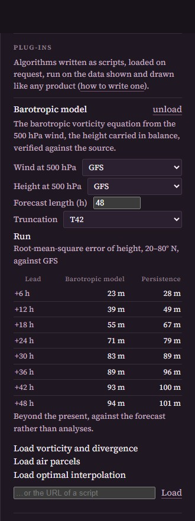

# plugins: Algorithms Loaded on Request

*Status: draft (2026-10-22).* Decision record: [ADR 0027](../../../development/decisions/0027-earth-atlas-plugins.md). The classes are in [src/plugins/plugin.js](../src/plugins/plugin.js); the host that loads and runs plug-ins is [src/plugins/host.js](../src/plugins/host.js).

A plug-in is a script that the Earth Atlas loads when asked, runs on the data it holds, and shows on the Earth. It derives from one of the atlas's classes, says which fields it needs, and returns data, which the atlas draws like anything else. It is written in JavaScript, and runs in the page; or in Python or C++, and runs in the atlas's server (§9), shown the same way. Nothing is loaded without a click, and a loaded script runs with the page's, or the server's, authority: read a script before loading it, as any code.

## 1. Using a Plug-in



In the Earth Atlas, in the panel on the right, scroll to **Plug-ins**.

1. **Load** a plug-in: click *Load vorticity and divergence*, *Load air parcels*, *Load optimal interpolation* or *Load the barotropic model*; or paste the URL of any plug-in script into the field below them (for example `plugins/wind-speed.js`) and click *Load*.
2. The plug-in appears with a **source** for each field it needs (every model in the library that carries that field is offered, such as *GFS, 500 hPa*) and its **parameters**. Change them, or keep the defaults.
3. Click **Run**. A progress bar shows the work; the page stays usable.
4. Read the result. A *field* joins the catalogue as a model of its quantity and is selected for you: it sits beside GFS and the others under that quantity in the panel, where it can be differenced with "minus", and a click on the map reads its value. A *sketch* is drawn on the globe. *Tables* and *notes* appear under the plug-in. Move the time to see a forecast evolve or parcels travel.
5. **Run** again after changing a parameter or a source: the new result replaces the old. **Unload** removes the plug-in and its sketches.

From the browser's console, `atlas.plugins.load('plugins/vorticity.js')`, `atlas.plugins.run('vorticity')` and `atlas.plugins.view()` do the same. The four built-in plug-ins at work are in [the gallery, §1.8](../../../docs/gallery.md#18-plug-ins-algorithms-loaded-on-request).

## 2. The Contract

A plug-in is an ES module with one export:

```js
export function create(api) {
  class Mine extends api.Diagnostic { /* ... */ }
  return new Mine();
}
```

`api` is [src/plugins/index.js](../src/plugins/index.js): the classes, the result makers and a few numerical helpers. A script written against it needs no import of the atlas; it may import the domains and foundations by URL for the science it uses, as the examples here do with relative paths.

The smallest complete plug-in is [wind-speed.js](wind-speed.js), a page long, to be read first: it names itself, says it needs a wind, declares one output, and computes it time by time. Everything else is the base class's.

```js
export function create(api) {
  class WindSpeed extends api.Diagnostic {
    id = 'wind-speed';
    title = 'Wind speed';
    needs() { return [{ name: 'wind', label: 'Wind', standard_names: ['eastward_wind', 'northward_wind'] }]; }
    outputs() { return [{ name: 'speed', long_name: 'Wind speed', standard_name: 'wind_speed', units: 'm s-1' }]; }
    compute(inputs, params, index) {
      const { product, names: [u, v] } = inputs.wind;
      const a = product.slice(u, index), b = product.slice(v, index), speed = new Float32Array(a.length);
      for (let i = 0; i < a.length; i++) speed[i] = Math.hypot(a[i], b[i]);
      return { speed };
    }
  }
  return new WindSpeed();
}
```

## 3. The Classes

Each class is named by what the algorithm is, and writes `run()` from smaller hooks that a subclass overrides. All of them share:

| Member | Meaning |
|---|---|
| `id`, `title`, `description`, `domain` | Identity. `id` names the product (`plugin-<id>`); a second run replaces the first. |
| `parameters` | `{ name: { label, default, min, max, step, unit } }` or `{ name: { label, default, choices: [[value, label]] } }`. The panel offers them and passes their values to `run()` as `params`. |
| `needs()` | The fields needed: `[{ name, label, standard_name` or `standard_names: [u, v], level?, times?, distinct? }]`. The host finds every product and level that carries them; the user chooses the source; `run()` receives `inputs[name] = { product, names, variables, meta, model, level }`. `distinct` asks for a source other than the needs before it; `times` for at least that many times. |
| `run(inputs, params, context)` | The algorithm, returning results. The subclasses below write it from their hooks. |
| `breathe(context, fraction, text)` | A resting point in a long loop: progress for the panel, and a turn for the page. |

| Class | What it is | Hooks to override |
|---|---|---|
| `Diagnostic` | A field computed from fields, at every time of the first need, on its grid | `outputs()`: the variables returned; `compute(inputs, params, index, context)`: `{ name: Float32Array }` for one time; `vectors()`, `show()` |
| `ForecastModel` | A state advanced in time from an analysis, started at the input time at or before the instant shown, recorded every few hours, verified against the input's later times beside persistence (20–80° N) | `grid()`, `outputs()`, `initial(inputs, index, params, context)`, `advance(state, seconds, params)`, `record(state, params)`, `verify()`; the fields `dt`, `every` |
| `DataAssimilation` | A background and observations to an analysis and its increment | `observations(inputs, index, params, context)`: `[{ lon, lat, value }]`; `analyse(background, grid, observations, params, context)`: the analysis; `markers()` |
| `Trajectories` | Parcels carried through a flow by a Runge–Kutta step on the sphere | `seeds(inputs, params, context)`: `[{ lon, lat, colour? }]`; `velocity(inputs, params)`: `(lon, lat, ms) -> [u, v]` or `null` |

`Plugin` itself may be derived from for anything else, with `run()` written in full.

## 4. Results

`run()` returns a list of results made by the makers in `api`. They are data; the atlas does the drawing.

| Maker | Result | Shown as |
|---|---|---|
| `field(product, show)` | A field product (`makeProduct`), with `show = { surface, flow, lines }` naming what to select by variable or vector name | A model among the others of its quantity: drawn, contoured, differenced with "minus", carried by particles, read in the place card; listed in the verification table when it carries one |
| `sketch({ title, polylines, markers, labels, moving })` | Polylines `{ coords: [lon, lat, ...], colour, width, alpha, dashed }`, markers `{ lon, lat, colour, size }`, labels `{ lon, lat, text }`, moving points `{ times: [ms], coords, colour, size }` | Drawn as they are over the globe, in every projection; a moving point is drawn where it is at the time shown |
| `table(title, columns, rows, note)` | Headings and rows | In the panel, under the plug-in |
| `note(text)` | A sentence | In the panel |

`makeProduct({ name, title, model, domain, grid, times, variables, vectors, source, verification })` builds a product from `variables: [{ name, long_name, standard_name, units, level?, slices: [Float32Array per time] }]`; `grid` is `{ lon0, dlon, nlon, lat0, dlat, nlat, periodic }` with rows north to south, values row-major, `NaN` where missing. The catalogue recognises standard names and levels, so a product with `geopotential_height` at `500 hPa` joins the height maps of the forecast models. A variable that is a difference of two quantities of its units, such as an analysis increment in kelvin, carries `difference: true`: it is then drawn on a symmetric diverging scale, and the offset of its units (kelvin to degrees Celsius) is not applied.

## 5. The Context

`context` is what a plug-in sees of the atlas while it runs: `time`, the instant shown in ms UTC; `pinned`, the chosen place as `[lon, lat]` or `null`; `fields()`, the metadata of every field product; `field(name)`; `geography()`; and `progress(fraction, text)`. The same view is made from files when a plug-in is checked without a page.

## 6. Helpers in `api`

`sampleOnGrid(product, name, index, grid)` samples a variable onto another grid; `indexAtOrBefore(times, ms)`; `lattice(n)` spreads `n` points evenly over the sphere; `parcelStep(flow, lon, lat, ms, dt)` is one Runge–Kutta step on the sphere; `iso(ms)`. The built-in plug-ins offered by the panel are those of [index.json](index.json); a script anywhere else is loaded by its URL.

## 7. Checking Without a Page

The classes touch neither the page nor three.js. A plug-in runs in Node from synthetic fields:

```js
const api = await import('../src/plugins/index.js');
const plugin = (await import('../plugins/vorticity.js')).create(api);
const product = api.makeProduct({ name: 'zonal', title: 'Zonal flow', grid, times, variables: [...] });
const [result] = await plugin.run({ wind: { product, names: ['u', 'v'], variables: product.meta.variables, meta: product.meta, model: 'test' } }, {}, context);
```

[tests/run-tests.mjs](../tests/run-tests.mjs) checks each example against an answer known in closed form.

## 8. The Examples

| File | Class | Shows | Checked by |
|---|---|---|---|
| [wind-speed.js](wind-speed.js) | `Diagnostic` | The speed of the wind chosen: the smallest plug-in, to be read first; loaded by URL | A solid-body rotation: U cos φ |
| [vorticity.js](vorticity.js) | `Diagnostic` | Relative vorticity and divergence of the wind at the level chosen, by centred differences | A solid-body rotation: ζ = 2U sin φ / a, δ = 0 |
| [trajectories.js](trajectories.js) | `Trajectories` | Parcels from a ring around the chosen place, or a lattice, through the forecast wind; the paths, and the parcels moving with the time shown | A parcel in a solid-body rotation keeps its latitude and turns by U t / a |
| [optimal-interpolation.js](optimal-interpolation.js) | `DataAssimilation` | A background analysed toward a second model's values at a lattice of points; the increment, and the analysis among the models of the quantity | Exact observations are reproduced where they are, and the background kept far from them |
| [barotropic.js](barotropic.js) | `ForecastModel` | The barotropic vorticity equation from the 500 hPa wind, the height in balance, verified against the source | A solid-body rotation is steady |
| [vorticity.py](vorticity.py) | `Diagnostic`, Python | The same diagnostic in Python, run by the server on numpy (§9) | The same solid-body rotation, and a product's round trip through the files |
| [vorticity.cpp](vorticity.cpp) | `Diagnostic`, C++ | The same diagnostic in C++, compiled and run by the server (§9) | The same solid-body rotation, where a compiler exists |

## 9. The Same Contract in Python and C++

A plug-in may be written in Python or C++ instead ([ADR 0029](../../../development/decisions/0029-plugins-in-python-and-cpp.md)). It then runs in the atlas's server rather than in the page, and the page shows it the same way, with the language named beside its title. The file must lie under this `plugins/` directory: the server runs nothing from elsewhere.

**Python.** The classes of [../py/plugins.py](../py/plugins.py) have the same names, hooks and results as the JavaScript ones; fields are numpy arrays `(nlat, nlon)` of float32 with NaN where there is no value, and times are datetimes in UTC. The script defines `create(api)`:

```python
def create(api):
    class Vorticity(api.Diagnostic):
        id = "vorticity-py"
        title = "Vorticity and divergence (Python)"
        def needs(self): return [{"name": "wind", "label": "Wind", "standard_names": ["eastward_wind", "northward_wind"]}]
        def outputs(self): return [{"name": "zeta", "long_name": "Relative vorticity", "standard_name": "atmosphere_relative_vorticity", "units": "s-1"}]
        def compute(self, inputs, params, index, context):
            u = inputs["wind"].product.slice(inputs["wind"].names[0], index)
            ...
            return {"zeta": zeta}
    return Vorticity()
```

[vorticity.py](vorticity.py) is the whole of it. From the command line, in the environment of `data/requirements.txt`:

```
python applications/earth-atlas/py/host.py describe plugins/vorticity.py
python applications/earth-atlas/py/host.py run plugins/vorticity.py "wind=gfs-levels-forecast|500 hPa"
```

**C++.** A plug-in is a program built from [cpp/plugin.hpp](cpp/plugin.hpp), which gives the same `Diagnostic` and the main function; the server compiles it with the compiler at hand (`c++`, `g++` or `clang++`, C++20, standard library only) and runs it on files:

```cpp
#include "cpp/plugin.hpp"
struct Vorticity : plugin::Diagnostic {
  Vorticity() { id = "vorticity-cpp"; title = "Vorticity and divergence (C++)";
    needs = {{"wind", "Wind", {"eastward_wind", "northward_wind"}, "", 0}};
    outputs = {{"zeta", "Relative vorticity", "atmosphere_relative_vorticity", "s-1", "", false}}; show = {{"surface", "zeta"}}; }
  std::map<std::string, std::vector<float>> compute(const plugin::Inputs& in, const plugin::Params&, int index) override {
    const float* u = in.at("wind").slice(0, index); /* ... */ return {{"zeta", zeta}};
  }
};
PLUGIN_MAIN(Vorticity)
```

[vorticity.cpp](vorticity.cpp) is the whole of it. The contract on disk, should another language want it: the host writes a directory with `input.txt` (tab-separated lines: `time`, `pinned`, `param`, `need` with the grid, `times`, `data` naming a float32 file per variable, `ntimes × nlat × nlon`, NaN where missing) and runs the program with `--run <dir>`; the program writes `output.txt` (`field` lines naming a float32 file per output, `show` lines) beside it. `--describe` prints the plug-in's description as JSON. In C++ the classes stop at `Diagnostic` for now, and parameters are numbers.

**Checking.** `python applications/earth-atlas/py/check.py` runs the Python plug-in, a product's round trip through the files, and the C++ plug-in when a compiler exists; the atlas's suite runs it.

## 10. Limits and Next Steps

- A JavaScript plug-in runs in the page's thread; `breathe()` keeps the page alive but a long model is slow there. A plug-in may start its own worker, as the atlas's models do; or be written in Python or C++ and run in the server.
- The two models the atlas runs itself (ADR 0015, 0019) are the pattern's other appearance; migrating them to `ForecastModel` plug-ins would delete their hand-written wiring.
- `ForecastModel`, `DataAssimilation` and `Trajectories` in C++ are the next step of the file contract.
