# Gallery

*Status: draft, 2026-10-22.*

These are screenshots of the laboratory's two applications, taken on 22 October 2026 from their local servers, with the data of that day.

- Both are web applications without a build step.
- Their computations are the laboratory's provisional core, tested against published references: 151 checks for the Earth Atlas and 66 for the Celestial Atlas.
- Each caption says what is shown, where the data come from, and how the picture is made.

Click an image to see it at full size. To run the applications yourself, see the READMEs of the [Earth Atlas](../applications/geography/earth-atlas/README.md) and the [Celestial Atlas](../applications/astronomy/celestial-atlas/README.md).

## 1. The Earth Atlas

The atmosphere, the ocean, the land and its people on one globe, or on equal-area and equirectangular maps, at one instant. Each kind of data comes from its own dataset and is joined to the map only in the application.

### 1.1 Weather and the Ocean

<table>
<tr>
<td width="50%" valign="top"><a href="../assets/gallery/earth-01-wind.jpg">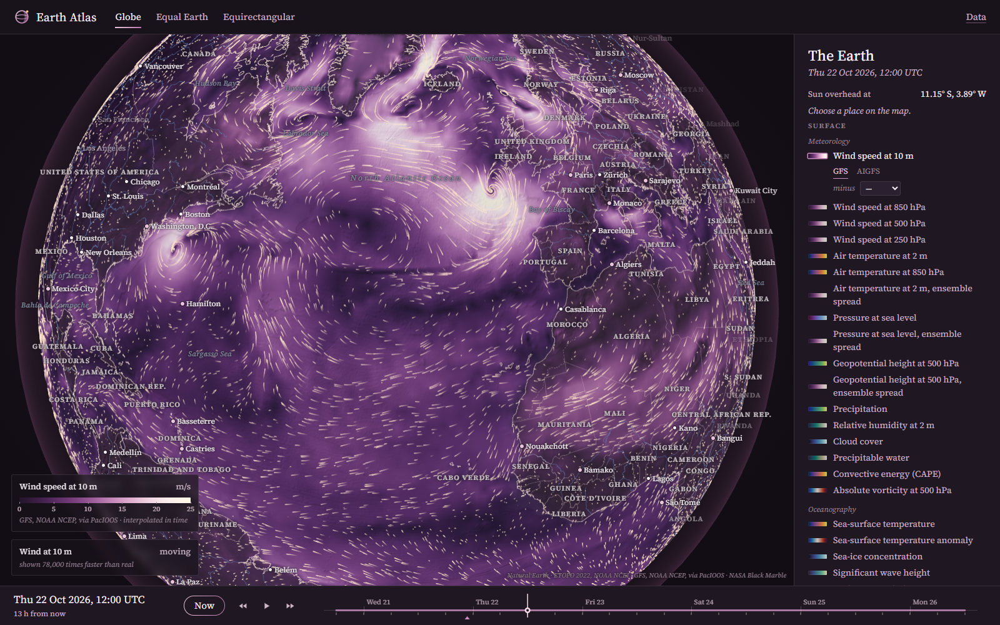</a><br><b>Wind at 10 m</b> from the GFS forecast for 22 October 2026, 12:00 UTC. Colour gives the speed, and moving particles trace the flow. Two cyclones turn in the North Atlantic.</td>
<td width="50%" valign="top"><a href="../assets/gallery/earth-02-isobars.jpg">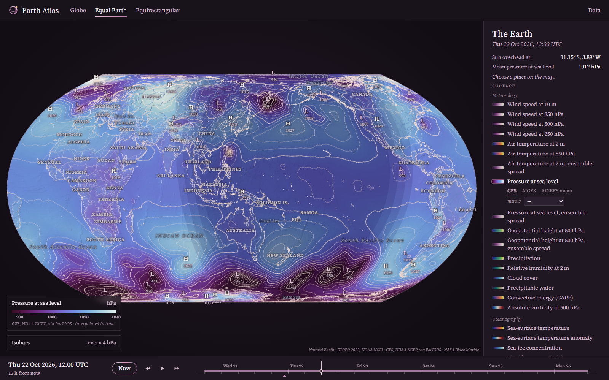</a><br><b>Pressure at sea level</b> and isobars every 4 hPa, with highs and lows, on the equal-area Equal Earth projection. Lows near 950 hPa follow the Southern Ocean's storm track, and a typhoon of 932 hPa lies east of the Philippines.</td>
</tr>
<tr>
<td width="50%" valign="top"><a href="../assets/gallery/earth-04-waves.jpg">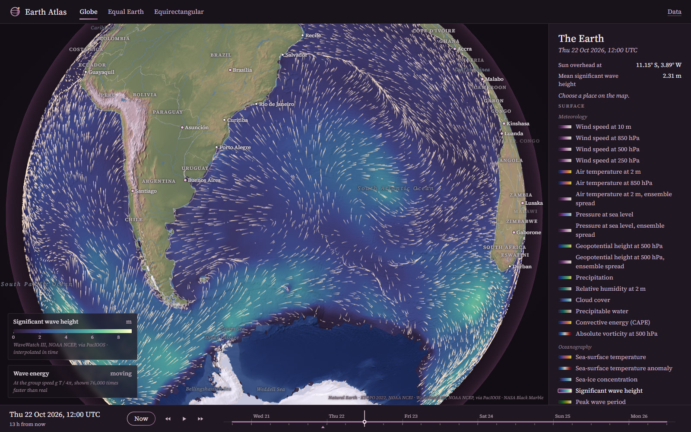</a><br><b>Waves</b> from WaveWatch III. Colour gives the significant wave height. Particles travel along the peak direction at the deep-water group speed, gT/4π. Swell from the Southern Ocean spreads north into the Atlantic.</td>
<td width="50%" valign="top"><a href="../assets/gallery/earth-07-sst-anomaly.jpg">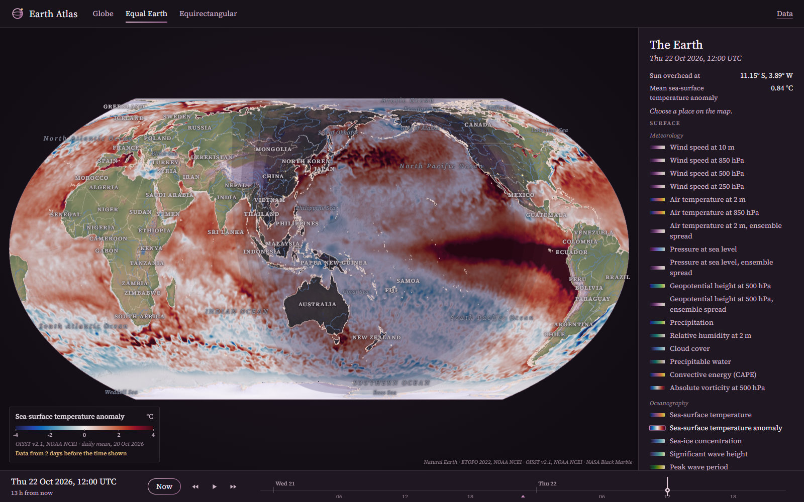</a><br><b>Sea-surface temperature anomaly</b> from NOAA's OISST v2.1, 20 October 2026. A warm tongue lies along the equator in the eastern Pacific, the pattern of El Niño.</td>
</tr>
</table>

### 1.2 Models Compared, and the Laboratory's Own

<table>
<tr>
<td width="50%" valign="top"><a href="../assets/gallery/earth-05-model-difference.jpg">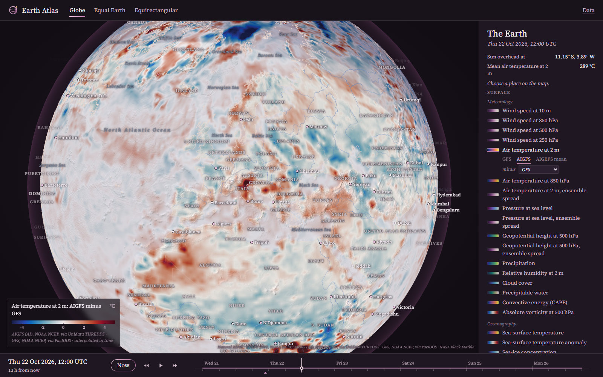</a><br><b>Two models compared.</b> NOAA's AI model AIGFS minus the GFS, air temperature at 2 m, on a diverging scale fitted to the whole forecast. Any two models of the same quantity can be differenced this way.</td>
<td width="50%" valign="top"><a href="../assets/gallery/earth-06-laboratory-models.jpg">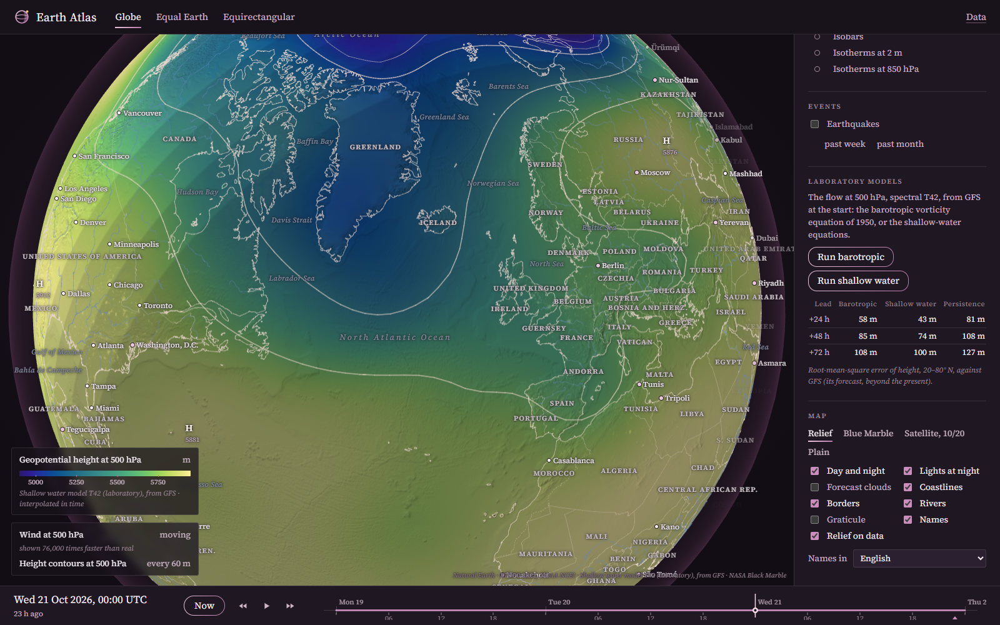</a><br><b>A model of our own.</b> The laboratory's shallow-water model, 48 hours after starting from the GFS analysis of 19 October 2026: heights at 500 hPa, contours every 60 m, and the wind.</td>
</tr>
</table>

The laboratory's two models run in the page by the spectral transform method at T42. The panel compares their errors with persistence, the forecast that nothing changes:

| Lead | Barotropic model (1950) | Shallow-water model | Persistence |
|---|---|---|---|
| +24 h | 58 m | 43 m | 81 m |
| +48 h | 85 m | 74 m | 108 m |
| +72 h | 108 m | 100 m | 127 m |

These are root-mean-square errors of the height of the 500 hPa surface over 20–80° N, against the GFS's own analyses. The theory is in [the barotropic note](../theory/meteorology/barotropic-vorticity-model.md) and [the shallow-water note](../theory/meteorology/shallow-water-model.md).

### 1.3 Prediction: an AI Model Run Here, Tropical Cyclones and Disasters

The laboratory runs the AI weather model Pangu-Weather (Bi et al. 2023) itself, on a laptop's CPU, from NOAA's GFS analysis at 0.25°. A week's forecast takes about half an hour, and becomes a product like NOAA's. Tropical cyclones are found in every forecast's sea-level pressure and drawn beside the observed track and the official forecast ([ADR 0022](../development/decisions/0022-ai-forecast-cyclones-and-disasters.md)).

<table>
<tr>
<td width="50%" valign="top"><a href="../assets/gallery/earth-15-cyclone-forecasts.jpg">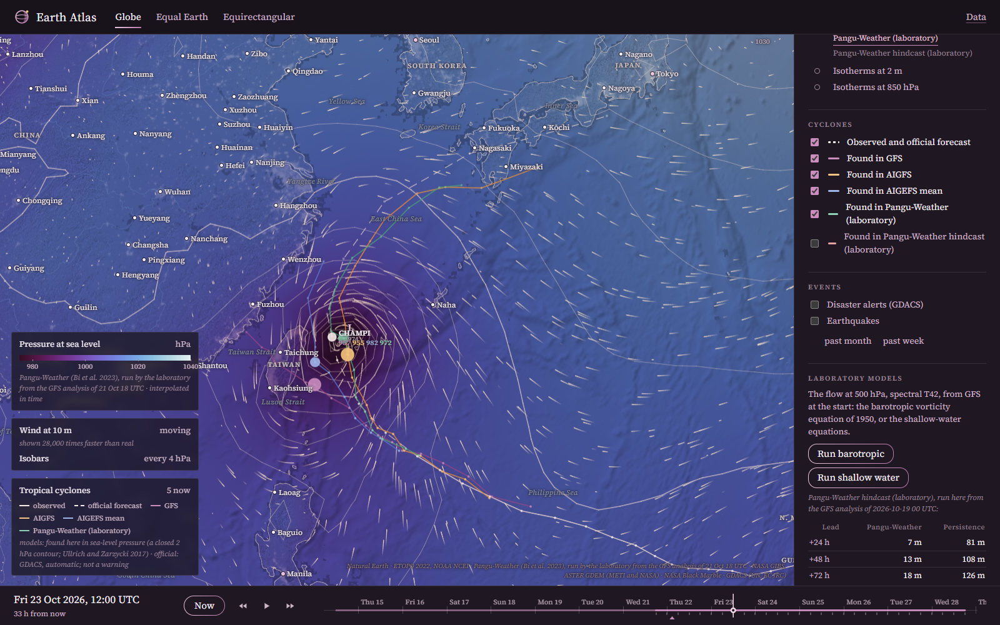</a><br><b>One typhoon, five forecasts.</b> Typhoon Champi on 23 October 2026, 12:00 UTC, in Pangu-Weather's sea-level pressure and wind. Its track as found in each model is drawn in that model's colour. Pangu-Weather (green) and NOAA's AIGFS (gold) recurve it toward southern Japan with the official forecast (white, dashed), the AIGEFS ensemble mean (blue) takes it north, and the GFS (pink) west into the Taiwan Strait. The label gives each model's central pressure.</td>
<td width="50%" valign="top"><a href="../assets/gallery/earth-16-ai-verification.jpg">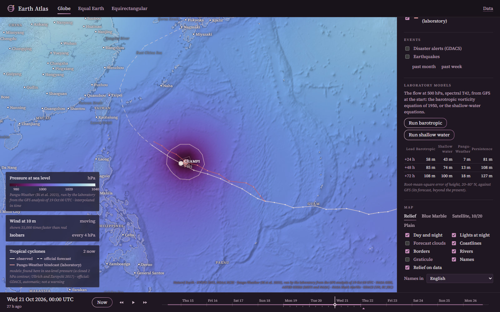</a><br><b>A forecast checked.</b> Pangu-Weather started from the analysis of 19 October 2026, 00:00 UTC, seen 48 hours later. Its track of Champi (red) runs beside the observed one (white), within 49 km at one day and 58 km at two. In the panel, its errors are set beside the laboratory's own models and persistence.</td>
</tr>
<tr>
<td width="50%" valign="top"><a href="../assets/gallery/earth-17-ai-week-ahead.jpg">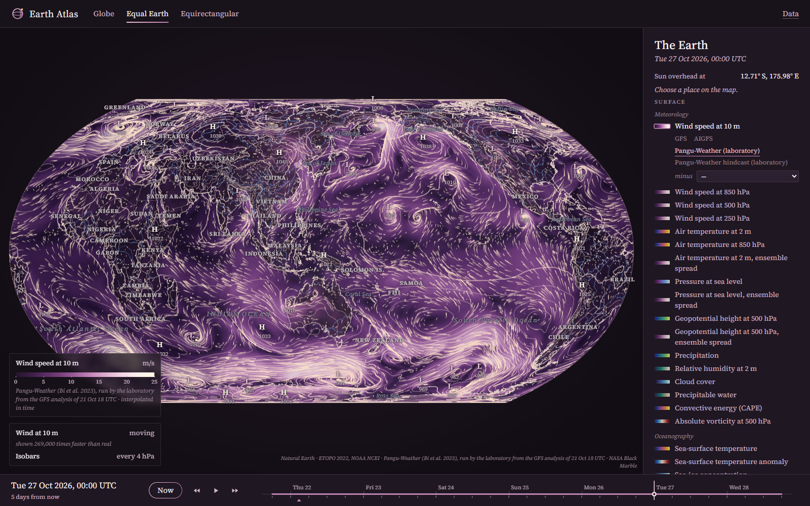</a><br><b>Five days ahead.</b> Pangu-Weather's wind at 10 m and pressure at sea level for 27 October 2026, 00:00 UTC, from the analysis of 21 October, 18:00 UTC: the storm tracks of both hemispheres, the trade winds, and two cyclones in the western Pacific.</td>
<td width="50%" valign="top"><a href="../assets/gallery/earth-18-disaster-alerts.jpg">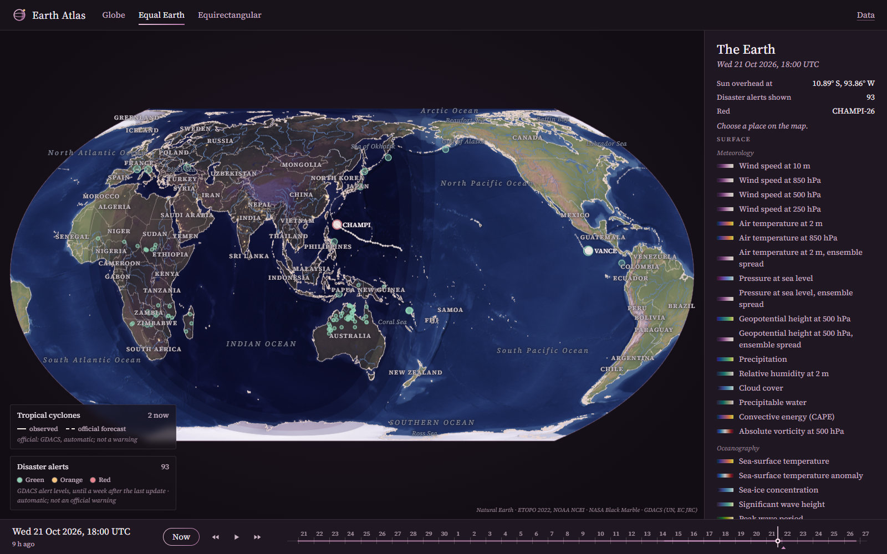</a><br><b>Disaster alerts</b> of the last month from GDACS: tropical cyclones, earthquakes, floods, volcanoes, droughts and wildfires, coloured by alert level. Champi is Red. GDACS's alerts are automatic and do not replace official warnings.</td>
</tr>
</table>

Errors of the forecast from 19 October, as for the laboratory's models above:

| Lead | Pangu-Weather | Shallow-water model | Barotropic model | Persistence |
|---|---|---|---|---|
| +24 h | 6.6 m | 43 m | 58 m | 81 m |
| +48 h | 12.7 m | 74 m | 85 m | 108 m |
| +72 h | 18.3 m | 100 m | 108 m | 126 m |

Its cyclones are too weak, as its authors report: Champi's central pressure in it is about 45 hPa above the GFS's on the same grid. The theory is in [the note on learned forecast models](../theory/meteorology/learned-forecast-models.md) and [the note on cyclone tracking](../theory/meteorology/tropical-cyclone-tracking.md).

### 1.4 Climate

<table>
<tr>
<td width="50%" valign="top"><a href="../assets/gallery/earth-08-koppen.jpg">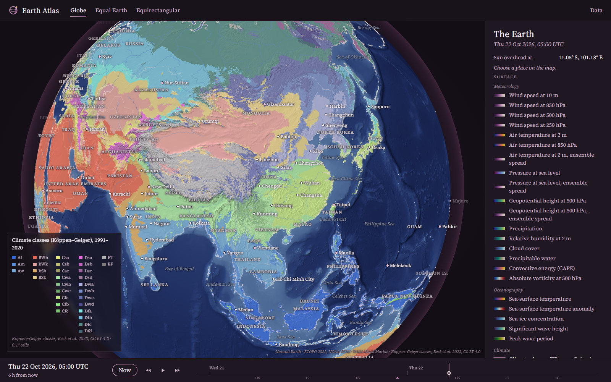</a><br><b>Climate classes</b> of 1991–2020 after Köppen and Geiger, from the 1 km maps of Beck et al. (2023) at 0.1°. The conventional colours are kept but softened, over the shaded relief.</td>
<td width="50%" valign="top"><a href="../assets/gallery/earth-09-koppen-change.jpg">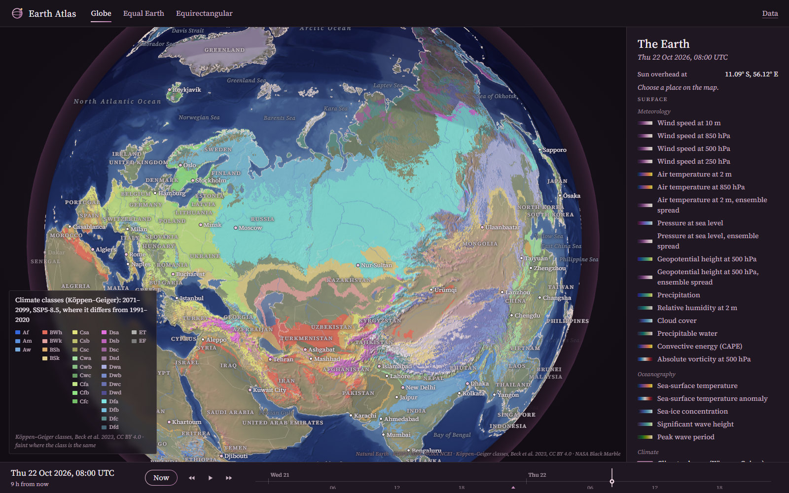</a><br><b>Climate classes in change.</b> The classes of 2071–2099 under the scenario SSP5-8.5, in colour where they differ from those of 1991–2020, and faint where they do not. Much of Siberia passes from Dfc to Dfb and Dfa: its summers warm.</td>
</tr>
<tr>
<td width="50%" valign="top"><a href="../assets/gallery/earth-10-climate-diagram.jpg">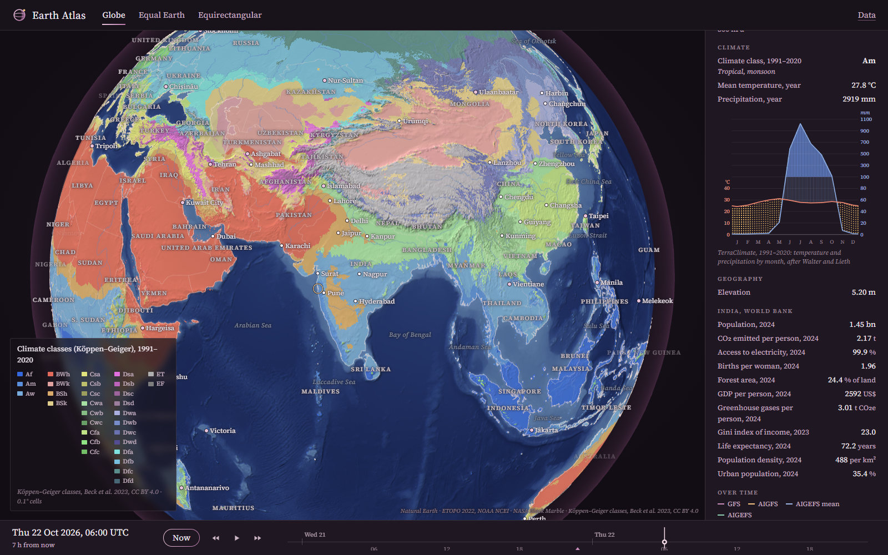</a><br><b>A climate diagram.</b> Mumbai, class Am (tropical monsoon), and its normal year from TerraClimate, drawn after Walter and Lieth (1960). The dry season, from November to May, is dotted. The monsoon, above 100 mm a month from June to September, is filled.</td>
<td width="50%" valign="top"><a href="../assets/gallery/earth-11-precipitation-normal.jpg">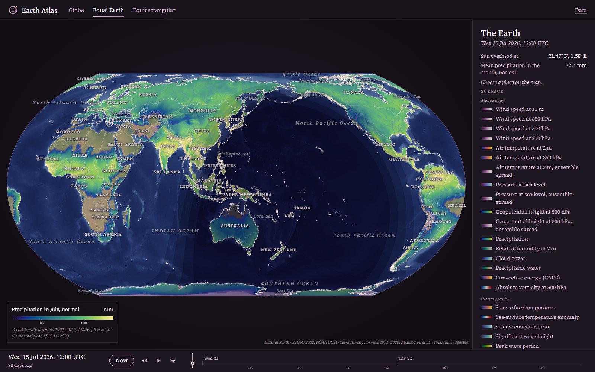</a><br><b>The normal July.</b> Precipitation in July, the normal of 1991–2020 from TerraClimate. The monsoons of South Asia and the Sahel are wet, and the Mediterranean summer is dry. Normals follow the month of the time shown.</td>
</tr>
</table>

The atlas also classifies the TerraClimate normals itself, by the rules of Beck et al. (2018). Its classes agree with the published map in 89 % of land cells. The classification is invariant under a group of order 2·(6!)⁴: permutations of the months within each half-year, and the exchange of the halves. See [the theory note](../theory/climate/koppen-geiger-classification.md).

### 1.5 The Earth from Space, and Its Relief

<table>
<tr>
<td width="50%" valign="top"><a href="../assets/gallery/earth-03-blue-marble.jpg">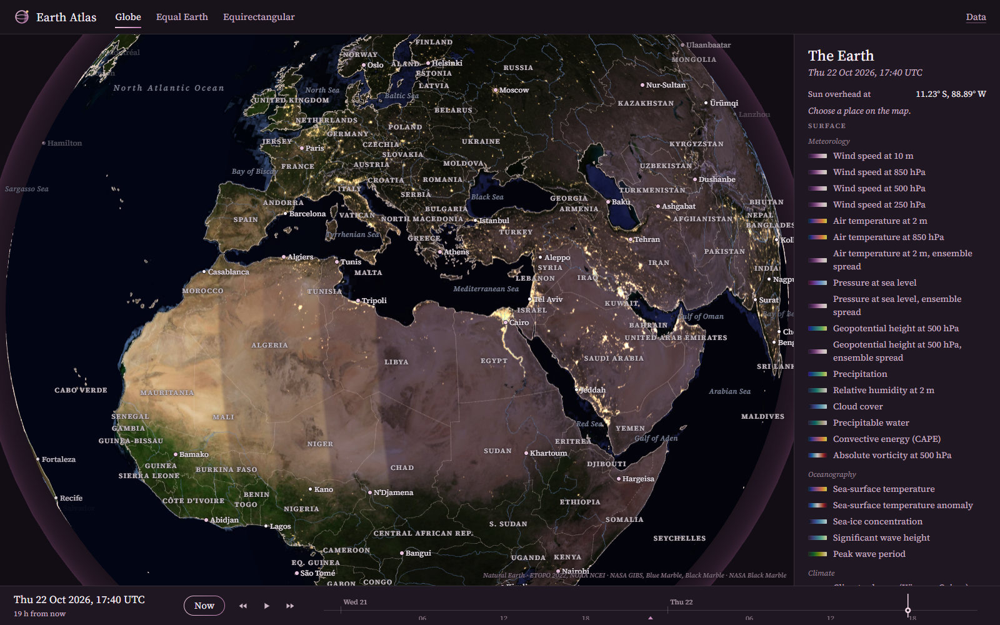</a><br><b>Day and night.</b> NASA's Blue Marble by day, and the Black Marble's city lights where the Sun has set, at 17:40 UTC. Sunset and the ends of civil, nautical and astronomical twilight are drawn as steps.</td>
<td width="50%" valign="top"><a href="../assets/gallery/earth-03b-satellite.jpg">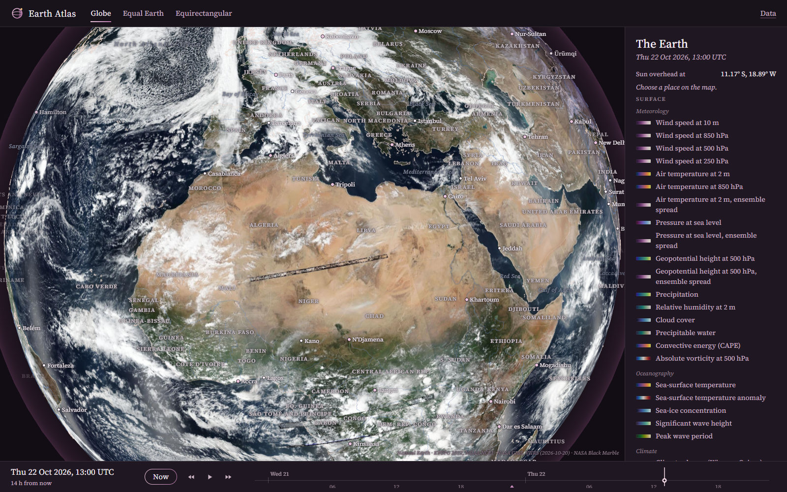</a><br><b>The Earth from space</b> on 20 October 2026: the VIIRS true-colour mosaic from NASA GIBS. A gap between two orbits crosses the Sahara.</td>
</tr>
<tr>
<td width="50%" valign="top"><a href="../assets/gallery/earth-12-alps.jpg">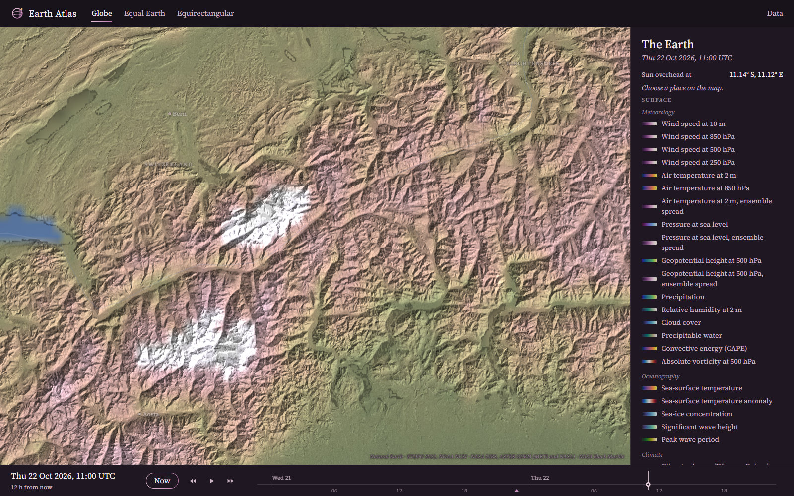</a><br><b>The Alps at close range.</b> Shaded relief from 30 m elevations (ASTER GDEM, through NASA GIBS), fetched for the region in view. It is drawn over hypsometric tints from ETOPO 2022, with Lake Geneva on the left.</td>
<td width="50%" valign="top"><a href="../assets/gallery/earth-12b-himalaya.jpg">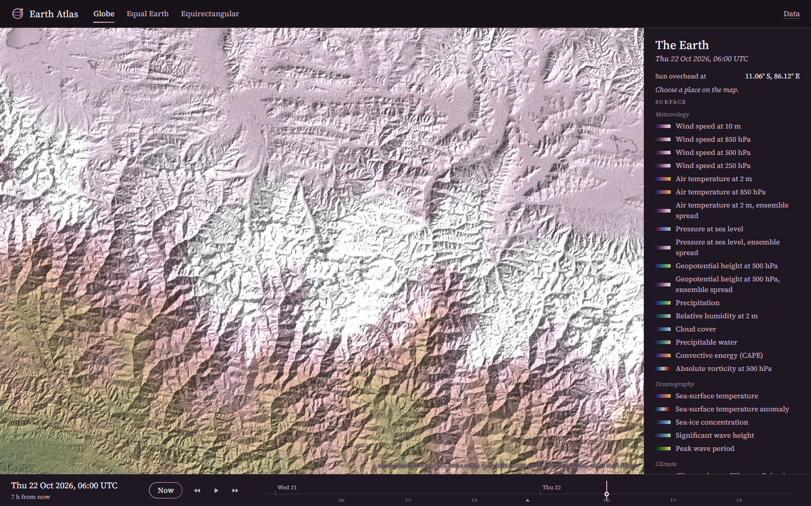</a><br><b>The Himalaya</b> around Everest, at the centre of the view, in the same way. The Tibetan Plateau lies above, and the valleys descend toward the Ganges plain below.</td>
</tr>
</table>

### 1.6 Earthquakes and People

<table>
<tr>
<td width="50%" valign="top"><a href="../assets/gallery/earth-13-earthquakes.jpg">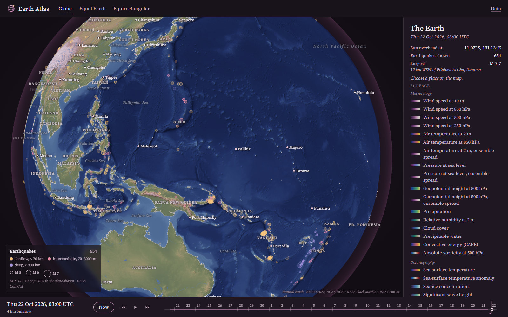</a><br><b>Earthquakes</b> of magnitude 4.5 and above over a month, from the USGS. Colour gives the depth and size the magnitude. They trace the subduction zones of the western Pacific.</td>
<td width="50%" valign="top"><a href="../assets/gallery/earth-14-population-density.jpg">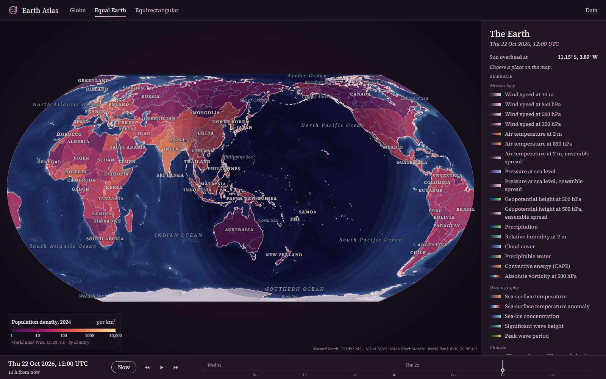</a><br><b>People.</b> Population density by country, 2024, from the World Bank. It is joined to Natural Earth's countries by stated codes; the base map itself carries no values.</td>
</tr>
</table>

### 1.7 The Ocean Beneath, and the Solid Earth

Choose a place, and the atlas looks beneath it: into the ocean, fetched on demand from the US Navy's ocean model ([ADR 0023](../development/decisions/0023-ocean-column-and-data-on-demand.md)), and into the solid Earth: its plates, the motion of the ground, its earthquakes and its crust ([ADR 0024](../development/decisions/0024-the-solid-earth.md)).

<table>
<tr>
<td width="50%" valign="top"><a href="../assets/gallery/earth-19-ocean-column.jpg">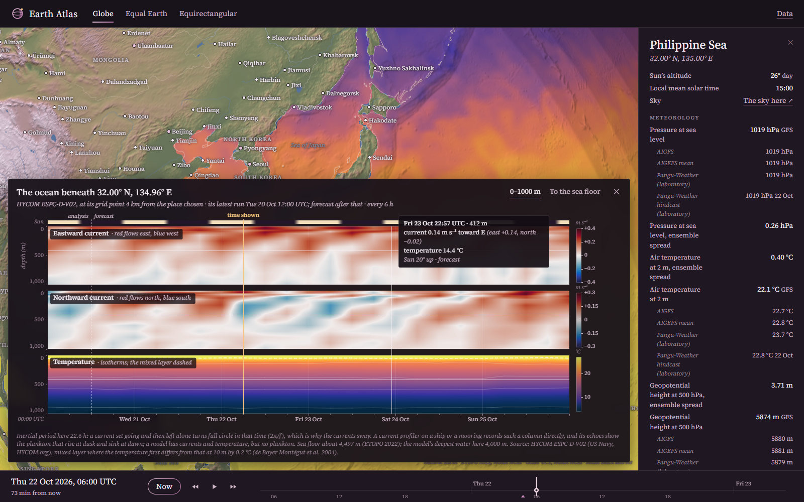</a><br><b>The ocean beneath a place.</b> The Kuroshio south of Japan, as a current profiler would record it: eastward and northward current and temperature to 1000 m, two days back and four ahead, from HYCOM (US Navy). The strip above is the Sun's height there; the dashed line, the mixed layer; the pointer reads every value.</td>
<td width="50%" valign="top"><a href="../assets/gallery/earth-20-plates.jpg">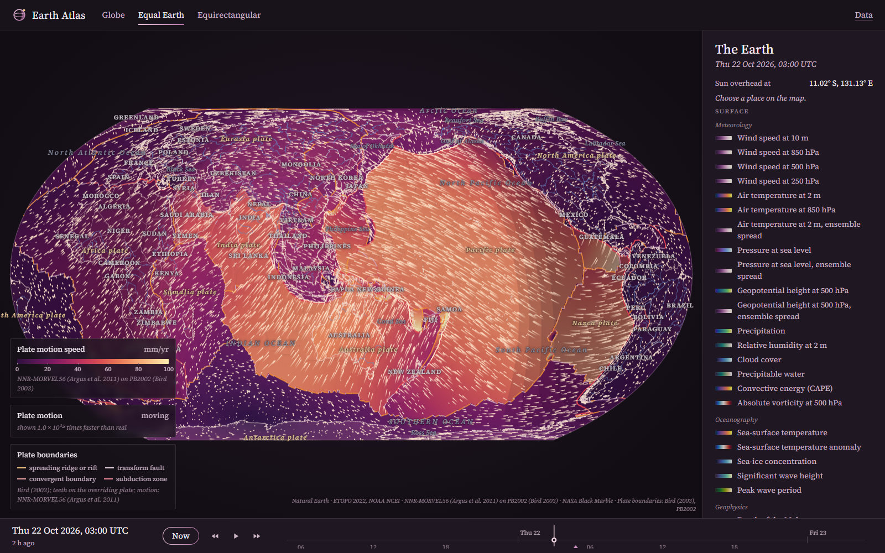</a><br><b>The plates in motion.</b> The 52 plates of PB2002 (Bird 2003), coloured by their speed in NNR-MORVEL56 and carried as particles, about 10¹⁵ times faster than real. The Pacific and the plates around Australia move fastest; boundaries are coloured by kind, with teeth on the overriding plate at trenches.</td>
</tr>
<tr>
<td width="50%" valign="top"><a href="../assets/gallery/earth-21-gps-record.jpg">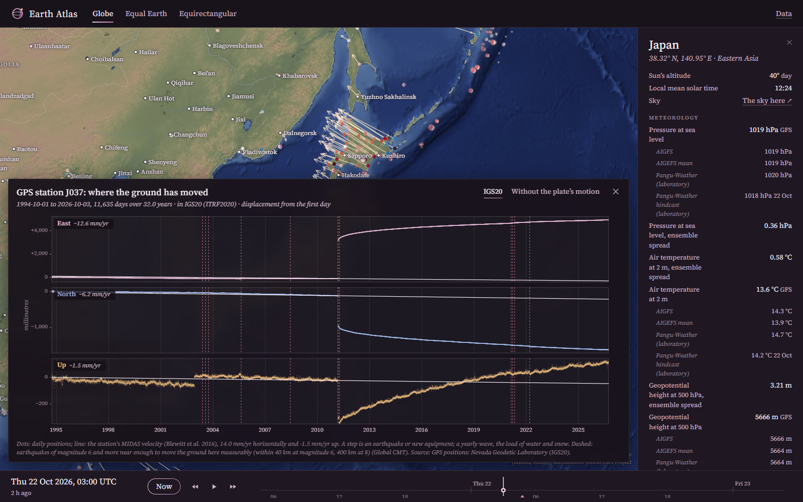</a><br><b>Where the ground has moved.</b> GPS station J037 at Sendai since 1994, its plate's motion removed: the Tōhoku earthquake of 2011 threw it 3 m east and 1 m south, and it has crept east since, as the mantle relaxes. Dashed: earthquakes near enough to move it. On the map, GPS velocities relative to their plates (Nevada Geodetic Laboratory).</td>
<td width="50%" valign="top"><a href="../assets/gallery/earth-22-mechanisms.jpg">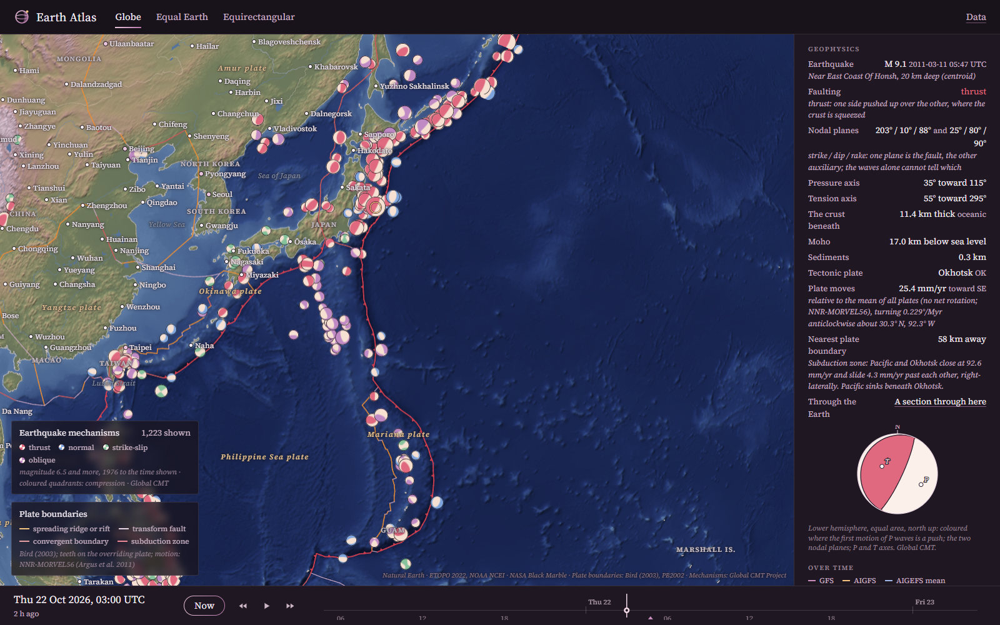</a><br><b>How the ground broke.</b> Every earthquake of magnitude 6.5 and more since 1976 around Japan, as beach balls from Global CMT moment tensors: thrusts (rose) along the trenches, normal faults (blue) on the outer rise. The place card gives Tōhoku's planes and axes on a stereonet.</td>
</tr>
<tr>
<td width="50%" valign="top"><a href="../assets/gallery/earth-23-section.jpg">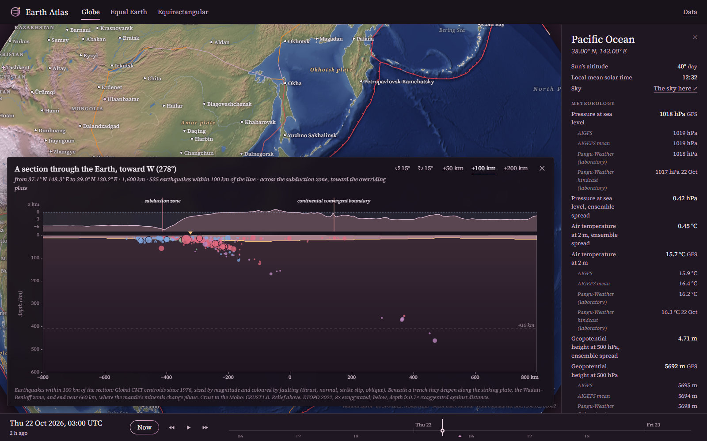</a><br><b>A section across the Japan Trench,</b> toward the overriding plate: the relief above, the crust to the Moho, and the earthquakes within 100 km of the line, which trace the Pacific plate sinking westward, the Wadati–Benioff zone, down to 450 km beneath the Sea of Japan.</td>
<td width="50%" valign="top"><a href="../assets/gallery/earth-24-crust.jpg">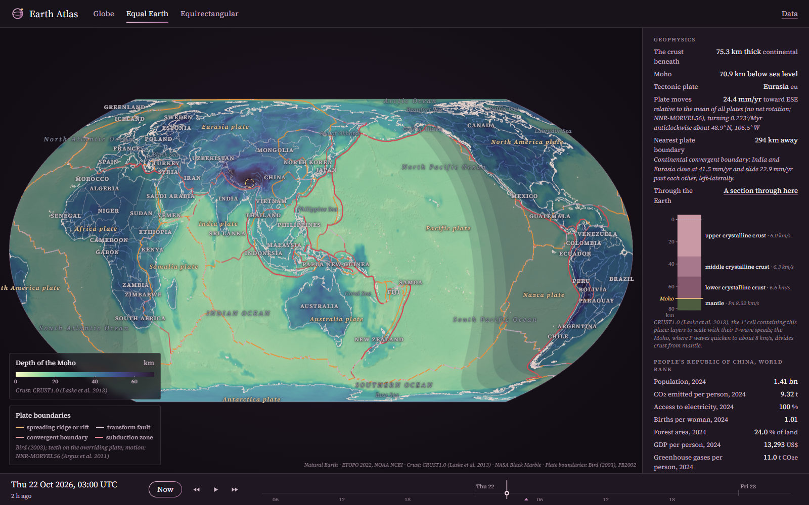</a><br><b>The crust.</b> The depth of the Moho from CRUST1.0, from 7 km under the oceans to 70 km under Tibet; beside it, the column beneath Lhasa, 75 km of crust to scale, with each layer's P-wave speed.</td>
</tr>
</table>

Their verification: plate velocities agree with the EarthScope calculator to 0.005 mm/yr; GPS stations in stable plate interiors move by 0.3 to 0.6 mm/yr relative to their plate; the nodal planes of all 70,451 Global CMT earthquakes agree with the catalogue's within 0.76° (99 %). The theory is in [the note on plate kinematics](../theory/geodesy/plate-kinematics.md), [the note on earthquake mechanisms](../theory/geophysics/earthquake-mechanisms.md) and [the note on the ocean column](../theory/oceanography/the-ocean-column.md).

## 2. The Celestial Atlas

The Sun, the Moon, the planets, the stars and the galaxies, at any instant from 1849 to 2150 or live. Positions come from JPL's DE440 ephemeris, read directly from its kernel.

### 2.1 The Solar System

<table>
<tr>
<td width="50%" valign="top"><a href="../assets/gallery/celestial-01-solar-system.jpg">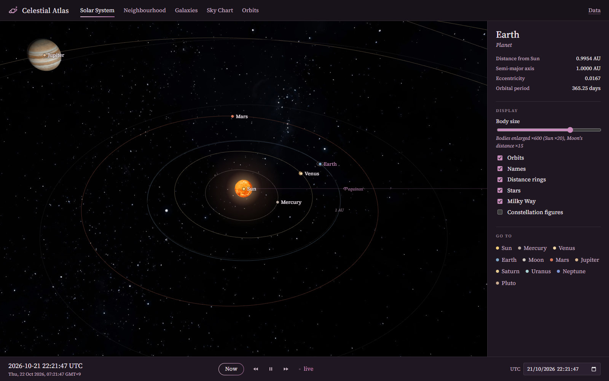</a><br><b>The Solar System</b> on 21 October 2026, 22:21 UTC, with osculating orbits and the Milky Way behind the stars. Bodies are enlarged 600 times (the Sun 20 times), and the view says so.</td>
<td width="50%" valign="top"><a href="../assets/gallery/celestial-02-saturn.jpg">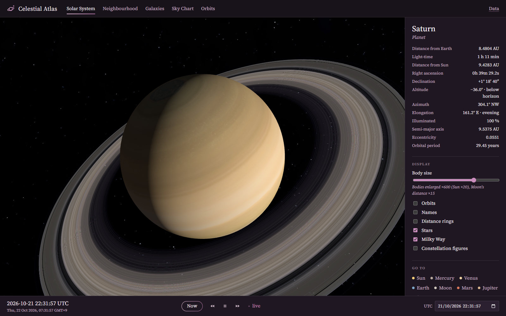</a><br><b>Saturn</b> and its rings, which lie in its equatorial plane. Each body's map is turned to the instant shown by the IAU rotation models, which agree with JPL Horizons to within 0.011°.</td>
</tr>
<tr>
<td width="50%" valign="top"><a href="../assets/gallery/celestial-03-jupiter.jpg">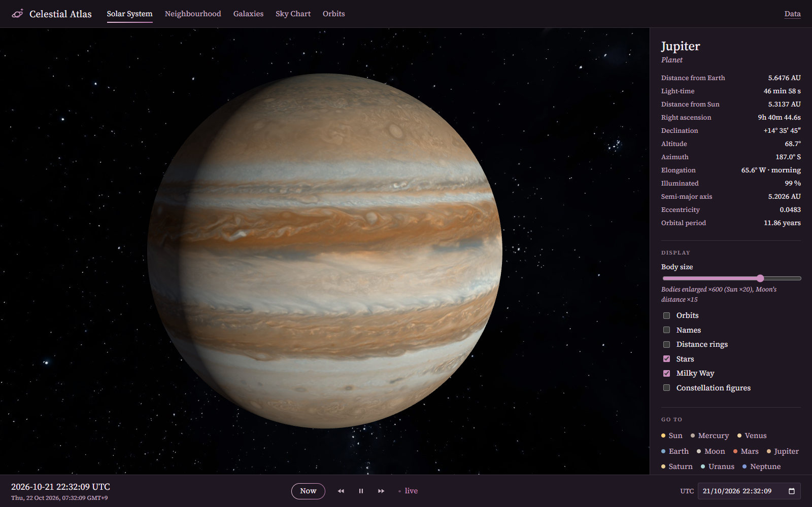</a><br><b>Jupiter</b>, lit by the Sun from its direction at that instant.</td>
<td width="50%" valign="top"><a href="../assets/gallery/celestial-04-earth-night.jpg">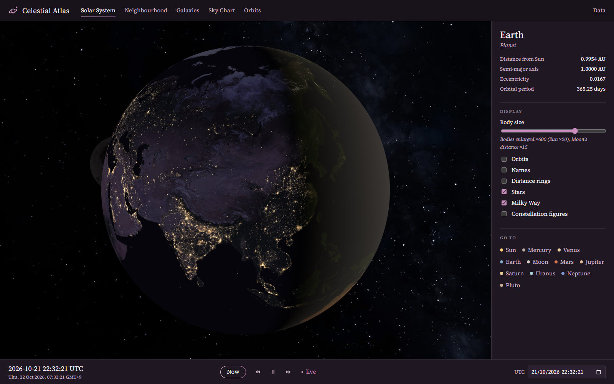</a><br><b>The Earth at night.</b> The Blue Marble by day, and the Black Marble's lights where the Sun is below the horizon: the same imagery products as the Earth Atlas.</td>
</tr>
</table>

### 2.2 Close to the Moon and Mars, and Beyond the Sun

<table>
<tr>
<td width="50%" valign="top"><a href="../assets/gallery/celestial-05-moon.jpg">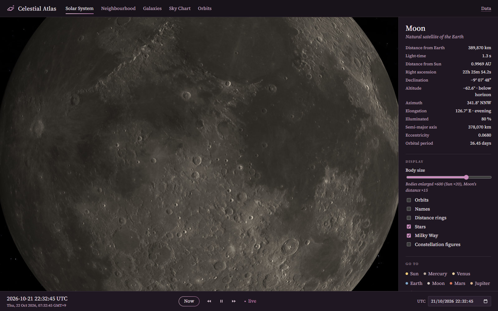</a><br><b>The Moon</b> at close range. When a body fills the view, the part in view is fetched from NASA's Trek tiles (here the LRO wide-angle camera mosaic) at the screen's resolution.</td>
<td width="50%" valign="top"><a href="../assets/gallery/celestial-06-moon-close.jpg">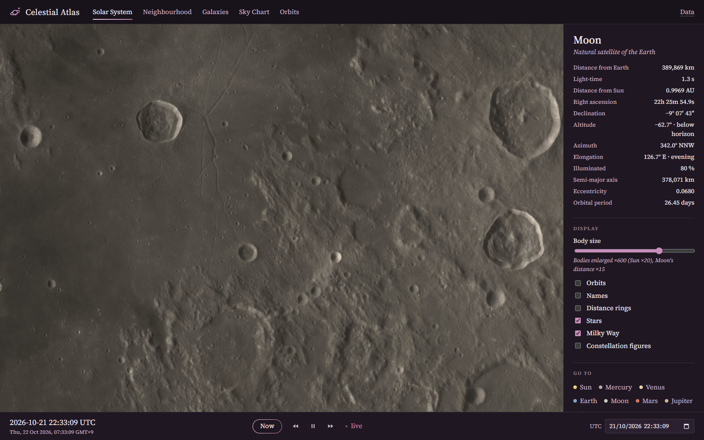</a><br><b>Closer still:</b> craters and a winding rille, lit by the Sun from its direction at that instant.</td>
</tr>
<tr>
<td width="50%" valign="top"><a href="../assets/gallery/celestial-07-mars.jpg">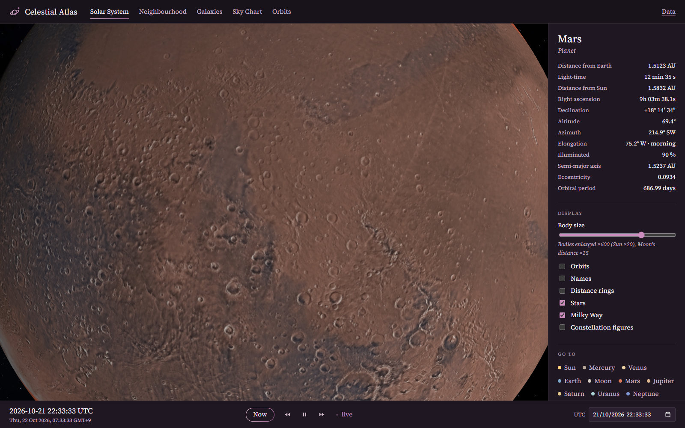</a><br><b>Mars</b> from the Viking MDIM 2.1 colour mosaic, turned by Mars's IAU rotation model, periodic terms included.</td>
<td width="50%" valign="top"><a href="../assets/gallery/celestial-08-neighbourhood.jpg">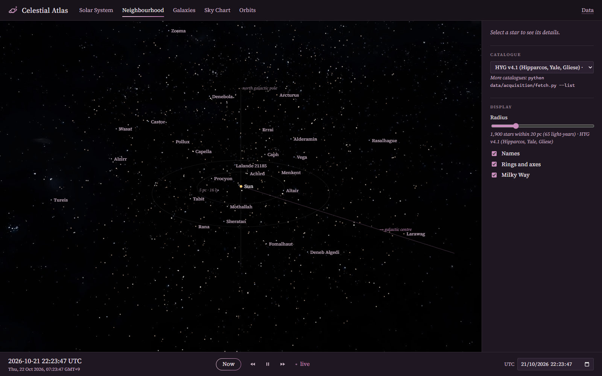</a><br><b>The stellar neighbourhood:</b> 1,900 stars within 20 parsecs from HYG v4.1, at their measured distances, in galactic coordinates, against the Milky Way.</td>
</tr>
</table>

### 2.3 Galaxies, the Sky and the Orbits

<table>
<tr>
<td width="50%" valign="top"><a href="../assets/gallery/celestial-09-local-volume.jpg">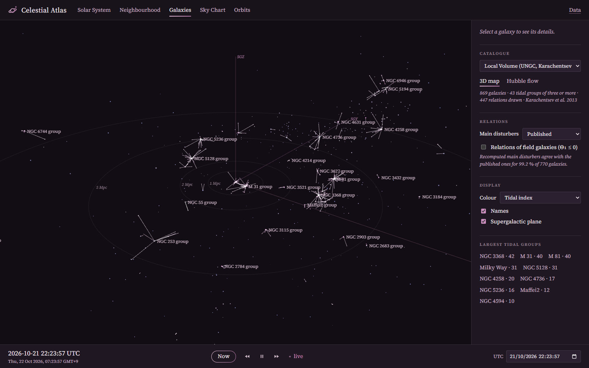</a><br><b>The Local Volume.</b> 869 galaxies of the Updated Nearby Galaxy Catalog (Karachentsev et al. 2013), in supergalactic coordinates. Each is linked to its main disturber, and the tidal groups are named. The atlas recomputes the disturbers; they agree with the published ones for 99.2 % of galaxies.</td>
<td width="50%" valign="top"><a href="../assets/gallery/celestial-10-hubble-flow.jpg">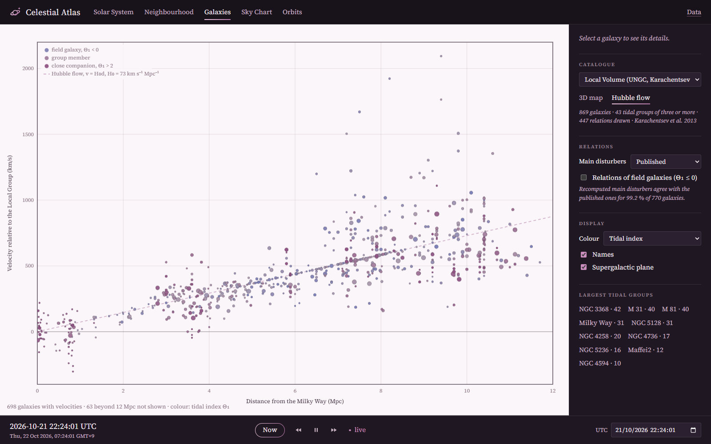</a><br><b>The Hubble flow</b> of the Local Volume: velocity against distance, coloured by tidal index, with v = H₀d for H₀ = 73 km s⁻¹ Mpc⁻¹.</td>
</tr>
<tr>
<td width="50%" valign="top"><a href="../assets/gallery/celestial-11-local-universe.jpg">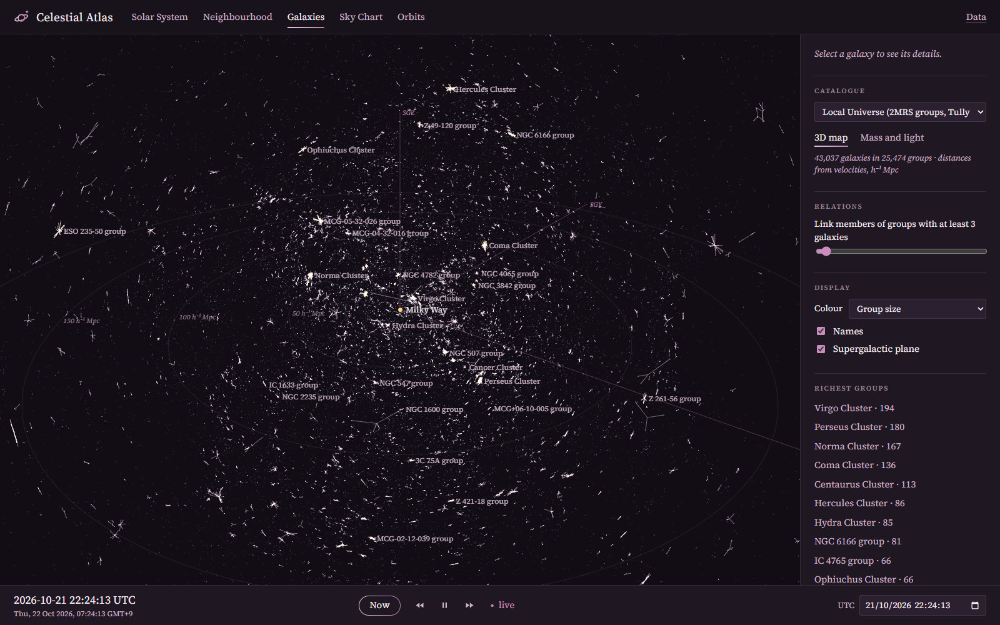</a><br><b>The Local Universe.</b> 43,037 galaxies of the 2MASS Redshift Survey in 25,474 groups (Tully 2015), linked to their group centres. Clusters are named through SIMBAD.</td>
<td width="50%" valign="top"><a href="../assets/gallery/celestial-12-sky-chart.jpg">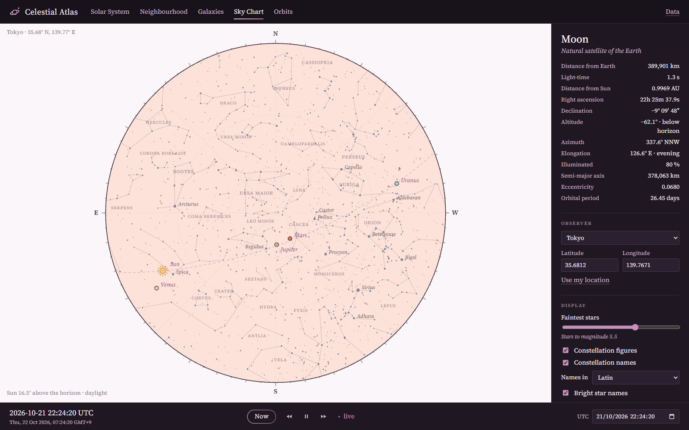</a><br><b>The sky</b> over Tokyo on the morning of 22 October 2026, drawn as a star atlas. It shows the constellations, the bright stars and the planets, with refraction applied.</td>
</tr>
<tr>
<td width="50%" valign="top"><a href="../assets/gallery/celestial-13-orbits.jpg">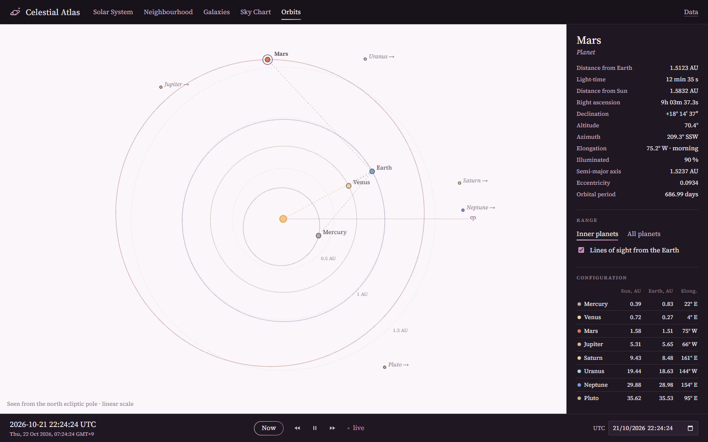</a><br><b>The orbits</b> of the inner planets seen from the north ecliptic pole, with the lines of sight from the Earth and each planet's elongation.</td>
<td width="50%" valign="top"><a href="../assets/gallery/celestial-14-sky-from-a-place.jpg">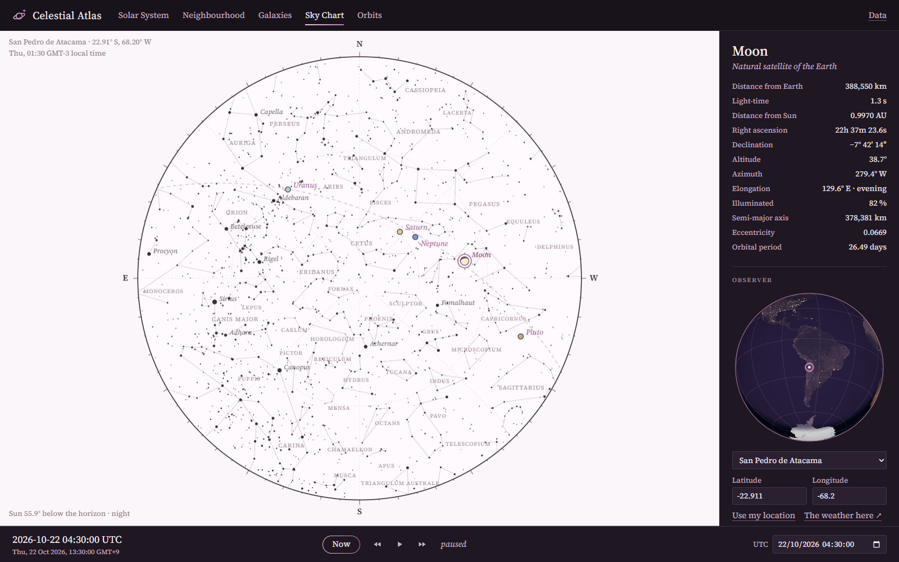</a><br><b>The sky from a place</b> chosen by clicking the Earth: here San Pedro de Atacama, at 01:30 local time on 22 October 2026, with Canopus, Achernar and the far southern constellations high in the south. The globe in the panel shows the Earth by day and its lights by night at that instant. "The weather here" opens the Earth Atlas at the same place and time.</td>
</tr>
</table>

## 3. Credits

The screenshots are the laboratory's, under its MIT licence, except the three that show Pangu-Weather's forecasts (§1.3: earth-15, earth-16 and earth-17). Those are shared under CC BY-NC-SA 4.0, the licence of the model's parameters: for learning and research, not for commercial use. The data in all of them keep their own licences.

| Data | Source | Licence |
|---|---|---|
| Base map | Natural Earth | Public domain |
| Relief | ETOPO 2022 (NOAA NCEI); ASTER GDEM (METI and NASA), shaded by NASA GIBS | Public domain; NASA, acknowledge |
| Forecasts and analyses | GFS and WaveWatch III (NOAA NCEP, via PacIOOS ERDDAP); AIGFS and AIGEFS (NOAA NCEP and EPIC, via Unidata THREDDS); OISST v2.1 (NOAA NCEI) | Public domain |
| The laboratory's AI forecasts | Pangu-Weather (Bi et al. 2023, *Nature* 619, 533–538), run from the GFS analysis at 0.25° (NOAA NCEP, NOMADS) | Model parameters CC BY-NC-SA 4.0; analysis public domain |
| Cyclone tracks and disaster alerts | GDACS (United Nations and European Commission JRC), relaying the warning centres | No reuse licence stated; provided "as is"; credited, and not a warning |
| Climate classes | Beck et al. (2023), *Scientific Data* 10, 724 | CC BY 4.0 |
| Climate normals | TerraClimate (Abatzoglou et al. 2018) | CC0 |
| Imagery of the Earth | VIIRS true colour, Blue Marble and Black Marble (NASA, via GIBS) | NASA, acknowledge |
| Country indicators | World Bank, World Development Indicators | CC BY 4.0 |
| Earthquakes | USGS ComCat | Public domain |
| The ocean beneath a place | HYCOM ESPC-D-V02 (US Navy, via HYCOM.org) | Public release, distribution unlimited |
| Tectonic plates | PB2002 (Bird 2003), as converted by H. Ahlenius (Nordpil); motion NNR-MORVEL56 (Argus et al. 2011) | ODC Attribution 1.0 |
| GPS velocities and positions | Nevada Geodetic Laboratory (Blewitt, Hammond and Kreemer 2018) | None stated; supplied as is; cited |
| Earthquake mechanisms | Global CMT Project (Dziewonski et al. 1981; Ekström et al. 2012) | None stated; cited |
| The crust | CRUST1.0 (Laske et al. 2013) | None stated; cited |
| Ephemeris | JPL DE440 (Park et al. 2021) | Freely distributed |
| Maps of the bodies and the sky | Solar System Scope (INOVE), from NASA, JPL and ESA data | CC BY 4.0 |
| Detail of the Moon and Mars | LRO WAC (NASA/GSFC/ASU), Viking MDIM 2.1 (NASA/USGS), via NASA Trek | NASA, acknowledge |
| Stars | HYG v4.1 | CC BY-SA 4.0 |
| Galaxies | Karachentsev et al. (2013); Tully (2015); names from SIMBAD (CDS) | Published catalogues; cite |

## 4. Making the Screenshots

The screenshots were taken with headless Chrome at 1600 × 1000 pixels, driven over the DevTools protocol, and saved as JPEG.

The Earth Atlas keeps its view in the address, so each picture can be reproduced from its URL on the local server. For example:

```
http://127.0.0.1:8790/#p=globe&c=-32,36,3.25&s=wind.10m@gfs-forecast:speed&f=wind.10m@gfs-forecast&t=2026-10-22T12:00Z
```

- `p`: the projection.
- `c`: the longitude, latitude and distance of the view.
- `s`, `f`, `l` and `m`: the surface, the flow, the lines, and the model compared.
- `t`: the instant, in UTC.
