# Gallery

*Status: draft, 2026-10-31.*

These are screenshots of the infrastructure's applications, the three atlases taken on 22 October 2026 from their local servers with the data of that day, the Spiking Simulator and the Complex Atlas on 23 October, the History Complex, the Genome Workbench and the Economy Atlas on 24 October, Cosmopoiesis on 30 October, and the Urban Building Workbench on 31 October.

- All are web applications without a build step.
- Their science is the provisional JavaScript of the domains they draw on, tested against published references and closed-form answers in 422 checks, and the C++ of the foundations and of the metrology, geodesy, astronomy, geophysics, meteorology, navigation, neuroscience, history, genomics, evolution, economics, robotics, planetary-science and urban-science domains, checked the same way.
- Each caption says what is shown, where the data come from, and how the picture is made.

Click an image to see it at full size. To run the applications yourself, see the READMEs of the [Earth Atlas](../applications/earth-atlas/README.md), the [Celestial Atlas](../applications/celestial-atlas/README.md), the [Brain Atlas](../applications/brain-atlas/README.md), the [Spiking Simulator](../applications/spiking-simulator/README.md), the [Complex Atlas](../applications/complex-atlas/README.md), the [History Complex](../applications/history-complex/README.md) and the [Genome Workbench](../applications/genome-workbench/README.md), the [Economy Atlas](../applications/economy-atlas/README.md), [Cosmopoiesis](../applications/cosmopoiesis-lab/README.md) and the [Urban Building Workbench](../applications/urban-building-workbench/README.md).

## 1. The Earth Atlas

The atmosphere, the ocean, the land and its people on one globe, or on equal-area and equirectangular maps, at one instant. Each kind of data comes from its own dataset and is joined to the map only in the application.

### 1.1 Weather and the Ocean

<table>
<tr>
<td width="50%" valign="top"><a href="../assets/gallery/earth-01-wind.jpg"></a><br><b>Wind at 10 m</b> from the GFS forecast for 22 October 2026, 12:00 UTC. Colour gives the speed, and moving particles trace the flow. Two cyclones turn in the North Atlantic.</td>
<td width="50%" valign="top"><a href="../assets/gallery/earth-02-isobars.jpg"></a><br><b>Pressure at sea level</b> and isobars every 4 hPa, with highs and lows, on the equal-area Equal Earth projection. Lows near 950 hPa follow the Southern Ocean's storm track, and a typhoon of 932 hPa lies east of the Philippines.</td>
</tr>
<tr>
<td width="50%" valign="top"><a href="../assets/gallery/earth-04-waves.jpg"></a><br><b>Waves</b> from WaveWatch III. Colour gives the significant wave height. Particles travel along the peak direction at the deep-water group speed, gT/4π. Swell from the Southern Ocean spreads north into the Atlantic.</td>
<td width="50%" valign="top"><a href="../assets/gallery/earth-07-sst-anomaly.jpg"></a><br><b>Sea-surface temperature anomaly</b> from NOAA's OISST v2.1, 20 October 2026. A warm tongue lies along the equator in the eastern Pacific, the pattern of El Niño.</td>
</tr>
</table>

### 1.2 Models Compared, and Our Own

<table>
<tr>
<td width="50%" valign="top"><a href="../assets/gallery/earth-05-model-difference.jpg"></a><br><b>Two models compared.</b> NOAA's AI model AIGFS minus the GFS, air temperature at 2 m, on a diverging scale fitted to the whole forecast. Any two models of the same quantity can be differenced this way.</td>
<td width="50%" valign="top"><a href="../assets/gallery/earth-06-our-models.jpg"></a><br><b>A model of our own.</b> Our shallow-water model, 48 hours after starting from the GFS analysis of 19 October 2026: heights at 500 hPa, contours every 60 m, and the wind.</td>
</tr>
</table>

Our two models run in the page by the spectral transform method at T42. The panel compares their errors with persistence, the forecast that nothing changes:

| Lead | Barotropic model (1950) | Shallow-water model | Persistence |
|---|---|---|---|
| +24 h | 58 m | 43 m | 81 m |
| +48 h | 85 m | 74 m | 108 m |
| +72 h | 108 m | 100 m | 127 m |

These are root-mean-square errors of the height of the 500 hPa surface over 20–80° N, against the GFS's own analyses. The theory is in [the barotropic note](../domains/meteorology/theory/barotropic-vorticity-model.md) and [the shallow-water note](../domains/meteorology/theory/shallow-water-model.md).

### 1.3 Prediction: an AI Model Run Here, Tropical Cyclones and Disasters

We run the AI weather model Pangu-Weather (Bi et al. 2023) ourselves, on a laptop's CPU, from NOAA's GFS analysis at 0.25°. A week's forecast takes about half an hour, and becomes a product like NOAA's. Tropical cyclones are found in every forecast's sea-level pressure and drawn beside the observed track and the official forecast ([ADR 0022](../development/decisions/0022-ai-forecast-cyclones-and-disasters.md)).

<table>
<tr>
<td width="50%" valign="top"><a href="../assets/gallery/earth-15-cyclone-forecasts.jpg"></a><br><b>One typhoon, five forecasts.</b> Typhoon Champi on 23 October 2026, 12:00 UTC, in Pangu-Weather's sea-level pressure and wind. Its track as found in each model is drawn in that model's colour. Pangu-Weather (green) and NOAA's AIGFS (gold) recurve it toward southern Japan with the official forecast (white, dashed), the AIGEFS ensemble mean (blue) takes it north, and the GFS (pink) west into the Taiwan Strait. The label gives each model's central pressure.</td>
<td width="50%" valign="top"><a href="../assets/gallery/earth-16-ai-verification.jpg"></a><br><b>A forecast checked.</b> Pangu-Weather started from the analysis of 19 October 2026, 00:00 UTC, seen 48 hours later. Its track of Champi (red) runs beside the observed one (white), within 49 km at one day and 58 km at two. In the panel, its errors are set beside our own models and persistence.</td>
</tr>
<tr>
<td width="50%" valign="top"><a href="../assets/gallery/earth-17-ai-week-ahead.jpg"></a><br><b>Five days ahead.</b> Pangu-Weather's wind at 10 m and pressure at sea level for 27 October 2026, 00:00 UTC, from the analysis of 21 October, 18:00 UTC: the storm tracks of both hemispheres, the trade winds, and two cyclones in the western Pacific.</td>
<td width="50%" valign="top"><a href="../assets/gallery/earth-18-disaster-alerts.jpg"></a><br><b>Disaster alerts</b> of the last month from GDACS: tropical cyclones, earthquakes, floods, volcanoes, droughts and wildfires, coloured by alert level. Champi is Red. GDACS's alerts are automatic and do not replace official warnings.</td>
</tr>
</table>

Errors of the forecast from 19 October, as for our models above:

| Lead | Pangu-Weather | Shallow-water model | Barotropic model | Persistence |
|---|---|---|---|---|
| +24 h | 6.6 m | 43 m | 58 m | 81 m |
| +48 h | 12.7 m | 74 m | 85 m | 108 m |
| +72 h | 18.3 m | 100 m | 108 m | 126 m |

Its cyclones are too weak, as its authors report: Champi's central pressure in it is about 45 hPa above the GFS's on the same grid. The theory is in [the note on learned forecast models](../domains/meteorology/theory/learned-forecast-models.md) and [the note on cyclone tracking](../domains/meteorology/theory/tropical-cyclone-tracking.md).

### 1.4 Climate

<table>
<tr>
<td width="50%" valign="top"><a href="../assets/gallery/earth-08-koppen.jpg"></a><br><b>Climate classes</b> of 1991–2020 after Köppen and Geiger, from the 1 km maps of Beck et al. (2023) at 0.1°. The conventional colours are kept but softened, over the shaded relief.</td>
<td width="50%" valign="top"><a href="../assets/gallery/earth-09-koppen-change.jpg"></a><br><b>Climate classes in change.</b> The classes of 2071–2099 under the scenario SSP5-8.5, in colour where they differ from those of 1991–2020, and faint where they do not. Much of Siberia passes from Dfc to Dfb and Dfa: its summers warm.</td>
</tr>
<tr>
<td width="50%" valign="top"><a href="../assets/gallery/earth-10-climate-diagram.jpg"></a><br><b>A climate diagram.</b> Mumbai, class Am (tropical monsoon), and its normal year from TerraClimate, drawn after Walter and Lieth (1960). The dry season, from November to May, is dotted. The monsoon, above 100 mm a month from June to September, is filled.</td>
<td width="50%" valign="top"><a href="../assets/gallery/earth-11-precipitation-normal.jpg"></a><br><b>The normal July.</b> Precipitation in July, the normal of 1991–2020 from TerraClimate. The monsoons of South Asia and the Sahel are wet, and the Mediterranean summer is dry. Normals follow the month of the time shown.</td>
</tr>
</table>

The atlas also classifies the TerraClimate normals itself, by the rules of Beck et al. (2018). Its classes agree with the published map in 89 % of land cells. The classification is invariant under a group of order 2·(6!)⁴: permutations of the months within each half-year, and the exchange of the halves. See [the theory note](../domains/climate/theory/koppen-geiger-classification.md).

### 1.5 The Earth from Space, and Its Relief

<table>
<tr>
<td width="50%" valign="top"><a href="../assets/gallery/earth-03-blue-marble.jpg"></a><br><b>Day and night.</b> NASA's Blue Marble by day, and the Black Marble's city lights where the Sun has set, at 17:40 UTC. Sunset and the ends of civil, nautical and astronomical twilight are drawn as steps.</td>
<td width="50%" valign="top"><a href="../assets/gallery/earth-03b-satellite.jpg"></a><br><b>The Earth from space</b> on 20 October 2026: the VIIRS true-colour mosaic from NASA GIBS. A gap between two orbits crosses the Sahara.</td>
</tr>
<tr>
<td width="50%" valign="top"><a href="../assets/gallery/earth-12-alps.jpg"></a><br><b>The Alps at close range.</b> Shaded relief from 30 m elevations (ASTER GDEM, through NASA GIBS), fetched for the region in view. It is drawn over hypsometric tints from ETOPO 2022, with Lake Geneva on the left.</td>
<td width="50%" valign="top"><a href="../assets/gallery/earth-12b-himalaya.jpg"></a><br><b>The Himalaya</b> around Everest, at the centre of the view, in the same way. The Tibetan Plateau lies above, and the valleys descend toward the Ganges plain below.</td>
</tr>
</table>

### 1.6 Earthquakes and People

<table>
<tr>
<td width="50%" valign="top"><a href="../assets/gallery/earth-13-earthquakes.jpg"></a><br><b>Earthquakes</b> of magnitude 4.5 and above over a month, from the USGS. Colour gives the depth and size the magnitude. They trace the subduction zones of the western Pacific.</td>
<td width="50%" valign="top"><a href="../assets/gallery/earth-14-population-density.jpg"></a><br><b>People.</b> Population density by country, 2024, from the World Bank. It is joined to Natural Earth's countries by stated codes; the base map itself carries no values.</td>
</tr>
</table>

### 1.7 The Ocean Beneath, and the Solid Earth

Choose a place, and the atlas looks beneath it: into the ocean, fetched on demand from the US Navy's ocean model ([ADR 0023](../development/decisions/0023-ocean-column-and-data-on-demand.md)), and into the solid Earth: its plates, the motion of the ground, its earthquakes and its crust ([ADR 0024](../development/decisions/0024-the-solid-earth.md)).

<table>
<tr>
<td width="50%" valign="top"><a href="../assets/gallery/earth-19-ocean-column.jpg"></a><br><b>The ocean beneath a place.</b> The Kuroshio south of Japan, as a current profiler would record it: eastward and northward current and temperature to 1000 m, two days back and four ahead, from HYCOM (US Navy). The strip above is the Sun's height there; the dashed line, the mixed layer; the pointer reads every value.</td>
<td width="50%" valign="top"><a href="../assets/gallery/earth-20-plates.jpg"></a><br><b>The plates in motion.</b> The 52 plates of PB2002 (Bird 2003), coloured by their speed in NNR-MORVEL56 and carried as particles, about 10¹⁵ times faster than real. The Pacific and the plates around Australia move fastest; boundaries are coloured by kind, with teeth on the overriding plate at trenches.</td>
</tr>
<tr>
<td width="50%" valign="top"><a href="../assets/gallery/earth-21-gps-record.jpg"></a><br><b>Where the ground has moved.</b> GPS station J037 at Sendai since 1994, its plate's motion removed: the Tōhoku earthquake of 2011 threw it 3 m east and 1 m south, and it has crept east since, as the mantle relaxes. Dashed: earthquakes near enough to move it. On the map, GPS velocities relative to their plates (Nevada Geodetic Laboratory).</td>
<td width="50%" valign="top"><a href="../assets/gallery/earth-22-mechanisms.jpg"></a><br><b>How the ground broke.</b> Every earthquake of magnitude 6.5 and more since 1976 around Japan, as beach balls from Global CMT moment tensors: thrusts (rose) along the trenches, normal faults (blue) on the outer rise. The place card gives Tōhoku's planes and axes on a stereonet.</td>
</tr>
<tr>
<td width="50%" valign="top"><a href="../assets/gallery/earth-23-section.jpg"></a><br><b>A section across the Japan Trench,</b> toward the overriding plate: the relief above, the crust to the Moho, and the earthquakes within 100 km of the line, which trace the Pacific plate sinking westward, the Wadati–Benioff zone, down to 450 km beneath the Sea of Japan.</td>
<td width="50%" valign="top"><a href="../assets/gallery/earth-24-crust.jpg"></a><br><b>The crust.</b> The depth of the Moho from CRUST1.0, from 7 km under the oceans to 70 km under Tibet; beside it, the column beneath Lhasa, 75 km of crust to scale, with each layer's P-wave speed.</td>
</tr>
</table>

Their verification: plate velocities agree with the EarthScope calculator to 0.005 mm/yr; GPS stations in stable plate interiors move by 0.3 to 0.6 mm/yr relative to their plate; the nodal planes of all 70,451 Global CMT earthquakes agree with the catalogue's within 0.76° (99 %). The theory is in [the note on plate kinematics](../domains/geophysics/theory/plate-kinematics.md), [the note on earthquake mechanisms](../domains/geophysics/theory/earthquake-mechanisms.md) and [the note on the ocean column](../domains/oceanography/theory/the-ocean-column.md).

### 1.8 Plug-ins: Algorithms Loaded on Request

A plug-in is a script the atlas loads when asked, runs on the data it holds, and shows on the Earth. It derives from one of four classes, `Diagnostic`, `ForecastModel`, `DataAssimilation` or `Trajectories`, says which fields it needs, and returns products and sketches that the atlas draws like anything else ([ADR 0027](../development/decisions/0027-earth-atlas-plugins.md)). The four built in are shown here, each loaded and run from the panel, which is on the right of every picture: the source of each field, the parameters, Run, and the tables.

<table>
<tr>
<td width="50%" valign="top"><a href="../assets/gallery/earth-25-plugin-vorticity.jpg"></a><br><b>A diagnostic.</b> Relative vorticity at 500 hPa, computed from the GFS wind by centred differences on the sphere, in the unit of synoptic charts. The jet stream shows as paired bands, cyclonic (red) and anticyclonic (blue), and a typhoon near Taiwan as a knot of red; particles trace the wind that was differenced. The source and its level are chosen in the panel.</td>
<td width="50%" valign="top"><a href="../assets/gallery/earth-26-plugin-parcels.jpg"></a><br><b>Trajectories.</b> Twenty-four parcels started on a ring 300 km around Tokyo and carried through the GFS forecast's 500 hPa wind, hour by hour through the forecast's own times, by a fourth-order Runge–Kutta step on the sphere. The paths are drawn whole; the points on them move with the time shown, here 36 hours on, well out over the Pacific.</td>
</tr>
<tr>
<td width="50%" valign="top"><a href="../assets/gallery/earth-27-plugin-assimilation.jpg"></a><br><b>Data assimilation.</b> Optimal interpolation of the GFS temperature at 2 m, the background, toward 300 observations taken from NOAA's AI model AIGFS at a lattice of points: the increment the analysis adds, on a symmetric scale, with the observations drawn warm where they lie above the background and cool below (correlation length 500 km, σ<sub>b</sub> = 2 K, σ<sub>o</sub> = 1 K). The analysis itself joins the models of the quantity, and can be differenced against either.</td>
<td width="50%" valign="top"><a href="../assets/gallery/earth-28-plugin-barotropic.jpg"></a><br><b>A forecast model.</b> The barotropic vorticity equation at T42, run through the <code>ForecastModel</code> class from the GFS wind at 500 hPa, 48 hours on: the height in balance with the flow, contours every 60 m, a low of 5070 m over Iceland. The panel sets its root-mean-square error of height over 20–80° N beside persistence at every recorded lead.</td>
</tr>
</table>

Each plug-in is checked without a page, in [the Earth Atlas's suite](../applications/earth-atlas/tests/run-tests.mjs), against an answer in closed form: the vorticity of a solid-body rotation, a parcel in such a rotation, an analysis that reproduces exact observations and leaves the far field alone, and a rotation the barotropic model keeps steady. How to use and write one is in [plugins/README.md](../applications/earth-atlas/plugins/README.md).

<table>
<tr>
<td width="50%" valign="top"><a href="../assets/gallery/earth-30b-plugin-cpp.jpg"></a><br><b>The same algorithm in C++,</b> on the project's server: the vorticity plug-in written as a program, compiled by the server with its own compiler, run on files behind one contract, and shown by the page exactly as the JavaScript one ([ADR 0029](../development/decisions/0029-plugins-in-python-and-cpp.md)). The three implementations, JavaScript, Python and C++, agree on a solid-body rotation to the last digit.</td>
<td width="50%" valign="top"><a href="../assets/gallery/earth-30-plugin-languages.jpg"></a><br><b>Three languages in one panel.</b> The C++ plug-in, run, and the Python one, loaded, each named with its language and where it runs; below them the JavaScript plug-ins still to load, and the field for a script's URL. The panel is the same whatever the language.</td>
</tr>
</table>

### 1.9 Observations, and Our Own Sensors

Weather stations, buoys and the user's own sensors are drawn as dots, each its report nearest the time shown, on the same colour scale as the models' fields, so that a dot and the field beneath it compare by eye ([ADR 0031](../development/decisions/0031-observations-scores-and-hazards.md)). A sensor's reading, posted to the API, appears on the globe within a tenth of a second ([observation/sensors](../observation/sensors/README.md)).

<table>
<tr>
<td width="50%" valign="top"><a href="../assets/gallery/earth-31-observations.jpg"></a><br><b>Weather at aerodromes.</b> Air temperature at about 5,300 aerodromes (METAR, NOAA Aviation Weather Center) at 16:19 UTC on 22 October 2026, each station's report nearest the time shown. The place card gives the models' values at a chosen place, and below them the nearest station's report.</td>
<td width="50%" valign="top"><a href="../assets/gallery/earth-32-buoys.jpg"></a><br><b>Waves measured and forecast.</b> NDBC buoys off the eastern United States, coloured by the significant wave height they measured, over WaveWatch III's forecast on the same scale.</td>
</tr>
</table>

### 1.10 ECMWF's Forecasts, the Scores, and Real Observations Assimilated

<table>
<tr>
<td width="50%" valign="top"><a href="../assets/gallery/earth-33-ecmwf.jpg"></a><br><b>ECMWF's AI model.</b> AIFS's wind at 10 m and isobars over the North Atlantic, with lows of 984–995 hPa. ECMWF's IFS and AIFS are model buttons beside GFS, AIGFS and Pangu-Weather under every quantity (open data, CC BY 4.0: based on data and products of ECMWF).</td>
<td width="50%" valign="top"><a href="../assets/gallery/earth-34-ensemble-probability.jpg"></a><br><b>The ensemble as a probability.</b> The chance, among ECMWF's ensemble members, of at least 20 mm of rain in the 24 hours to 23 October 00 UTC: the intertropical convergence zone, the storm tracks, and a typhoon east of the Philippines.</td>
</tr>
<tr>
<td width="50%" valign="top"><a href="../assets/gallery/earth-35-scores.jpg"></a><br><b>How the forecasts did.</b> Every run is kept and scored once its weather has happened. Pangu-Weather's 500 hPa height errs by 6.6 m at a day and 18.5 m at three; persistence (dashed) by 80 and 127 m. Its anomaly correlation stays above 0.98 at three days, while persistence falls to 0.24. Faint points rest on few cases.</td>
<td width="50%" valign="top"><a href="../assets/gallery/earth-36-assimilation.jpg"></a><br><b>Real observations assimilated.</b> GFS's 2 m temperature analysed toward 5,104 METAR reports at the time shown, 96 rejected as gross errors: the increment, warm where the stations are warmer than the model. The root-mean-square difference from the stations falls from 2.88 K to 1.70 K.</td>
</tr>
</table>

### 1.11 Hazards

Hazard models in the domains, run as plug-ins on the forecasts and catalogues. None is a warning: warnings come from the national services.

<table>
<tr>
<td width="50%" valign="top"><a href="../assets/gallery/earth-37-fire-weather.jpg"></a><br><b>Fire weather.</b> The Canadian Fire Weather Index over Australia on 24 October 2026, from GFS's weather at local noon (Van Wagner 1987; the standard test data reproduced). The dry west and centre rate highest.</td>
<td width="50%" valign="top"><a href="../assets/gallery/earth-38-heat.jpg"></a><br><b>Heat.</b> The day's greatest wet-bulb temperature (Stull 2011), where heat meets humidity: highest over the warm seas and coasts of the Arabian Sea and the Bay of Bengal. The plug-in also gives the NWS heat index and the excess over the month's normal.</td>
</tr>
<tr>
<td width="50%" valign="top"><a href="../assets/gallery/earth-39-heavy-rain.jpg"></a><br><b>Heavy rain.</b> The rain of the 72 hours to 24 October 18:00 UTC from GFS, on a logarithmic scale; the plug-in also gives it as a fraction of the month's normal.</td>
<td width="50%" valign="top"><a href="../assets/gallery/earth-40-tsunami.jpg"></a><br><b>Tsunami travel times</b> from the M 6.6 earthquake off Vanuatu on 20 October, over ETOPO's bathymetry, with hourly contours: Port Vila in 44 minutes, Honiara in 1 h 09 min. Chile 1960, computed the same way, reaches Hilo in 14.9 h and Sanriku in 22.4 h, as observed.</td>
</tr>
<tr>
<td width="50%" valign="top"><a href="../assets/gallery/earth-41-aftershocks.jpg"></a><br><b>Aftershocks</b> of the M 7.7 earthquake off Panama on 9 October, 12.9 days on (Reasenberg and Jones 1989): a 23 % chance of M ≥ 6 in the next week, 50 % in the month. The circle is the zone of the rupture's length; the dots, the earthquakes since.</td>
<td width="50%" valign="top"><a href="../assets/gallery/earth-42-volcanic-ash.jpg"></a><br><b>Volcanic ash</b> from Sakurajima: parcels of 25 µm ash released 1 to 12 km up the column, carried by the forecast wind at their height and settling at Stokes' speed. The lowest land on Kyushu and Shikoku within hours; the highest are carried thousands of kilometres east.</td>
</tr>
</table>

### 1.12 People, Regions and the Land

<table>
<tr>
<td width="50%" valign="top"><a href="../assets/gallery/earth-43-exposure.jpg"></a><br><b>People exposed</b> to a forecast maximum above 35 °C, by country, from GHS-POP 2025 and GFS: 88 million in Nigeria, 73 million in Pakistan, 92 % of the people of Sudan. Provinces are offered too.</td>
<td width="50%" valign="top"><a href="../assets/gallery/earth-44-population.jpg"></a><br><b>Where people live:</b> GHS-POP 2025 (European Commission JRC, CC BY 4.0), summed to 0.25°, on a logarithmic scale. Its world total, 8 191 988 536, is the release's own.</td>
</tr>
<tr>
<td width="50%" valign="top"><a href="../assets/gallery/earth-45-terrain.jpg"></a><br><b>Terrain and water.</b> The area draining through each cell of South America, from ETOPO's relief by Priority-Flood and D8 (2.3 million cells in 0.7 s in the page), which draws the rivers; with the Amazon's watershed at Óbidos, 5.3 million km², its main stem and its way to the sea.</td>
<td width="50%" valign="top"><a href="../assets/gallery/earth-46-ndvi.jpg"></a><br><b>The Earth at 20 m.</b> The vegetation index (NDVI) of the Sentinel-2 scene of 18 October 2026 in a box of 20 km near Tsukuba, computed by a Python plug-in in the server from Cloud-Optimised GeoTIFF windows (contains modified Copernicus Sentinel data 2026). <a href="../assets/gallery/earth-46b-ndvi-close.jpg">A close-up</a> shows the Kinu and Kokai rivers among the fields.</td>
</tr>
</table>

Every product shown here is also served to programs in Python, C and C++ and JavaScript by the API ([api/README.md](../api/README.md)): fields sampled at places, observations and their stream, the domains' functions, and the plug-ins.

## 2. The Celestial Atlas

The Sun, the Moon, the planets, the stars and the galaxies, at any instant from 1849 to 2150 or live. Positions come from JPL's DE440 ephemeris, read directly from its kernel.

### 2.1 The Solar System

<table>
<tr>
<td width="50%" valign="top"><a href="../assets/gallery/celestial-01-solar-system.jpg"></a><br><b>The Solar System</b> on 21 October 2026, 22:21 UTC, with osculating orbits and the Milky Way behind the stars. Bodies are enlarged 600 times (the Sun 20 times), and the view says so.</td>
<td width="50%" valign="top"><a href="../assets/gallery/celestial-02-saturn.jpg"></a><br><b>Saturn</b> and its rings, which lie in its equatorial plane. Each body's map is turned to the instant shown by the IAU rotation models, which agree with JPL Horizons to within 0.011°.</td>
</tr>
<tr>
<td width="50%" valign="top"><a href="../assets/gallery/celestial-03-jupiter.jpg"></a><br><b>Jupiter</b>, lit by the Sun from its direction at that instant.</td>
<td width="50%" valign="top"><a href="../assets/gallery/celestial-04-earth-night.jpg"></a><br><b>The Earth at night.</b> The Blue Marble by day, and the Black Marble's lights where the Sun is below the horizon: the same imagery products as the Earth Atlas.</td>
</tr>
</table>

### 2.2 Close to the Moon and Mars, and Beyond the Sun

<table>
<tr>
<td width="50%" valign="top"><a href="../assets/gallery/celestial-05-moon.jpg"></a><br><b>The Moon</b> at close range. When a body fills the view, the part in view is fetched from NASA's Trek tiles (here the LRO wide-angle camera mosaic) at the screen's resolution.</td>
<td width="50%" valign="top"><a href="../assets/gallery/celestial-06-moon-close.jpg"></a><br><b>Closer still:</b> craters and a winding rille, lit by the Sun from its direction at that instant.</td>
</tr>
<tr>
<td width="50%" valign="top"><a href="../assets/gallery/celestial-07-mars.jpg"></a><br><b>Mars</b> from the Viking MDIM 2.1 colour mosaic, turned by Mars's IAU rotation model, periodic terms included.</td>
<td width="50%" valign="top"><a href="../assets/gallery/celestial-08-neighbourhood.jpg"></a><br><b>The stellar neighbourhood:</b> 1,900 stars within 20 parsecs from HYG v4.1, at their measured distances, in galactic coordinates, against the Milky Way.</td>
</tr>
</table>

### 2.3 Galaxies, the Sky and the Orbits

<table>
<tr>
<td width="50%" valign="top"><a href="../assets/gallery/celestial-09-local-volume.jpg"></a><br><b>The Local Volume.</b> 869 galaxies of the Updated Nearby Galaxy Catalog (Karachentsev et al. 2013), in supergalactic coordinates. Each is linked to its main disturber, and the tidal groups are named. The atlas recomputes the disturbers; they agree with the published ones for 99.2 % of galaxies.</td>
<td width="50%" valign="top"><a href="../assets/gallery/celestial-10-hubble-flow.jpg"></a><br><b>The Hubble flow</b> of the Local Volume: velocity against distance, coloured by tidal index, with v = H₀d for H₀ = 73 km s⁻¹ Mpc⁻¹.</td>
</tr>
<tr>
<td width="50%" valign="top"><a href="../assets/gallery/celestial-11-local-universe.jpg"></a><br><b>The Local Universe.</b> 43,037 galaxies of the 2MASS Redshift Survey in 25,474 groups (Tully 2015), linked to their group centres. Clusters are named through SIMBAD.</td>
<td width="50%" valign="top"><a href="../assets/gallery/celestial-12-sky-chart.jpg"></a><br><b>The sky</b> over Tokyo on the morning of 22 October 2026, drawn as a star atlas. It shows the constellations, the bright stars and the planets, with refraction applied.</td>
</tr>
<tr>
<td width="50%" valign="top"><a href="../assets/gallery/celestial-13-orbits.jpg"></a><br><b>The orbits</b> of the inner planets seen from the north ecliptic pole, with the lines of sight from the Earth and each planet's elongation.</td>
<td width="50%" valign="top"><a href="../assets/gallery/celestial-14-sky-from-a-place.jpg"></a><br><b>The sky from a place</b> chosen by clicking the Earth: here San Pedro de Atacama, at 01:30 local time on 22 October 2026, with Canopus, Achernar and the far southern constellations high in the south. The globe in the panel shows the Earth by day and its lights by night at that instant. "The weather here" opens the Earth Atlas at the same place and time.</td>
</tr>
</table>

## 3. The Brain Atlas

The human brain in the round, every part of it clickable for its anatomy; sections through it; atlases and data mapped onto it; the head and its electrodes around it; and the mouse brain beside it ([ADR 0028](../development/decisions/0028-neuroscience-and-the-brain-atlas.md), [ADR 0032](../development/decisions/0032-the-anatomy-of-the-brain-atlas.md)).

<table>
<tr>
<td width="50%" valign="top"><a href="../assets/gallery/brain-01-gyri.jpg"></a><br><b>The brain in the round</b>, the unbiased average of 152 adults (MNI 152 ICBM 2009c): the cortex from the template's tissue maps, coloured by the Harvard–Oxford gyri in the hues of their lobes and shaded by its sulcal depth, with the names set out beside it as on an engraved plate.</td>
<td width="50%" valign="top"><a href="../assets/gallery/brain-02-hippocampus.jpg"></a><br><b>Through a glass cortex</b>, the deep structures: the caudate and putamen, the thalamus, the hippocampus and amygdala, the ventricles, the brainstem and the cerebellum. Choosing a structure opens its card: its Latin name, its measures on each side, where it lies, what it does, what it connects, its blood supply and what follows when it fails, with the sources of each statement.</td>
</tr>
<tr>
<td width="50%" valign="top"><a href="../assets/gallery/brain-03-coronal-section.jpg"></a><br><b>A coronal cut</b> near the anterior commissure, from the tour <i>Into the deep nuclei</i>: the face of the cut shows the template's image washed in the colour of each structure, from the ventricle outward through the caudate, the internal capsule, the pallidum and the putamen to the insula.</td>
<td width="50%" valign="top"><a href="../assets/gallery/brain-04-arcuate.jpg"></a><br><b>The arcuate fasciculus</b>, from the tour <i>The paths of language</i>: its long segment in red, its anterior and posterior segments in green and yellow, as Catani et al. (2005) colour them, from the EBRAINS atlas of the deep white-matter bundles (Guevara et al. 2012).</td>
</tr>
<tr>
<td width="50%" valign="top"><a href="../assets/gallery/brain-05-sections.jpg"></a><br><b>Sections</b> through the template, every structure washed in its colour and the chosen one, the putamen, outlined; the card beside them is the same as in the round.</td>
<td width="50%" valign="top"><a href="../assets/gallery/brain-06-julich-area-44.jpg"></a><br><b>Julich-Brain 3.1</b>, the cortex divided by its cells (Amunts et al. 2020), each area in a hue of its lobe. Area 44, the posterior half of Broca's region, is chosen: the card says where it lies in the gross anatomy, 64 % of it in the pars opercularis.</td>
</tr>
<tr>
<td width="50%" valign="top"><a href="../assets/gallery/brain-07-networks.jpg"></a><br><b>Schaefer's 400 parcels</b> coloured by the seven networks of Yeo et al. (2011). A parcel of the default mode network is chosen; its card describes the network and finds the parcel in the precuneus and the posterior cingulate gyrus.</td>
<td width="50%" valign="top"><a href="../assets/gallery/brain-08-scalp-map.jpg"></a><br><b>The head and its electrodes</b>: the scalp cast from the template, the 10–20 system placed on it by the arcs between the nasion, the inion and the ears, and channel values interpolated by spherical splines (Perrin et al. 1989) and carried onto the cortex. The card of C3 names the gyrus beneath it and the depth to the brain.</td>
</tr>
<tr>
<td width="50%" valign="top"><a href="../assets/gallery/brain-09-mouse.jpg"></a><br><b>The mouse brain</b> in the Allen Common Coordinate Framework (Wang et al. 2020): its major divisions in the atlas's colours, softened, inside a glass outline, the ontology as a tree, and the hippocampal formation chosen.</td>
<td width="50%" valign="top"></td>
</tr>
</table>

### 3.1 Signals on the Brain

The Signals mode carries recordings of the living brain onto the template: EEG through a model of the head and an inverse estimate, MEG beside it, and fMRI read through the cortex ([ADR 0034](../development/decisions/0034-biosignals-on-the-brain.md)).

<table>
<tr>
<td width="50%" valign="top"><a href="../assets/gallery/brain-10-alpha-sources.jpg"></a><br><b>The alpha rhythm</b> of one person at rest with the eyes closed (PhysioNet's EEG Motor Movement/Imagery Dataset, Schalk et al. 2004): its power over a minute, carried from 64 electrodes to 4,694 sources on the cortex through three spheres (Rush and Driscoll 1968) and sLORETA (Pascual-Marqui 2002). It lies at both occipital poles, where Berger (1929) found it; the scalp map, the strongest sources and the spectrum, peaking at 10 Hz, are on the card, the 64 traces below.</td>
<td width="50%" valign="top"><a href="../assets/gallery/brain-11-potential.jpg"></a><br><b>One instant</b> of the same recording, filtered to the alpha band: the potential on the scalp by spherical splines, and the signed estimate on the cortex, the current flowing out (warm) or in (cool). Playing the recording, at any speed down to a tenth, moves the cursor through the traces and the maps with it.</td>
</tr>
<tr>
<td width="50%" valign="top"><a href="../assets/gallery/brain-12-mu-rhythm.jpg"></a><br><b>The mu rhythm</b> subsiding as a fist opens and closes: the power of 8–13 Hz in the spans of movement, against the spans of rest, read from the recording's annotations. The ratio falls most over the postcentral and precentral gyri of both sides, the event-related desynchronisation of Pfurtscheller and Lopes da Silva (1999).</td>
<td width="50%" valign="top"><a href="../assets/gallery/brain-13-eeg-and-meg.jpg"></a><br><b>EEG and MEG</b> of one current in the postcentral gyrus, placed by a click: the potential through three shells and the field by Sarvas's formula (1987) on a helmet of 248 magnetometers. The potential is broad, the field a tight pair of poles at right angles to it; turn the current to point along the radius and the field vanishes, while the potential stays.</td>
</tr>
<tr>
<td width="50%" valign="top"><a href="../assets/gallery/brain-14-fmri-hand.jpg"></a><br><b>Moving the right hand</b>, an fMRI map of one person from the Individual Brain Charting project (Pinho et al. 2018), smoothed by 6 mm and read through the cortex onto its surface: the hand knob of the left central sulcus, with the peaks named by the anatomy at them.</td>
<td width="50%" valign="top"><a href="../assets/gallery/brain-15-fmri-language.jpg"></a><br><b>Listening to stories</b>, against mental arithmetic: warm on the left middle temporal and angular gyri, where language and meaning are; cool over the intraparietal sulci, where the arithmetic is.</td>
</tr>
<tr>
<td width="50%" valign="top"><a href="../assets/gallery/brain-16-fmri-sections.jpg"></a><br><b>In sections</b>, the same map over the template's image, at its peak in the left middle temporal gyrus; a click on a peak in the card goes there.</td>
<td width="50%" valign="top"><a href="../assets/gallery/brain-17-fmri-faces.jpg"></a><br><b>Seeing faces</b>, against bodies, places and tools: the occipital and fusiform face areas of both sides, on the underside of the occipital and temporal lobes.</td>
</tr>
</table>

## 4. The Spiking Simulator

Networks of spiking neurons composed from the neuroscience domain's twenty-two models, classical and quantum, and run by its C++ engine: exact where the dynamics are linear, the same spikes on any number of threads ([ADR 0038](../development/decisions/0038-the-spiking-simulator.md)). Each picture is one of the simulator's examples, run on 23 October 2026 on the development machine (four cores, WSL) and shown by its visualizer; every number in a caption is the run's own, from the engine's analysis over the window it states. The simulator is not online; to run these examples yourself, see [the Spiking Simulator on your computer](../README.md#the-spiking-simulator-on-your-computer) in the README's Quick Start.

<table>
<tr>
<td width="50%" valign="top"><a href="../assets/gallery/snn-01-asynchronous-irregular.jpg"></a><br><b>Brunel's balanced network</b> (Brunel 2000, Fig. 8C): 10,000 excitatory and 2,500 inhibitory integrate-and-fire neurons, each receiving 1,000 and 250 synapses after 1.5 ms, inhibition five times as strong (g = 5), Poisson drive twice threshold (η = 2); 15.6 million synapses, a second of activity. 400 and 100 of them are drawn over the populations' rates. Each fires at 38 Hz, its intervals varying with a CV of 0.43, the population's rate without a rhythm.</td>
<td width="50%" valign="top"><a href="../assets/gallery/snn-02-fast-oscillation.jpg"></a><br><b>The fast oscillation</b> (g = 6, η = 4; Fig. 8B), dragged out to 300–360 ms: the population fires in volleys 5.3 ms apart, the 187.5 Hz rhythm of its spectrum, while each neuron, at 60 Hz, joins about one volley in three and skips the rest, irregularly (CV 0.78).</td>
</tr>
<tr>
<td width="50%" valign="top"><a href="../assets/gallery/snn-03-fast-oscillation-statistics.jpg"></a><br><b>Its statistics</b>, the engine's own: rates, the irregularity of intervals (CV, and the local variation LV), Fano factors, Golomb's synchrony χ = 0.23 (independent neurons would give 1/√400 = 0.05), and the spectrum of the population's rate by Welch's method, its peak at 187.5 Hz; the intervals between spikes below.</td>
<td width="50%" valign="top"><a href="../assets/gallery/snn-04-synchronous-regular.jpg"></a><br><b>Excitation dominant</b> (g = 3, η = 2; Fig. 8A), between 150 and 230 ms: every neuron fires at 332 Hz, near the limit set by its 2 ms refractory period, as regularly as a clock (CV below 0.01) and in step with the others (χ = 0.50).</td>
</tr>
<tr>
<td width="50%" valign="top"><a href="../assets/gallery/snn-05-slow-oscillation.jpg"></a><br><b>The slow oscillation</b> (g = 4.5, η = 0.9; Fig. 8D), two seconds: the population's rate rises and falls with a rhythm of 19.5 Hz, while each neuron fires at 6.3 Hz, irregularly (CV 0.66), in some of its waves.</td>
<td width="50%" valign="top"><a href="../assets/gallery/snn-06-classes-of-excitability.jpg"></a><br><b>The classes of excitability, in one run</b>: populations of 120 neurons, each neuron given its own current, so that its rate is a point of the model's f–I curve. Wang and Buzsáki's interneuron (1996) begins to fire at 16 pA, at any low rate, as Morris and Lecar's fibre does with Rinzel and Ermentrout's SNIC parameters, at 4 nA: class 1. Hodgkin and Huxley's axon jumps from silence to about 50 Hz near 0.6 nA: class 2 (Hodgkin 1948).</td>
</tr>
<tr>
<td width="50%" valign="top"><a href="../assets/gallery/snn-07-quantum-emitters.jpg"></a><br><b>Quantum emitters</b>, two-level systems followed along exact quantum trajectories, each detected photon a spike. 2,000 driven ones (Ω = 400 rad/s, γ = 100/s), starting together in their ground state, emit with a damped Rabi oscillation that settles near the master equation's 48.5 photons a second; 2,000 undriven ones, given a π pulse every 100 ms, decay at γ after each. No emitter gives two photons at once: the driven ones' Fano factor is 0.88, below Poisson's 1.</td>
<td width="50%" valign="top"><a href="../assets/gallery/snn-08-stdp.jpg"></a><br><b>A neuron learns from its inputs</b> (Song, Miller and Abbott 2000): a thousand Poisson inputs at 10 Hz reach it through synapses with additive STDP, depression 5 % the stronger. Over a minute the weights wear down and spread (mean 20.5 to 17.5 pA, standard deviation 11.5 to 12.8 pA), and the neuron, first driven at 34 Hz, slows to about 16 Hz.</td>
</tr>
<tr>
<td width="50%" valign="top"><a href="../assets/gallery/snn-09-adaptation.jpg"></a><br><b>Adaptation</b> in one adaptive exponential integrate-and-fire neuron (Brette and Gerstner 2005) under 800 pA from 100 to 500 ms: it fires fast at first, then more slowly, as the adaptation current w steps up by 80.5 pA at each spike and decays between them; after the step w ebbs and the potential sinks below rest before returning.</td>
<td width="50%" valign="top"><a href="../assets/gallery/snn-10-network.jpg"></a><br><b>The network drawn</b> from its specification: the two populations, their four projections (inhibitory ones ending in a dot) and the Poisson drive of each. Every network here is the engine's own JSON specification, with its quantities in units, and runs unchanged from the command line.</td>
</tr>
</table>

## 5. The Complex Atlas

Cell complexes, their invariants and the fields on them, and the generation of spacetime by field theories, from the foundations morphe and physis through the atlas's C++ engine ([ADR 0039](../development/decisions/0039-complexes-symmetry-and-fields.md), [ADR 0040](../development/decisions/0040-the-generation-of-spacetime.md)). Every number in the captions is the engine's own, computed on 23 October 2026 on the development machine; the runs are seeded, so each picture comes back the same.

<table>
<tr>
<td width="50%" valign="top"><a href="../assets/gallery/complex-01-gauge-torus.jpg"></a><br><b>A gauge field on a lattice torus</b>: U(1) on the 12 × 12 periodic lattice at β = 2, by heat bath and overrelaxation, 400 sweeps after 100. The links are coloured by their angle and the plaquettes by Re U. The mean plaquette, 0.6956 ± 0.0019, agrees with the exact value of two-dimensional Yang–Mills on a torus, 0.69777 (Migdal 1975; Witten 1991). The topological charge is an integer, −1, and the two Polyakov loops along the generators of π₁ vanish within their errors, as the centre symmetry requires.</td>
<td width="50%" valign="top"><a href="../assets/gallery/complex-02-genus-two-net.jpg"></a><br><b>The surface of genus 2</b> as one octagon glued by its word a₁ b₁ a₁⁻¹ b₁⁻¹ a₂ b₂ a₂⁻¹ b₂⁻¹: one vertex, four edges, one face, χ = −2. Its homology ℤ, ℤ⁴, ℤ and its fundamental group come from morphe's exact computation; the generator a₁ is drawn as its loop, the two sides it glues lit together.</td>
</tr>
<tr>
<td width="50%" valign="top"><a href="../assets/gallery/complex-03-torus-seven-generator.jpg"></a><br><b>The seven-vertex torus</b>, the minimal triangulation (Möbius 1886; Császár 1949), unfolded into its net: fourteen triangles in a hexagon whose sides are glued in pairs. A generator of H₁ = ℤ² is drawn in gold. The fundamental group simplifies from fifteen generators to ⟨e14, e18 | e14 e18 e14⁻¹ e18⁻¹⟩.</td>
<td width="50%" valign="top"><a href="../assets/gallery/complex-04-feynman-graphs.jpg"></a><br><b>A field theory's Feynman graphs</b>: the matrix model S = tr MM† + λ tr (MM†)² at second order, in the Generation mode. Its 24 Wick contractions fall into 8 graphs, 5 of them connected, each a 3-coloured graph (a ribbon graph) weighted N to its faces. The series are exact: Z = 1 − 2N³λ + (2N⁶ + 9N⁴ + N²)λ² + … and log Z = −2N³λ + (9N⁴ + N²)λ² + …. The planar graphs, which dominate, are ringed in gold.</td>
</tr>
<tr>
<td width="50%" valign="top"><a href="../assets/gallery/complex-05-planar-limit.jpg"></a><br><b>The planar limit</b>: at large N only planar graphs survive, and the eigenvalues settle into the density of Brézin, Itzykson, Parisi and Zuber (1978), here at g = 0.02 for V = M²/2 + gM⁴. The planar free energy ends at g_c = −1/48. There the planar surfaces grow without bound: the continuum of two-dimensional quantum gravity, with string susceptibility γ = −1/2. The engine reads −0.4999995 from 400 exact coefficients.</td>
<td width="50%" valign="top"><a href="../assets/gallery/complex-06-coloured-graphs.jpg"></a><br><b>Tensor models generate pseudomanifolds</b>: the coloured simplicial model in dimension 3 at third order has 41 connected Feynman graphs, each a 4-coloured graph triangulating a 3-dimensional pseudomanifold. The leading term, (22/3)N¹², sums the melonic graphs of Gurau degree ω = 0: 22 is the Fuss–Catalan number, divided by 3!. Graphs of degree 1 and 2 follow at N¹¹ and N¹⁰.</td>
</tr>
<tr>
<td width="50%" valign="top"><a href="../assets/gallery/complex-07-spin-foam.jpg"></a><br><b>A spin foam, vertex by vertex</b>: a Feynman graph of Boulatov's group field theory becomes the 2-complex of a triangulated 3-sphere. Its spins are sampled at r = 5 with weight |A|, its faces coloured by spin. Vertex v₀ is opened: its boundary spin network (the tetrahedral graph and its six spins) and its quantum tetrahedron, edges j + ½, volume 0.1136. Its quantum 6j symbol is −0.618 (−1/φ), against the Ponzano–Regge asymptotic −0.479. Summed over all spins, the amplitudes give the Turaev–Viro invariant 0.138197 = w⁻², that of S³.</td>
<td width="50%" valign="top"><a href="../assets/gallery/complex-08-condensate-bounce.jpg"></a><br><b>A condensate's universe bounces</b>: many quanta of a group field theory in one state, a mean field σ_j(φ) for spin ½ in the relational time of a massless scalar (Oriti, Sindoni and Wilson-Ewing 2016). Far from φ = 0 its volume follows classical FLRW, V ∝ exp(±√(12πG) φ), dashed. Where the classical volume would vanish, it bounces at V = 0.11516, when the matter density reaches ρ_c = 37.699. Right, the effective Friedmann equation: classical 4πG/3 at low density, zero at ρ_c.</td>
</tr>
<tr>
<td width="50%" valign="top"><a href="../assets/gallery/complex-09-random-quadrangulation.jpg"></a><br><b>The continuum of the planar limit</b>: a uniform random planar quadrangulation of 400 faces, drawn by the Cori–Vauquelin–Schaeffer bijection (Le Gall 2013; Miermont 2013). As the size grows, these converge to the Brownian map, of spectral dimension 2 and Hausdorff dimension 4. At this size the plateaus read d_s ≈ 2.39 and d_H ≈ 2.54: distances grow only as n^{1/4}, so d_H approaches 4 slowly.</td>
<td></td>
</tr>
</table>

## 6. The History Complex

Histories built into 2-complexes, from the history domain's canons through the application's C++ engine ([ADR 0041](../development/decisions/0041-the-history-domain.md), [the theory note](../domains/history/theory/the-history-complex.md)). The canons are seeds, drafted from general knowledge by a language model and not yet checked against their sources; the pictures show the method, not settled history. Every number in the captions is the engine's own, computed on 24 October 2026 on the development machine; the sampling is seeded, so each picture comes back the same.

<table>
<tr>
<td width="50%" valign="top"><a href="../assets/gallery/history-01-foam-europe.jpg">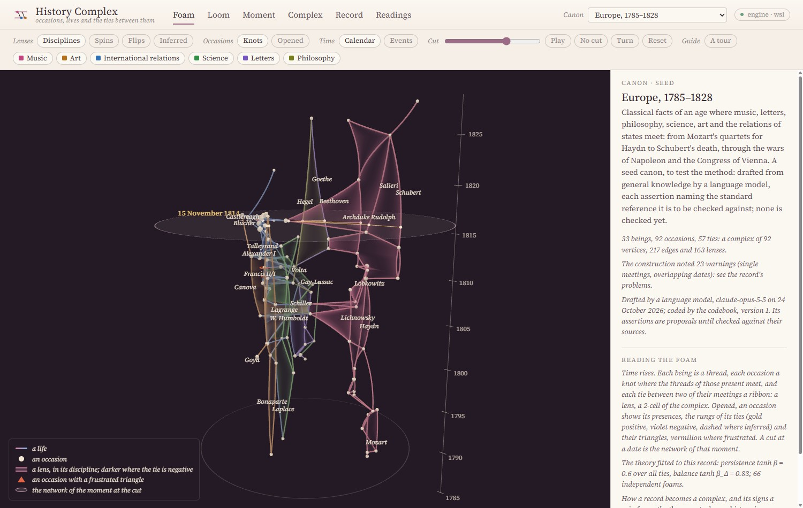</a><br><b>A history as a foam</b>: Europe, 1785–1828, time rising. Each of its 33 beings is a thread, coloured by discipline. Each of its 92 occasions is a knot where the threads of those present meet. Each tie, between two of its meetings, is a film: a lens, a 2-cell of the history complex, here of 92 vertices, 217 edges and 163 lenses. The cut at 15 November 1814, in the Congress of Vienna, is the network of that moment, the boundary of the history up to then. Fitted to the record, persistence is tanh β = 0.60 and balance tanh β_Δ = 0.83, and the complex holds 66 independent spin foams.</td>
<td width="50%" valign="top"><a href="../assets/gallery/history-02-congress-opened.jpg">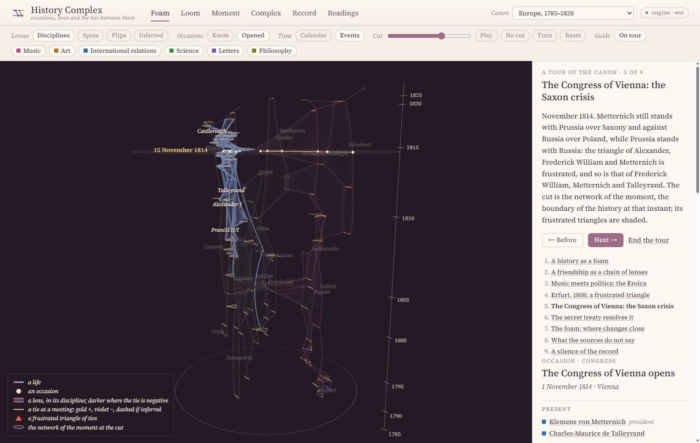</a><br><b>The Congress, opened</b>, on step 5 of the canon's tour, the Saxon crisis of November 1814. Opened, each occasion becomes the presences around it, joined by the rungs of its ties (gold positive, violet negative) and their triangles: the refined complex K̂, where the signs live. The triangle of Alexander I, Frederick William III and Metternich is frustrated, its three signs multiplying to −1, and so is that of Frederick William, Metternich and Talleyrand. The secret treaty of 3 January 1815 resolves them, at the tour's next step.</td>
</tr>
<tr>
<td width="50%" valign="top"><a href="../assets/gallery/history-03-vienna-spin.jpg">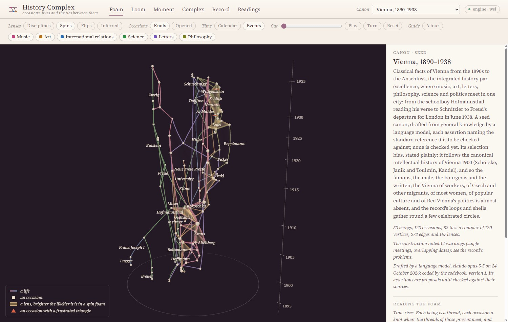</a><br><b>Vienna, 1890–1938, by spin</b>: 50 beings, 120 occasions, 88 ties. The lenses glow where they are likeliest to lie in a spin foam of the fitted theory, P(f ∈ S) = t(⟨h_f⟩ − t)/(1 − t²); the spin j_f ∈ {0, 1} of a cell says whether a change there closes up with others into a surface. Time is the time of events, so a crowded decade takes the height it needs. The foams gather round the Vienna Circle in the late 1920s and round Kraus, Loos, Klimt and Kokoschka before the war; 48 are independent.</td>
<td width="50%" valign="top"><a href="../assets/gallery/history-04-italy-loom.jpg">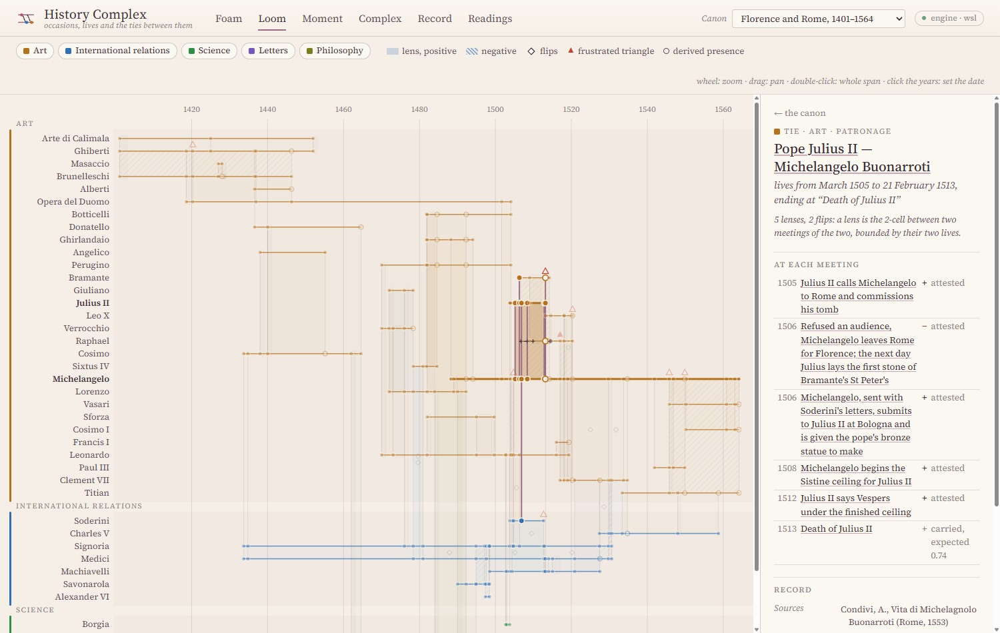</a><br><b>The loom of Florence and Rome, 1401–1564</b>: each being a lane, grouped by discipline; each tie a band between its two lanes, hatched where negative. Julius II and Michelangelo are in focus: five lenses from March 1505 to the pope's death in February 1513, and two flips. The refused audience of 1506 sends Michelangelo back to Florence, and the bronze commissioned at Bologna that year reconciles them. The sign at Julius's death is not attested; it is carried, with expectation 0.74.</td>
</tr>
<tr>
<td width="50%" valign="top"><a href="../assets/gallery/history-05-moment-vienna.jpg">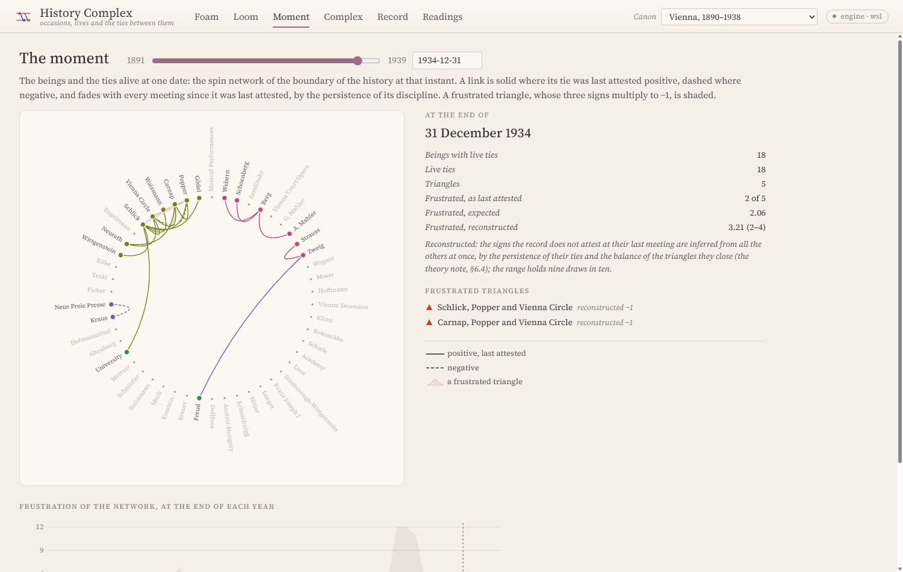</a><br><b>The moment</b>, Vienna at the end of 1934: the beings and ties alive at one date, the spin network on the boundary of the history up to then. A link is solid where its tie was last attested positive, dashed where negative, and fades with the meetings since. Of five triangles, two are frustrated as last attested. The reconstruction infers every unattested sign from all the others at once and finds 3.21, between 2 and 4 in nine draws of ten: Schlick, Popper and the Vienna Circle; Carnap, Popper and the Circle. Beneath, the frustration year by year.</td>
<td width="50%" valign="top"><a href="../assets/gallery/history-06-complexes.jpg">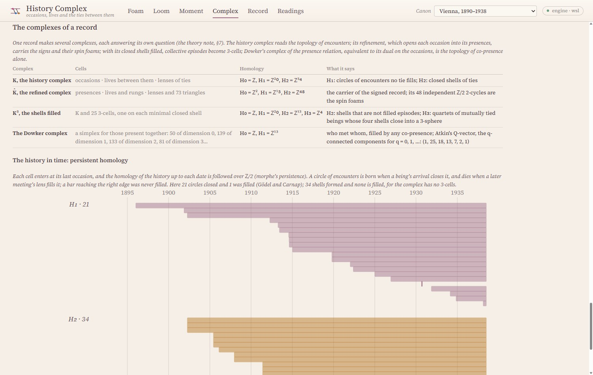</a><br><b>One record, four complexes</b>, for Vienna. The history complex K (H₁ = ℤ²⁰, H₂ = ℤ³⁴). Its refinement K̂, opened at each occasion, which carries the signs: its 48 independent ℤ/2 2-cycles are the spin foams. K³, with 25 closed shells filled by 3-cells (H₃ = ℤ⁴). Dowker's complex of who met whom, with Atkin's Q-vector (1, 25, 18, 13, 7, 2, 1). Beneath, persistent homology in time over ℤ/2, from morphe: 21 circles of encounters close and one is filled, by a meeting of Gödel and Carnap; 34 shells form.</td>
</tr>
<tr>
<td width="50%" valign="top"><a href="../assets/gallery/history-07-readings-foam.jpg">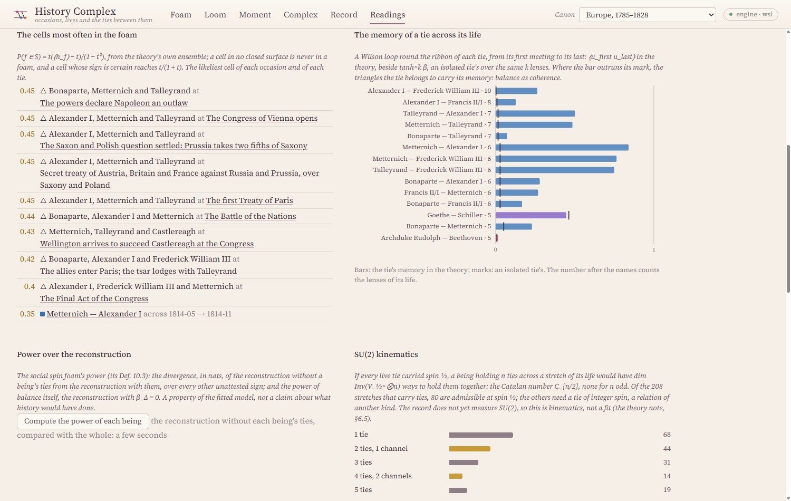</a><br><b>The memory of a tie</b>: a Wilson loop round the ribbon of each tie, ⟨u_first u_last⟩ in the fitted theory, against tanh^k β, an isolated tie's over the same k lenses (the marks). Alexander I and Frederick William III keep 0.26 of their sign across ten lenses, where an isolated tie would keep 0.003; Metternich and Alexander keep 0.84 across six. The triangles a tie belongs to carry its memory: balance as coherence. Left, the likeliest cell of each occasion. No cell exceeds t/(1 + t) = 0.45, the bound that the triangles of the great congresses reach, their balance all but certain.</td>
<td width="50%" valign="top"><a href="../assets/gallery/history-08-integrated.jpg">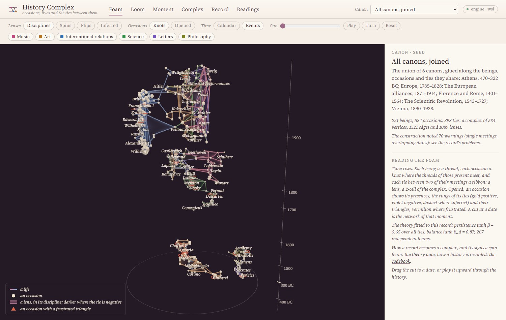</a><br><b>All canons, joined</b>: Athens, Florence and Rome, the Scientific Revolution, Europe 1785–1828, the European alliances and Vienna, in the time of events, so that the empty centuries shrink to nothing. 221 beings, 584 occasions and 398 ties make a complex of 584 vertices, 1521 edges and 1089 lenses, in five components: the alliances and Vienna are glued by Franz Joseph and Austria-Hungary, and the others stand apart until a being crosses between them. Canons share a being only where they agree who it is, by Wikidata item or by name. Alexander the Great and Alexander I of Russia, both <code>alexander</code> in their canons, stay two. The fitted theory has 267 independent foams.</td>
</tr>
<tr>
<td width="50%" valign="top"><a href="../assets/gallery/history-09-power-vienna.jpg">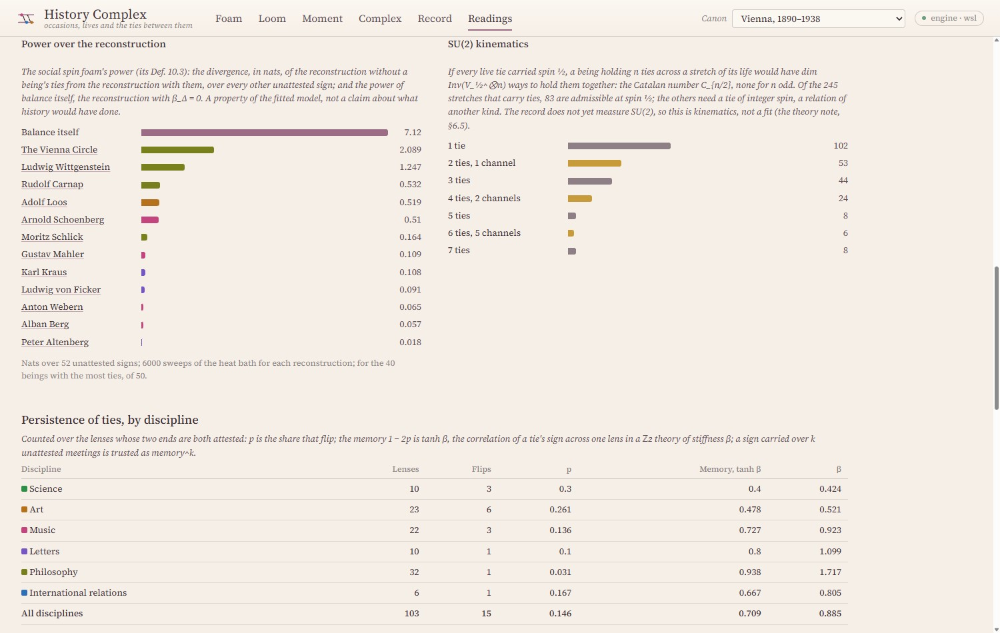</a><br><b>Power over the reconstruction</b>, in Vienna: the divergence, in nats, of the reconstruction without a being's ties from the reconstruction with them, over the 52 signs the record does not attest. Balance itself weighs 7.12 nats; the Vienna Circle 2.09, Wittgenstein 1.25, and Carnap, Loos and Schoenberg about 0.5. It is a property of the fitted model, not a claim about what history would have done. Right, SU(2) kinematics: of 245 stretches of lives that carry ties, 83 could hold them together at spin ½, in dim Inv(V_½^⊗n) ways, a Catalan number.</td>
<td width="50%" valign="top"><a href="../assets/gallery/history-10-science-1676.jpg">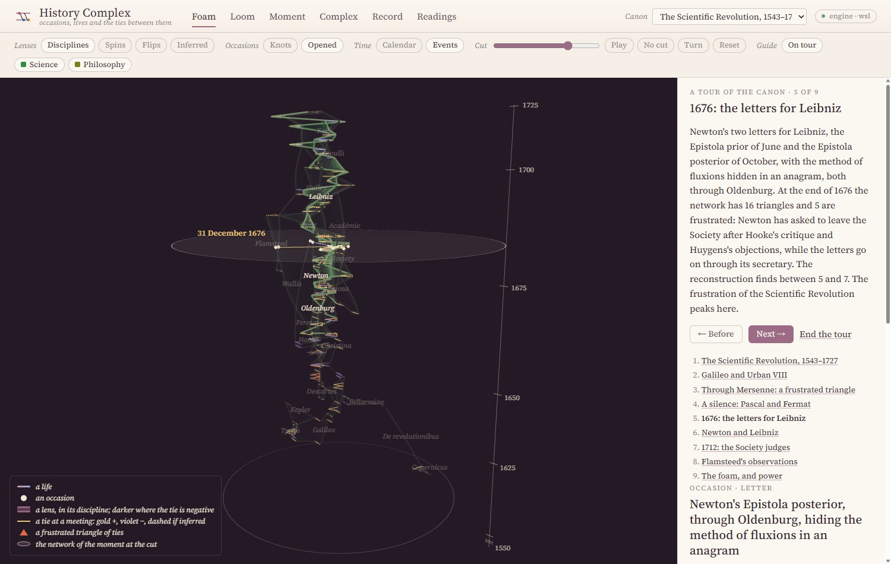</a><br><b>The Scientific Revolution, 1543–1727</b>, on step 5 of its tour: cut at the end of 1676, the occasion of Newton's Epistola posterior opened. Newton's two letters for Leibniz pass through Oldenburg while Newton is at odds with the Society after Hooke's critique and Huygens's objections. Of the moment's 16 triangles, 5 are frustrated, and the reconstruction finds between 5 and 7: the frustration of the canon peaks here. Its dates are written as their sources wrote them, England's in Old Style.</td>
</tr>
<tr>
<td width="50%" valign="top"><a href="../assets/gallery/history-11-athens-loom.jpg">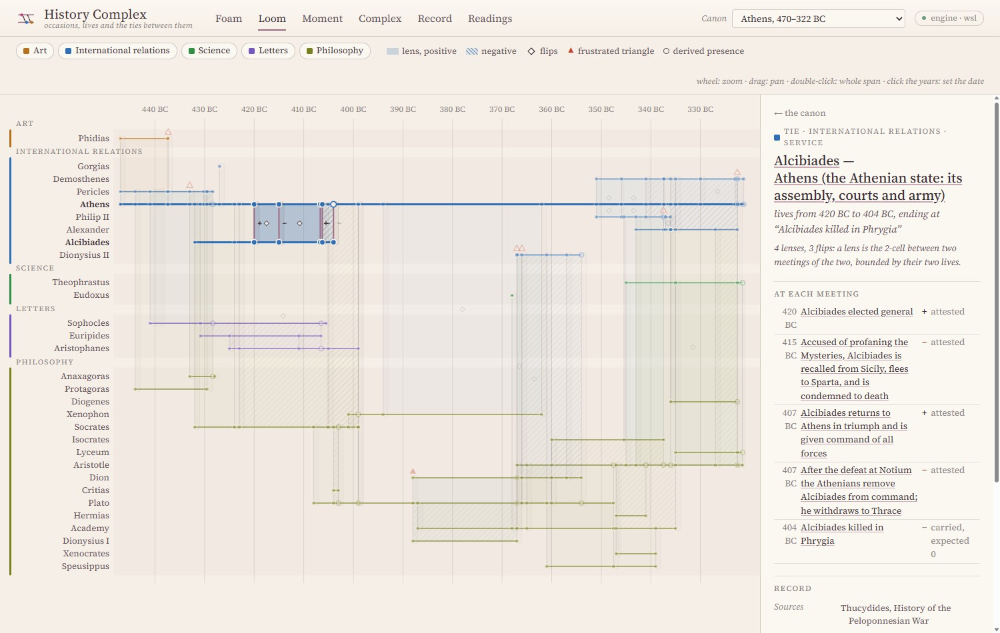</a><br><b>Athens on the loom</b>, 470–322 BC, its years in the Julian calendar. Alcibiades and the city: elected general in 420, recalled from Sicily in 415, returned in triumph in 407, removed after Notium in 406. Four lenses, three flips. In this canon the ties of the city with its men flip more often than not, 13 times in 25 lenses, so their persistence is negative (tanh β = −0.04): a tie without memory, and a signed foam. A reader's dates are read as historians read them, Julian before 1582, so that the canon's years end where the reader's do.</td>
<td width="50%" valign="top"><a href="../assets/gallery/history-12-record-science.jpg">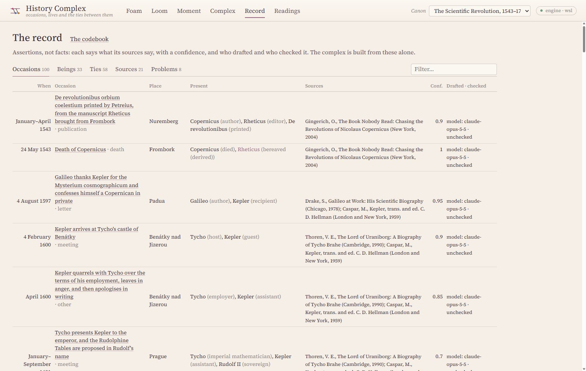</a><br><b>The record</b> behind every picture: assertions, not facts. Each occasion of the Scientific Revolution has its date as its source writes it, its place, the beings present with their roles, the sources it is to be checked against, a confidence, and who drafted and who checked it. Here every line was drafted by a language model and none is yet checked. The codebook fixes the vocabulary, and the domain's checks read every canon against it. The beings can be checked against Wikidata from this view.</td>
</tr>
<tr>
<td width="50%" valign="top"><a href="../assets/gallery/history-13-field-vienna.jpg">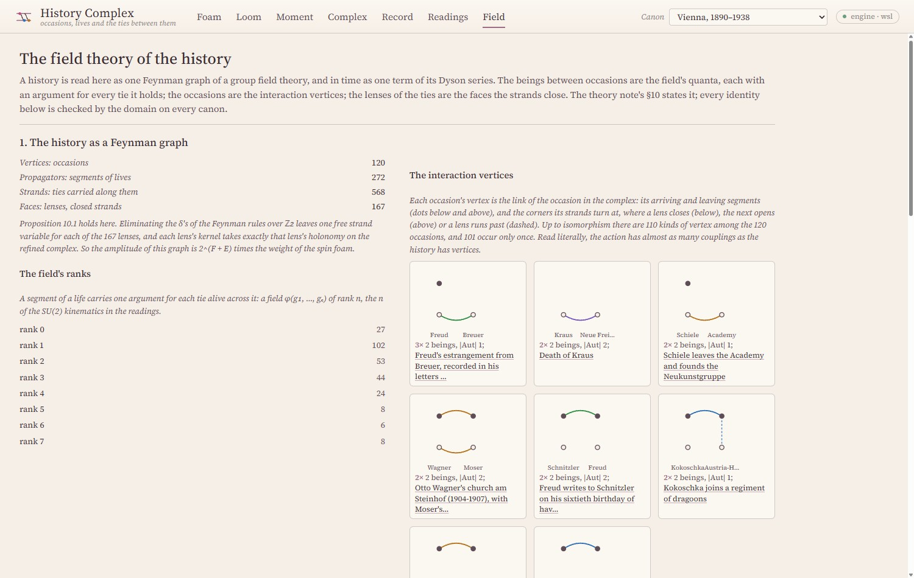</a><br><b>The history as a Feynman graph</b>: Vienna, 1890–1938, in the Field view, read as one Feynman graph of a group field theory over ℤ₂ ([ADR 0042](../development/decisions/0042-the-history-as-a-field-theory.md)). Its 120 occasions are the interaction vertices, its 272 segments of lives the propagators, the 568 ties carried along them the strands, and its 167 lenses the faces the strands close. Eliminating the deltas of the Feynman rules leaves one free variable for each lens, so the graph's amplitude is 2^(F + E) times the weight of the spin foam. The field has ranks 0 to 7, one argument for each tie a life carries. Up to isomorphism there are 110 kinds of vertex among the 120 occasions, 101 of them occurring once: read literally, the action has almost as many couplings as the history has occasions.</td>
<td width="50%" valign="top"></td>
</tr>
</table>

## 7. The Genome Workbench

Genomes drawn and computed with, through the application's C++ engine on the genomics and evolution domains ([ADR 0043](../development/decisions/0043-the-genome-infrastructure.md), [ADR 0045](../development/decisions/0045-the-genome-workbench.md)).

- The genomes are RefSeq's, fetched by the recipe.
- The reads, diploids and genomes marked simulated come from the domain's simulators, which keep their truth, so that every estimate can be read against it.
- Every number in the captions is the engine's own, computed on 24 October 2026 on the development machine.
- The simulations are seeded, so each picture comes back the same.

<table>
<tr>
<td width="50%" valign="top"><a href="../assets/gallery/genome-01-ecoli-origin.jpg">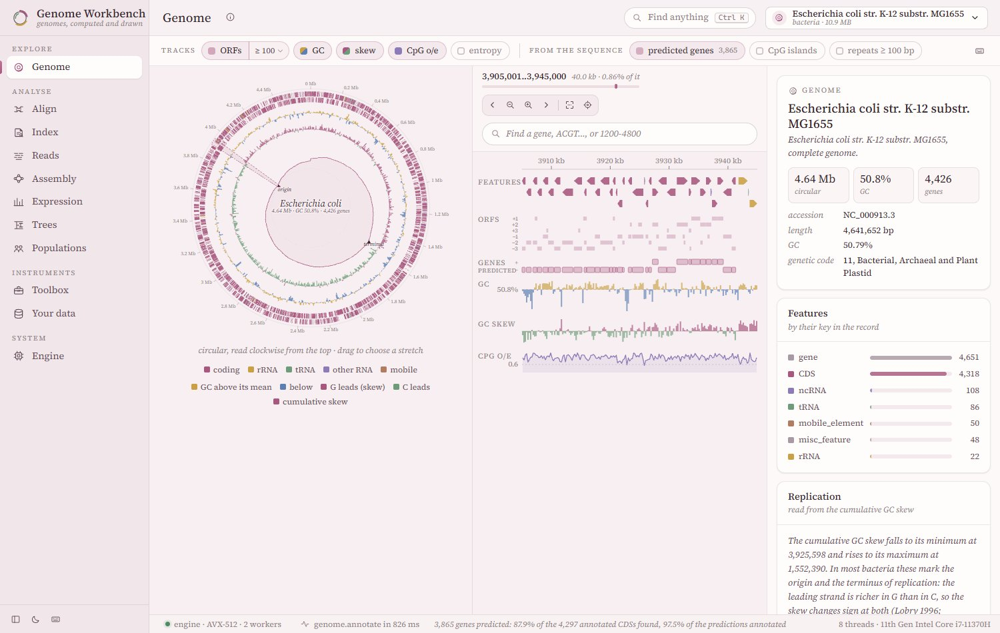</a><br><b>A genome in the round</b>: <i>Escherichia coli</i> K-12 MG1655, 4,641,652 bp. The circle carries its 4,426 genes by strand, GC against its mean, the GC skew, and inside them the cumulative skew. The skew's minimum at 3,925,598 and maximum at 1,552,390 mark the origin and the terminus of replication (Lobry 1996). The strip is opened on 40 kb around the origin, with three tracks: the record's features; the open reading frames of the six frames; and the genes predicted from the sequence alone. The prediction uses periodic Markov chains of coding trained on the genome itself. It gives 3,865 genes: they find 87.9% of the 4,297 annotated CDSs, and 97.5% of them are in the record. Each track is a chip in the colours it is drawn in.</td>
<td width="50%" valign="top"><a href="../assets/gallery/genome-02-wavefronts.jpg">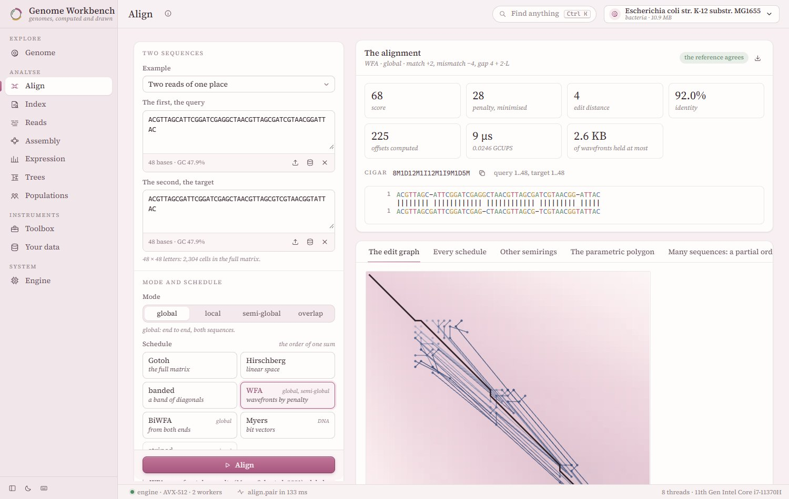</a><br><b>An alignment as a path</b>: two reads of one place, 48 bases each, aligned end to end by the wavefront algorithm (Marco-Sola et al. 2021). Each front joins the furthest cells that paths of one penalty reach on each diagonal, from penalty 0 to the optimum, 28. Under match +2, mismatch −4 and gaps 4 + 2·L, that is a score of 68. The fronts compute 225 offsets where the full matrix, drawn faintly beneath them, has 2,304 cells, and the path they find is Gotoh's optimum. The seven schedules are cards, each one an order of the same sum over the edit graph: the full matrix, linear space, a band, wavefronts from one end or from both, bit vectors, and vector lanes.</td>
</tr>
<tr>
<td width="50%" valign="top"><a href="../assets/gallery/genome-03-backward-search.jpg">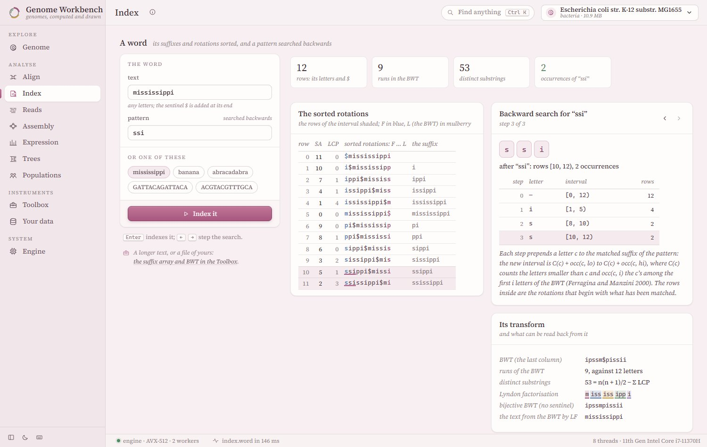</a><br><b>A word, indexed</b>: <i>mississippi</i>. Its 12 rotations are sorted into the suffix array, with the longest common prefix of neighbours. The Burrows–Wheeler transform, ipssm$pissii, is the last column, in 9 runs. The word's 53 distinct substrings are n(n + 1)/2 − Σ LCP. The pattern <i>ssi</i> is searched backwards a letter at a time (Ferragina and Manzini 2000). Each step narrows the interval of rows by C(c) + occ(c, i), ending at rows [10, 12): 2 occurrences. Beneath, the word's Lyndon factors m · iss · iss · ipp · i, and the text read back from the transform. For a genome, the same view counts and places patterns in its FMD-index, and finds the super-maximal exact matches of a read.</td>
<td width="50%" valign="top"><a href="../assets/gallery/genome-04-diploid-called.jpg">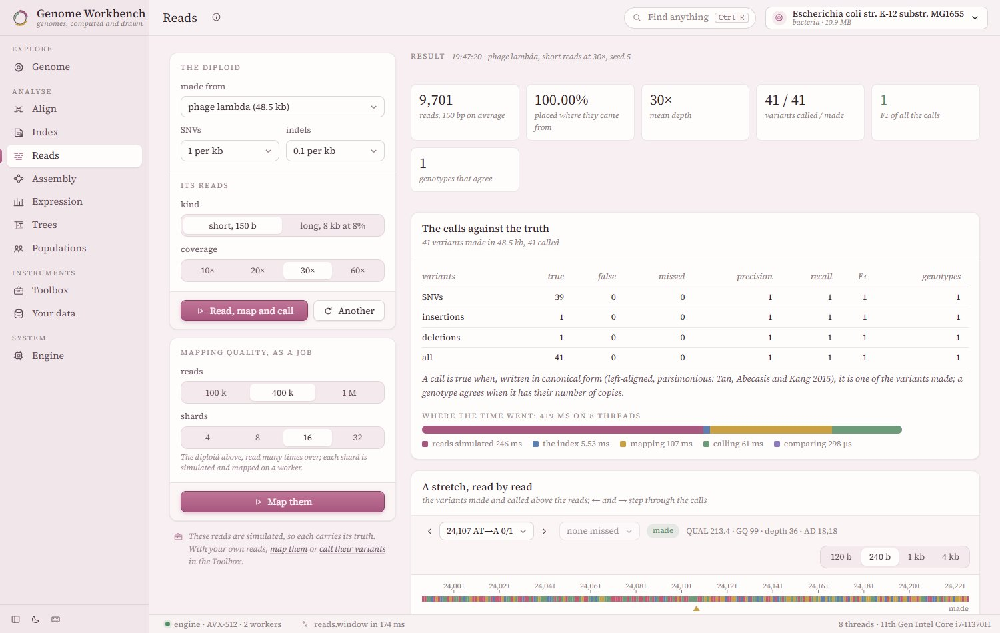</a><br><b>A diploid, read and called</b>. An individual is made from phage lambda, with an SNV every kilobase and an indel every ten. It is read as 9,701 short reads of 150 bases at 30×, and every read is mapped to where it came from. Its variants are called by genotype likelihoods. All 41 variants made are called, none falsely, each with the right genotype: 39 SNVs, an insertion and a deletion, judged in their canonical form (Tan, Abecasis and Kang 2015). The time went to simulating the reads (246 ms), the index, mapping (107 ms) and calling (61 ms). Below the picture, two further panels: the stretch around each call, read by read; and the accuracy of mapping by mapping quality, computed as a job across the workers.</td>
</tr>
<tr>
<td width="50%" valign="top"><a href="../assets/gallery/genome-05-assembly.jpg">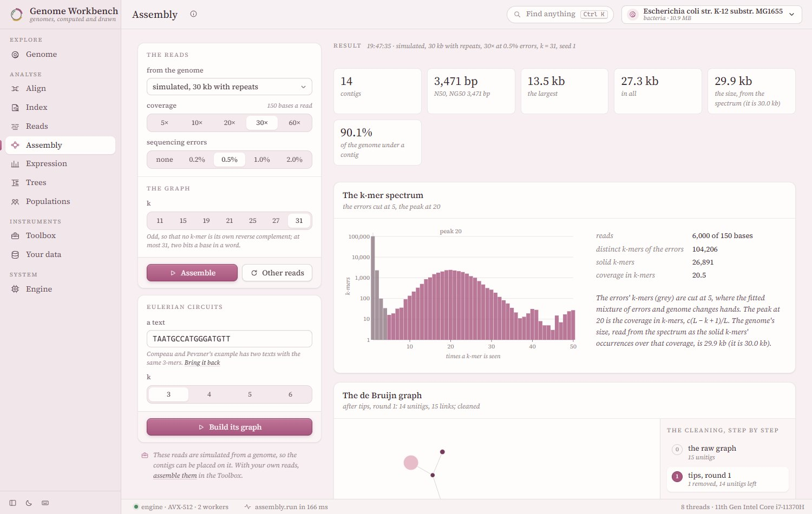</a><br><b>A genome rebuilt from its reads</b>. A simulated genome of 30.0 kb with two repeats is read at 30× with 0.5% errors, and the reads are counted in 31-mers. The spectrum separates the errors' k-mers, cut at 5, from the genome's, which peak at 20, the coverage in k-mers. The genome's size read from the spectrum is 29.9 kb. The de Bruijn graph of the solid k-mers is cleaned step by step of tips, bubbles and weak links. It leaves 14 contigs, N50 3,471 bp, the largest 13.5 kb, covering 90.1% of the genome; contigs end where a repeat longer than k makes the graph branch. Below the picture, the Eulerian trails of a text, counted by the BEST theorem.</td>
<td width="50%" valign="top"><a href="../assets/gallery/genome-06-primate-tree.jpg">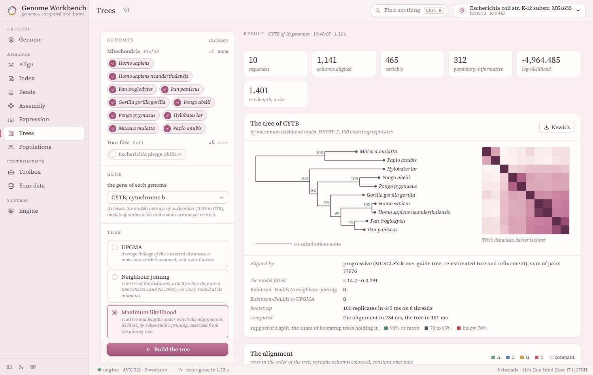</a><br><b>Ten primates on their tree</b>. The cytochrome b gene of each of ten mitochondrial genomes is read from its record and aligned progressively: 1,141 columns, 465 variable, 312 parsimony-informative. The genes are placed on a tree by maximum likelihood under HKY85 with four Γ rates: κ 14.7, α 0.291, log-likelihood −4,964.485. The tree's branches are supported by 100 bootstrap replicates, run on eight threads. The great apes, the gibbon and the Old World monkeys fall apart as they should. Beside the tree are the corrected distances, in its order. The genomes are chosen as chips, and a GenBank file of one's own joins them.</td>
</tr>
<tr>
<td width="50%" valign="top"><a href="../assets/gallery/genome-07-toolbox-alignment.jpg">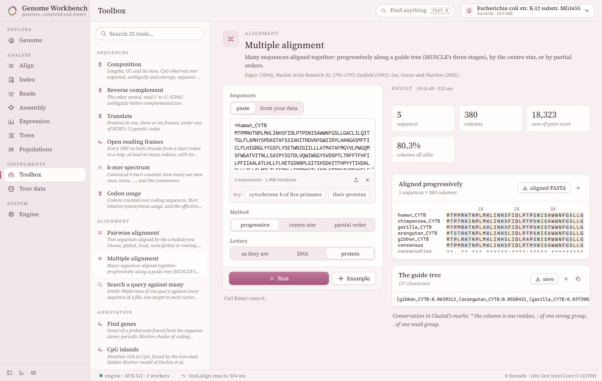</a><br><b>The Toolbox</b>: every instrument for one's own sequences and files, grouped by subject, each a form built from the tool's declared inputs. Here is its multiple alignment, run on its example: the cytochrome b proteins of human, chimpanzee, gorilla, orangutan and gibbon, read from RefSeq. They are aligned progressively along a guide tree (Edgar 2004), into 380 columns, 80.3% of them alike in all five, with the consensus and Clustal's marks of conservation. Each result can be saved, or kept in Your data for the next tool. The tools used lately stand at the top of the list.</td>
<td width="50%" valign="top"><a href="../assets/gallery/genome-08-toolbox-tree.jpg">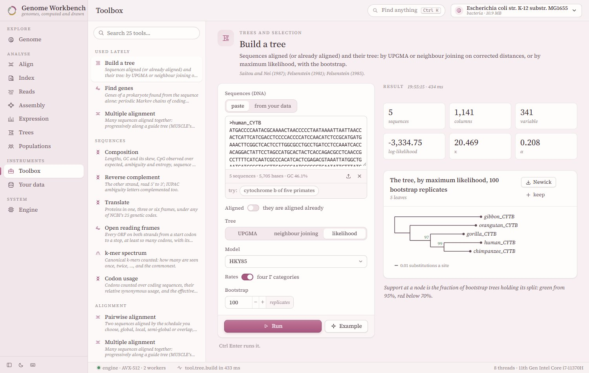</a><br><b>A tree from sequences of one's own</b>. The five cytochrome b genes (5,705 bases) are pasted, or given as a FASTA file. They are aligned and placed on a tree by maximum likelihood under HKY85 + Γ, with 100 bootstrap replicates: 1,141 columns, 341 variable, log-likelihood −3,334.75, κ 20.5, α 0.208. Human and chimpanzee join first, with support 99, then the gorilla, with 97. The form is the tool's schema: a choice of tree, a model, a switch for the rates and a number of replicates.</td>
</tr>
<tr>
<td width="50%" valign="top"><a href="../assets/gallery/genome-09-palette.jpg"></a><br><b>Finding anything</b>: the command palette (Ctrl K), open over Your data. One box finds the views, the tools, the genomes, one's files and the commands. It also reads what is typed where it can: a range as a stretch of the genome, a word of DNA as a motif to find on both strands, and a name as a gene. Behind it are the files dropped on the page: FASTA, FASTQ, GenBank, VCF, Newick or SAM, plain or gzipped. Each is recognised by its content and summarised, then opened as a genome or handed to the tools that take its kind. The files here are simulated reads, transcripts and a population's variants, made by the domain's simulators to test the tools.</td>
<td width="50%" valign="top"><a href="../assets/gallery/genome-10-engine.jpg">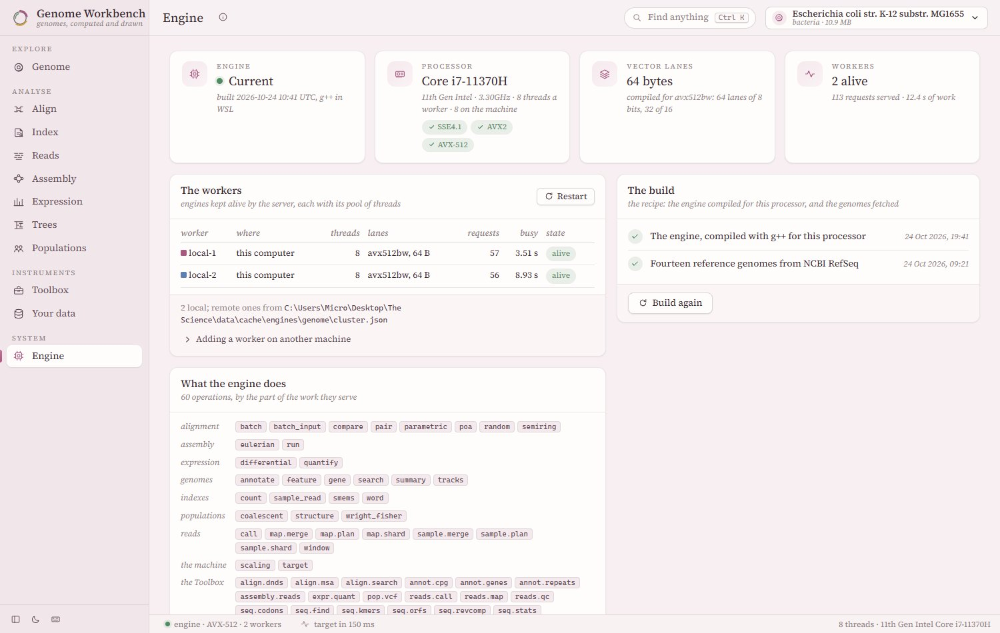</a><br><b>The engine</b>. Its build is current, compiled with g++ for this processor (AVX-512, 64-byte vector lanes). Two workers are kept alive by the server, each with a pool of eight threads, beside the recipe. The engine's 60 operations are grouped by the part of the work they serve, the Toolbox's among them. Below the picture are three measurements: a job cut into shards across the workers, on a timeline; the speed-up by threads; and the browser's GPU scoring alignments against the CPU's three schedules. Workers on other machines join by a command written once.</td>
</tr>
<tr>
<td width="50%" valign="top"><a href="../assets/gallery/genome-11-night.jpg">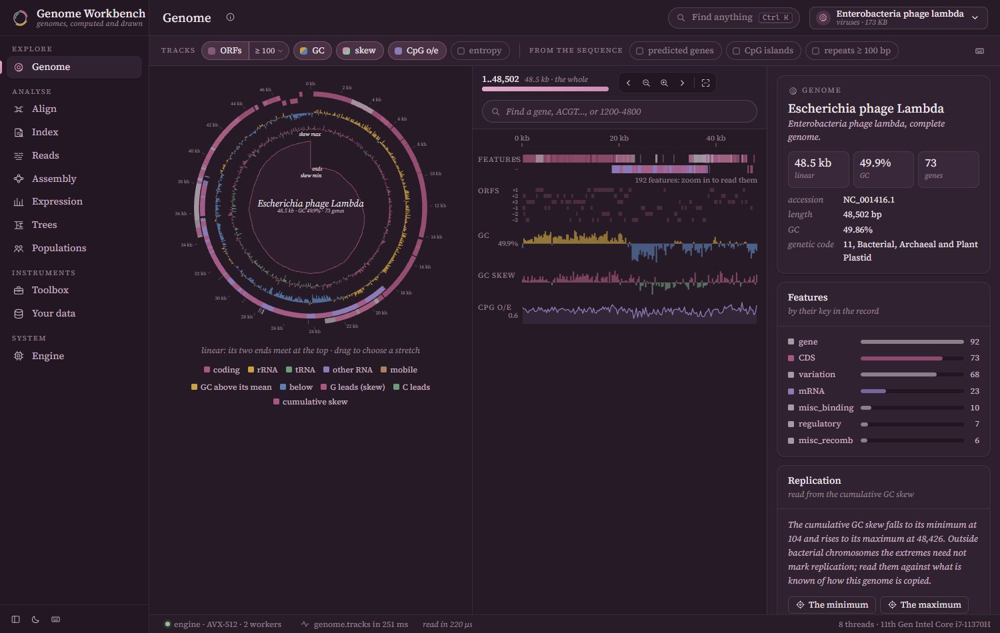</a><br><b>By night</b>: phage lambda, 48,502 bp, linear, its two ends meeting at the top of the circle, with 192 features, 73 of them CDSs. The workbench's colours are tokens: mulberry on blush paper by day, and on plum by night, with the bases in softened conventional colours. Outside bacterial chromosomes, the extremes of the cumulative skew need not mark replication, and the card says so.</td>
<td width="50%" valign="top"></td>
</tr>
</table>

## 8. The Economy Atlas

Value carried between places and through time, through the application's C++ engine on the economics domain ([ADR 0044](../development/decisions/0044-value-in-space-and-time.md), [ADR 0046](../development/decisions/0046-the-economy-atlas-data-and-plugins.md), [the theory note](../domains/economics/theory/value-in-space-and-time.md)), in its ledger of gold by day and by night.

- The trade is the OECD's Balanced International Merchandise Trade Statistics, adjusted for re-exports; the exchange rates and the euro's deposit facility rate are the ECB's, and the other policy rates the BIS's. The towns of the last picture, and their flows, are invented.
- Every number in the captions is the engine's own, or a plug-in's, computed on 24 October 2026 on the development machine.
- Nothing is sampled: each picture comes back the same from its link.

<table>
<tr>
<td width="50%" valign="top"><a href="../assets/gallery/economy-01-world-2024.jpg">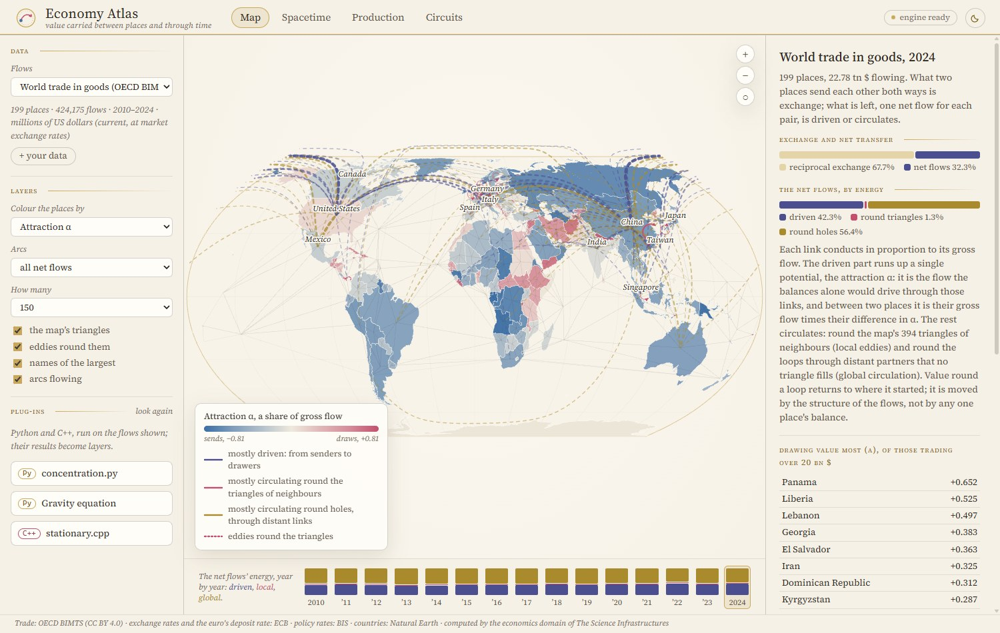</a><br><b>The world's trade, 2024</b>: 199 economies and 22.78 tn $ of exports of goods (the OECD's balanced statistics, adjusted for re-exports). 67.7% is reciprocal exchange, what two economies send each other both ways. The rest, one net flow for each of 15,754 pairs, is decomposed on the 394 spherical Delaunay triangles of the economies' places, each link conducting its gross trade. Countries are coloured by their attraction α, a share of gross trade, from steel blue (value sent out) to rose (value drawn in): the exporters of oil, gas and ores send most (Angola −0.75, Qatar −0.67, Russia −0.55). The arcs are the 150 largest net flows, each in the colour of its largest part, indigo where the balances drive it and gold where it circulates through distant links. The balances drive 42.3% of the net flows' energy; 56.4% circulates through distant links and 1.3% round the triangles. The strip beneath gives the same shares for every year from 2010.</td>
<td width="50%" valign="top"><a href="../assets/gallery/economy-02-circulation-2024.jpg">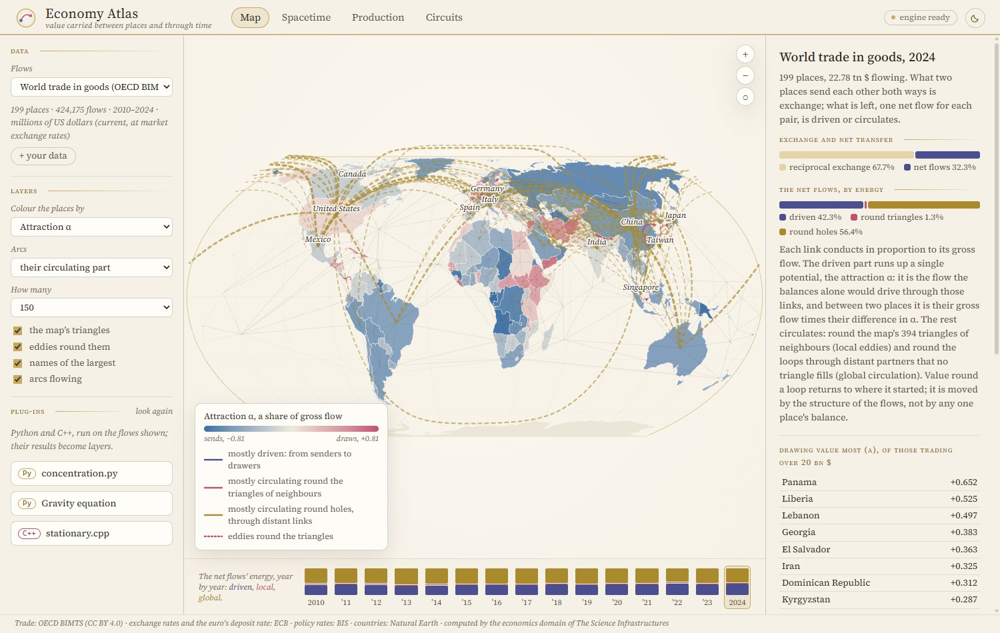</a><br><b>What circulates</b>: the same year, the arcs now the circulating part of each net flow, what no balance explains, value that comes back round a loop. Most of it runs between the industrial centres of the three continents and through the long links to South America and Australia. Round the triangles of neighbours, the largest eddy runs Korea → Taiwan → China → Korea, 26.2 bn $, and Belgium, Germany and the Netherlands turn 11.8 bn $.</td>
</tr>
<tr>
<td width="50%" valign="top"><a href="../assets/gallery/economy-03-united-states.jpg">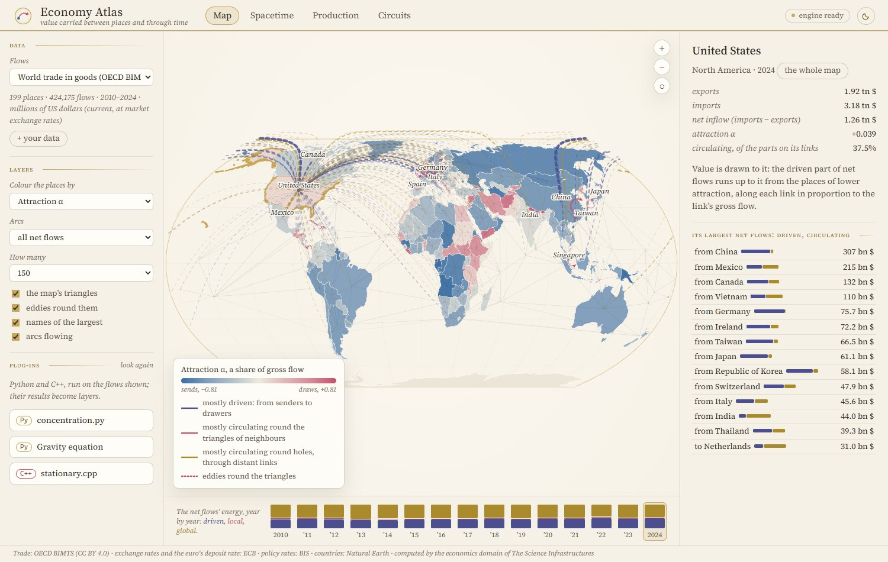</a><br><b>The United States, 2024</b>: 1.92 tn $ of exports, 3.18 tn $ of imports, a net inflow of 1.26 tn $. Its attraction is +0.04, near the world's middle: value is driven to it less by its own pull than by its partners' push. From China come 306.7 bn $ net, of which 279.2 bn $ is driven, the two economies' gross trade times their difference in attraction, 0.465, and 27.5 bn $ circulates. Of the parts of the flow from Mexico, 215 bn $, half circulate.</td>
<td width="50%" valign="top"><a href="../assets/gallery/economy-04-china.jpg">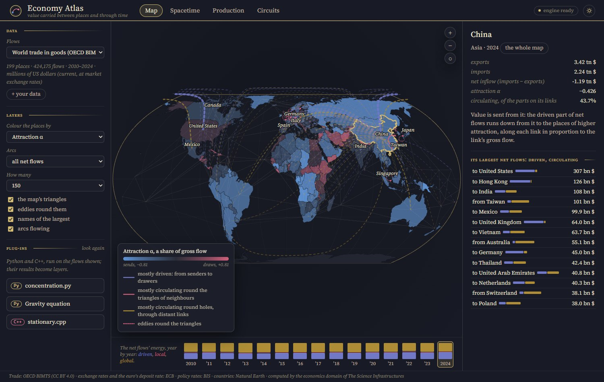</a><br><b>China, 2024, by night</b>: 3.42 tn $ of exports, 2.24 tn $ of imports, 1.19 tn $ sent out net. Its attraction, −0.43, is the lowest of the large economies (Germany's is −0.26). Its net flows run out to the United States, Hong Kong, India and Mexico. Beside each, its card draws the share of it driven (indigo) and circulating (gold). Of what comes to it from Taiwan (101 bn $) and Australia (55 bn $), 84% and 89% of the parts circulate: China's balance does not explain them. The night is the system's choice, or the reader's.</td>
</tr>
<tr>
<td width="50%" valign="top"><a href="../assets/gallery/economy-05-driven-2010.jpg">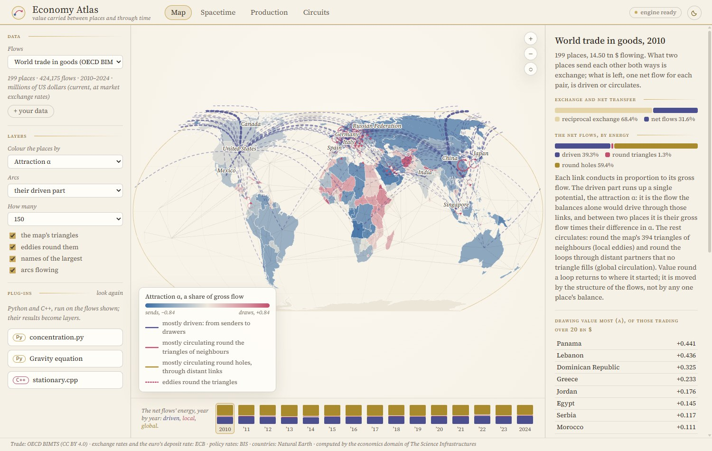</a><br><b>The driven part, 2010</b>: 14.50 tn $ of exports, 68.4% of them reciprocal. The arcs show only what the balances drive, 39.3% of the net flows' energy that year, against 42.3% in 2024. Panama, Lebanon, the Dominican Republic and Greece drew most among the economies trading over 20 bn $; Qatar (−0.80), Kuwait, Angola and Saudi Arabia sent most. Panama leads in most years, and Liberia lately: ships built abroad for owners registered under their flags are recorded as goods exported to them.</td>
<td width="50%" valign="top"><a href="../assets/gallery/economy-06-currencies.jpg">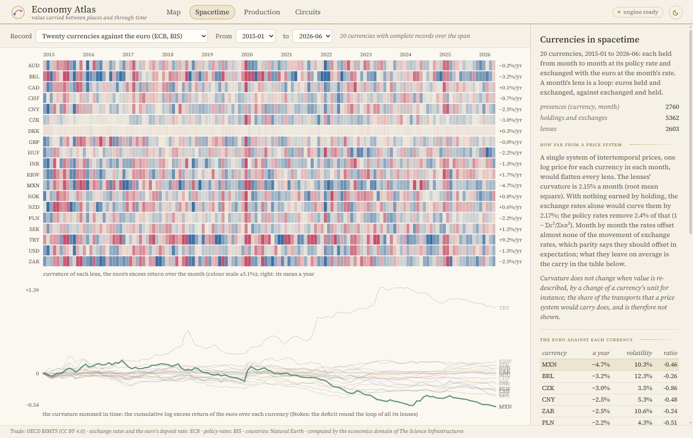</a><br><b>Twenty currencies in spacetime</b>, January 2015 to June 2026. Each is held month by month at its central bank's policy rate, the euro at the ECB's deposit facility rate, and exchanged with the euro at the month's average rate: 2,760 presences, 5,362 holdings and exchanges, 2,603 lenses. Each cell is a lens's curvature, the euro's excess return over a currency in a month, the departure from uncovered interest parity, from steel blue to rose. The policy rates remove only 2.4% of the curvature the exchange rates alone would make (2.15% against 2.17% a month). The lines sum it in time. The Mexican peso is drawn out: its rate averaged 7.0% against the euro's 0.7%, and though it fell from 17.08 to 20.01 per euro, holding it beat holding euros by 4.7% a year, a factor of 1.72 over the span.</td>
</tr>
<tr>
<td width="50%" valign="top"><a href="../assets/gallery/economy-07-production-cycle.jpg">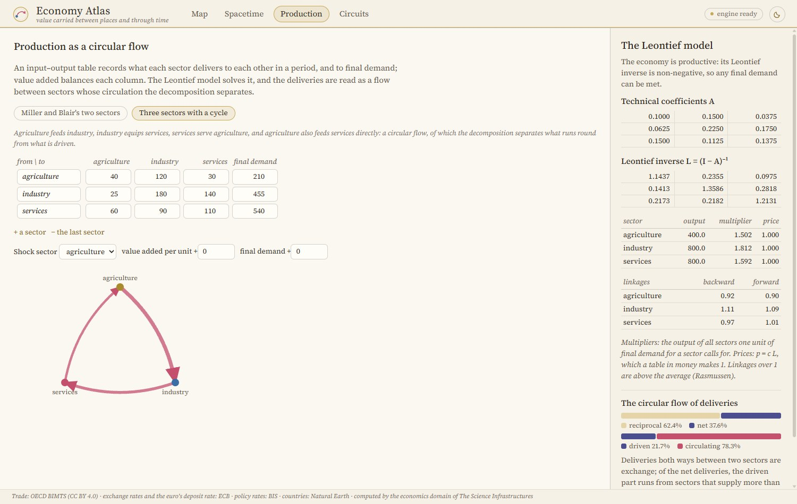</a><br><b>Production as a circular flow</b>: three sectors, agriculture feeding industry, industry equipping services, services serving agriculture, and agriculture also feeding services directly. The Leontief model solves the table: it is productive, and a unit of final demand for industry calls for 1.81 units of output in all. Of the deliveries, 62.4% are exchanged both ways. Of the net deliveries' energy, 78.3% circulates round the cycle and 21.7% is driven: production runs round its own loop.</td>
<td width="50%" valign="top"><a href="../assets/gallery/economy-08-five-positions.jpg">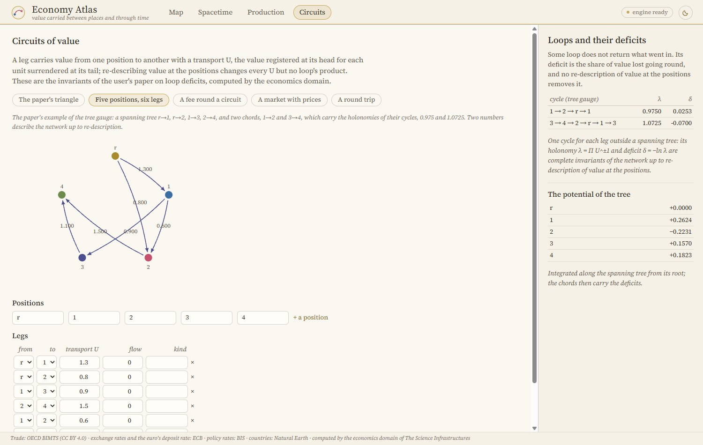</a><br><b>The invariants of a network</b>: the five positions and six legs of the user's paper on loop deficits. A spanning tree from r leaves two chords, whose cycles carry the holonomies λ = 0.975 and 1.0725: value carried round the first loses 2.5% (a deficit δ = 0.0253), round the second gains 7.25% (δ = −0.0700). Every re-description of value at the positions changes the transports, but not these two numbers; beside them, the potential of the tree.</td>
</tr>
<tr>
<td width="50%" valign="top"><a href="../assets/gallery/economy-09-gravity.jpg">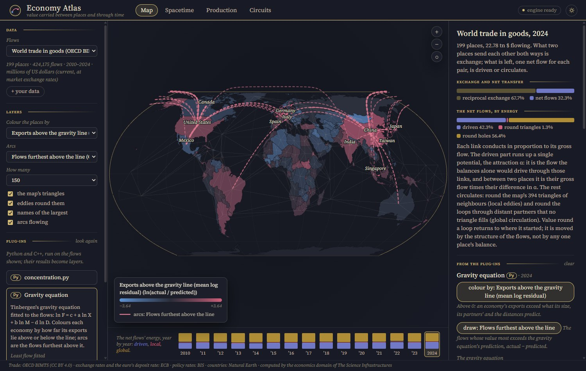</a><br><b>A plug-in: the gravity equation</b>, a Python script in the atlas's plugins/, run from its card on the map of 2024. Tinbergen's equation, ln F = c + a ln X + b ln M − d ln D, is fitted by least squares over 16,866 flows: a = 0.802 ± 0.006, b = 0.802 ± 0.006 and a distance elasticity d = 0.988 ± 0.014, near the literature's usual 1, with R² = 0.63. Its results became layers. The economies are coloured by how far their exports lie above or below the line, China +1.70 and the United States +1.04, Mexico −0.78. The rose arcs are the flows furthest above it: Mexico → United States (495 bn $, 16 times the prediction), China → United States (454 bn $, 24 times), Canada → United States (413 bn $). Its table and notes are in the panel. The same contract runs C++, which may use the economics domain itself.</td>
<td width="50%" valign="top"><a href="../assets/gallery/economy-10-your-towns.jpg">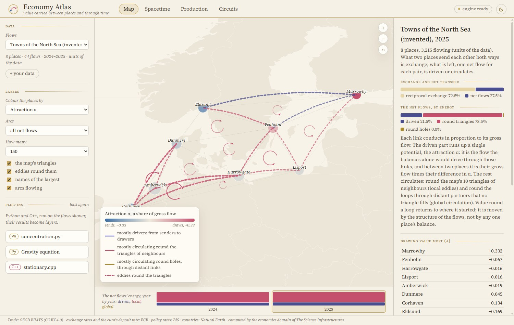</a><br><b>Data of one's own</b>: eight towns on the North Sea and the Baltic, and their flows in 2024 and 2025, given as two CSV files through + your data. Every number is invented, to try the formats (the atlas's examples/). The map fits their region, draws them as circles by their flows, and decomposes their flows as it does the world's. Of 3,215 (units of the data) in 2025, 72.5% is exchanged both ways. Of the net flows' energy, 78.5% turns round their 10 triangles, the rose eddies, and 21.5% is driven, from Eldsund (−0.17) to Marrowby (+0.33). With no long link across a hole, nothing circulates globally.</td>
</tr>
</table>

## 9. Cosmopoiesis

The Solar System as one world, with its addresses, its instruments, its fields, what lies beneath its ground and its seas, and the robots that move on them. It runs through the work's C++ engine on the domains of time, the Earth and the sky, planetary science, robotics and the solid Earth, and on physis, tyche and calx ([ADR 0049](../development/decisions/0049-the-spacetime-of-the-earth-and-the-moon.md), [ADR 0050](../development/decisions/0050-instruments-and-their-acquisition.md), [ADR 0052](../development/decisions/0052-fields-known-in-part.md) to [ADR 0055](../development/decisions/0055-the-earth-beneath.md); the work's [decisions 0002–0010](../applications/cosmopoiesis-lab/development/decisions/) and [formalism](../applications/cosmopoiesis-lab/docs/formalism.md)). Its console is in pink and purple, drawn as a precision instrument (its decision 0009), by night and by day.

- The bodies are placed and turned by JPL's DE440, the IAU's rotation models, IAU 2006/2000A and the IERS's Earth orientation; the satellites by SGP4 on CelesTrak's elements.
- The instant is the present, 30 October 2026, between 00:32 and 04:42 UTC. The readings of space weather are SWPC's of that hour, observed, and the others are the engine's models; each is marked by its provenance.
- Every number in the captions is the engine's own, or a feed's.

### 9.1 One World, Its Addresses and Its Instruments

The world at the present from Greenwich to Saturn, any point written in one line and answered in every frame, and the machinery beneath: the catalogue of frames, and the schedule of the instruments.

<table>
<tr>
<td width="50%" valign="top"><a href="../assets/gallery/cosmo-01-earth-console.jpg">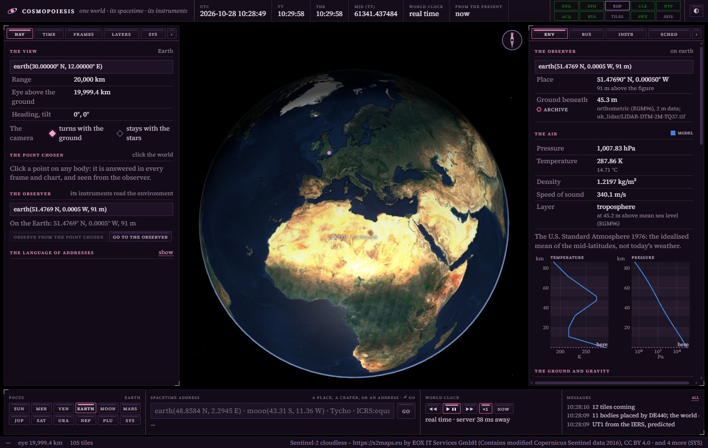</a><br><b>The console over the Earth, by night</b>. Across the top run the clocks and the engine's lamps. NTP's lamp is amber: this computer's clock is 0.8 s behind UTC, and the console says so. Beneath them, the context bar keeps five things apart: what is looked at, the Earth from 20,000 km; the point chosen; the observer, which follows it; the frame; and where the instruments are mounted, 12 on the observer and 9 elsewhere, with 9 feeds. The point is Greenwich, 92 m above WGS 84, 8.5 km from London. The observer stands there on the ground, which is 45.3 m above mean sea level by the UK's 2 m LIDAR (an archive's reading, the hollow mark). Its air is the 1976 standard atmosphere's at 46 m above the geoid: 1,007.71 hPa, 287.85 K, 1.2196 kg/m³, and sound at 340.1 m/s. The profiles of temperature and pressure run to 86 km, the observer's height marked. Dawn is reaching Arabia.</td>
<td width="50%" valign="top"><a href="../assets/gallery/cosmo-02-time-and-environment.jpg">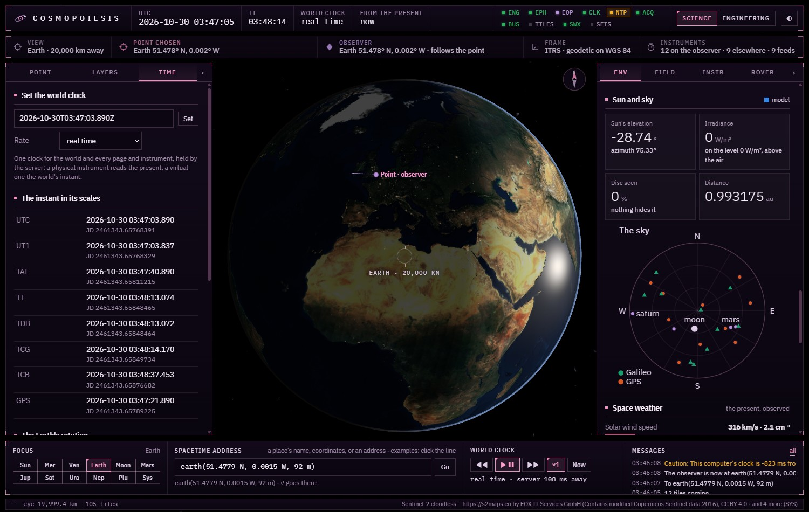</a><br><b>The instant and the sky</b>. The instant is 03:47:03.890 UTC, in eight scales. UT1 is 53.3 ms behind (the IERS's Bulletin A, predicted). TAI is 37 s ahead, TT a further 32.184 s, and TDB 1.490 ms behind TT. The coordinate times TCG and TCB have run ahead of TT since 1977, by 1.1 s and 24.4 s. At Greenwich the Sun is 28.74° below the horizon, at azimuth 75.33°, and 0.993175 au away. Above the horizon are the Moon, Mars, Saturn and the GPS and Galileo satellites. Beneath is space weather as observed: the solar wind at L1 at 316 km/s with 2.1 cm⁻³.</td>
</tr>
<tr>
<td width="50%" valign="top"><a href="../assets/gallery/cosmo-03-solar-system.jpg">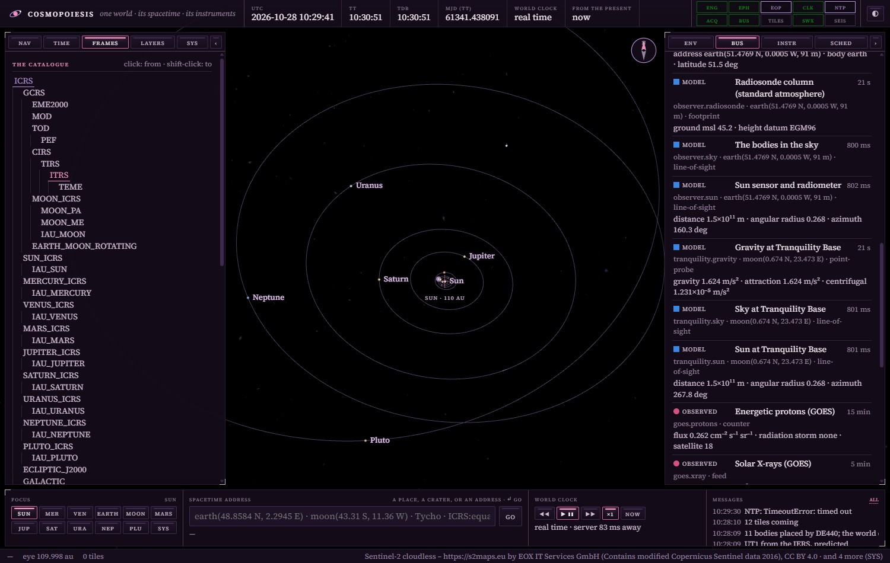</a><br><b>The Solar System, 110 au across</b>, on the engineering deck. Each orbit is one period of the body's own path in DE440. On the left is the catalogue of frames as one tree from the ICRS: the Earth's chain to the ITRS and TEME, the Moon's frames, each planet's centre and IAU frame. On the right is the bus, every stream of readings with its provenance and its age. The planetary K index is 0.67, quiet, three and a half hours old. The solar wind at L1 blows at 323 km/s with 1.3 cm⁻³, eight minutes old. GOES's X-rays are of class B2.5. Beneath them is an event that did not wait for a tick: an earthquake of magnitude 4.4 near Tambolaka, Indonesia, from the USGS.</td>
<td width="50%" valign="top"><a href="../assets/gallery/cosmo-04-saturn.jpg">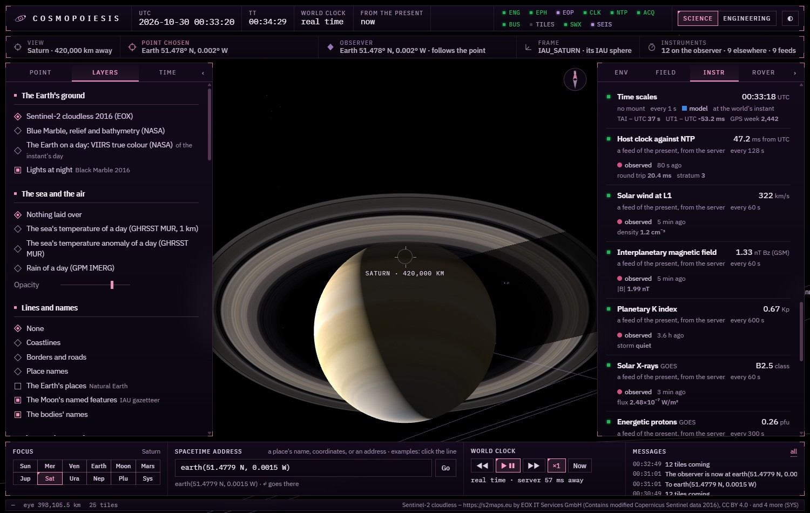</a><br><b>Saturn, 420,000 km out</b>, reached by a flight from the system's view. The planet and its rings carry Solar System Scope's maps, and the dark band across the rings is the planet's shadow. On the left are the layers. On the right are the instruments, readings first; here are the feeds of the present, each with its source, period, provenance and age. By NTP, the host's clock is 47.2 ms from UTC (stratum 3, a round trip of 20.4 ms). The solar wind blows at 322 km/s, and the interplanetary field's B<sub>z</sub> is +1.33 nT of |B| 1.99 nT. The K index is 0.67. The Sun's X-rays are of class B2.5, and the protons above 10 MeV are at 0.26 pfu, with no radiation storm.</td>
</tr>
<tr>
<td width="50%" valign="top"><a href="../assets/gallery/cosmo-05-mars.jpg">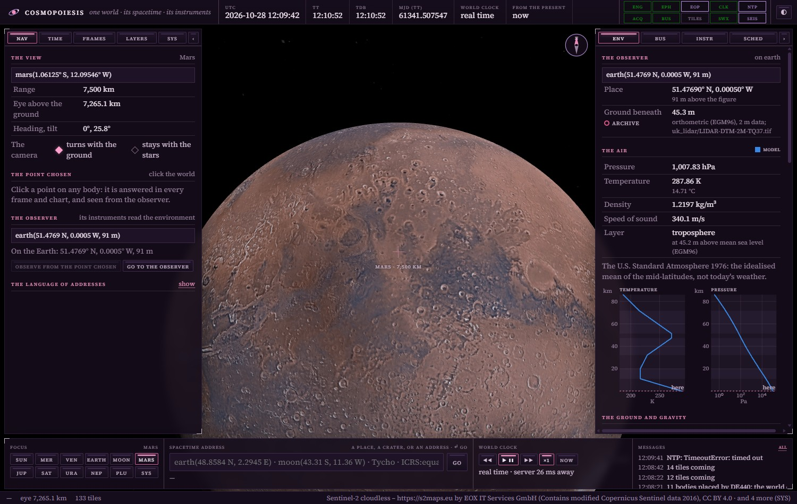</a><br><b>Mars by day</b>, 7,500 km above 0.76° S, 175.60° E. The viewpoint is taken on the Sun's side of the planet, from its own state. Its map is Solar System Scope's, with NASA Trek's Viking colour mosaic in finer detail as one comes near, lit by the Sun's direction at the instant. The console is on lilac paper. The observer and its air stay at Greenwich: a body in focus is where the camera is, not where the instruments are, and the context bar keeps the two apart.</td>
<td width="50%" valign="top"><a href="../assets/gallery/cosmo-06-tycho.jpg">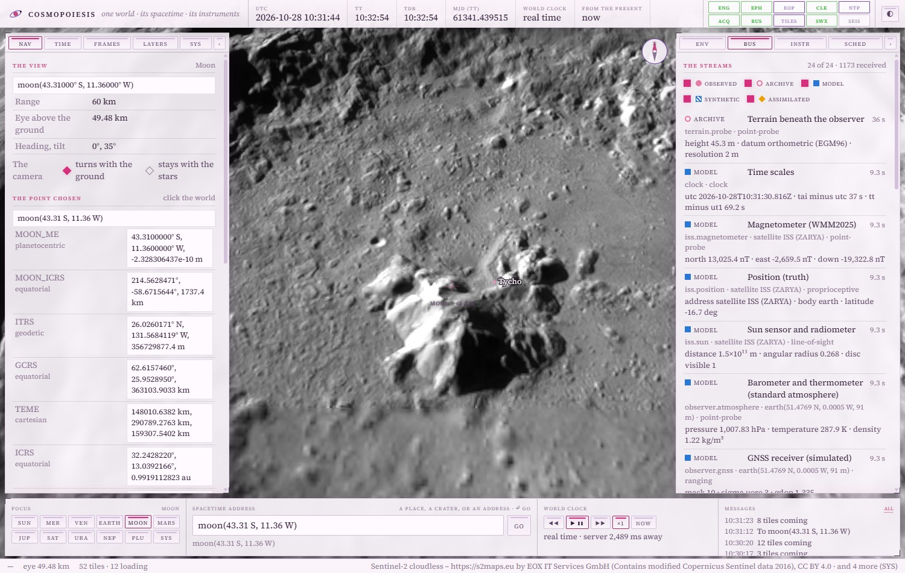</a><br><b>Tycho, by day</b>. The address <code>moon(43.31 S, 11.36 W)</code> was typed, and the camera stands 60 km from the crater's central peak, on LOLA's heights and LRO's mosaic. On the left, the point is answered in every frame of the catalogue. In MOON_ICRS it lies at 244.63°, −64.04°, 1,737.4 km. In the ITRS it is 27.55° N, 40.16° E, 357,677 km above WGS 84: the crater stood over Arabia. It is 364,051 km from the geocentre in the GCRS, and 0.99081 au from the barycentre in the ICRS. The observer follows the point chosen, so its environment, on the right, is the Moon's. Its ground lies 1,562.9 m below the Moon's sphere of 1,737.4 km (LOLA at 237 m, an archive's reading, the hollow mark), and gravity there is 1.62421 m/s². Beneath, the section along a geodesic draws LOLA's surface across 1,500 km and says what is missing: the seismic column reads only on the Earth, and no model of the Moon's interior is in the world yet.</td>
</tr>
<tr>
<td width="50%" valign="top"><a href="../assets/gallery/cosmo-07-address-from-fuji.jpg">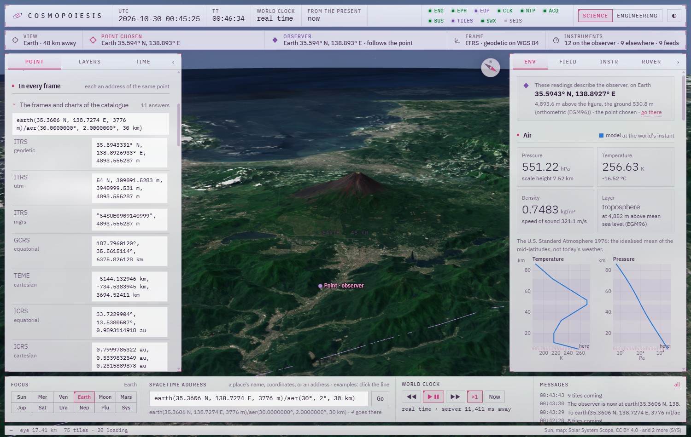</a><br><b>An address with a step</b>: <code>earth(35.3606 N, 138.7274 E, 3776 m)/aer(30°, 2°, 30 km)</code>, a point 30 km from the summit of Fuji at azimuth 30°, 2° up. The engine resolves it to 35.59433° N, 138.89269° E, 4,893.6 m above WGS 84. In UTM it is zone 54 N, 309,091.53 m east and 3,940,999.53 m north, and in MGRS 54SUE0909140999. It is answered in the GCRS, TEME and the ICRS too. The camera stands 48 km away and looks back south-west at the mountain, on Sentinel-2 cloudless and Terrarium's heights. The observer follows the point. Its air is the standard atmosphere's at 4,852 m above mean sea level: 551.22 hPa and 256.63 K. The ground beneath it lies 530.8 m above mean sea level.</td>
<td width="50%" valign="top"><a href="../assets/gallery/cosmo-08-loops-and-schedule.jpg">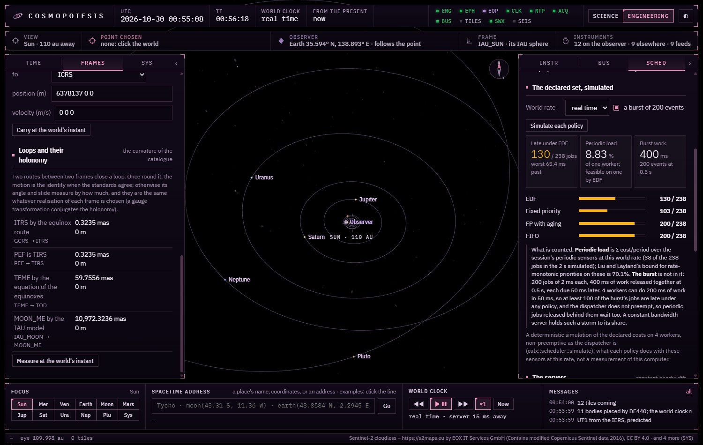</a><br><b>The catalogue's loops, and the schedule</b>. A loop is two routes between two frames, and its holonomy is the motion once round it. It is the same whatever realisation of each frame is chosen. The CIO and equinox routes to the ITRS agree to 0.3235 mas. GMST 1982 departs from IAU 2006 by 59.7556 mas in TEME. The IAU's model of the Moon and DE440's frame differ by 10,972.3 mas (11.0″). On the right, the declared set is simulated with a burst of 200 events of 2 ms, released together and due within 50 ms. Its periodic load is 8.83% of one worker, feasible by EDF. With the burst, EDF leaves 130 of 238 jobs late, fixed priority 103, and fixed priority with aging, or plain order, 200. Four workers can do only 200 ms of work in 50 ms, so at least 100 of the burst's jobs are late under any policy. This is what a storm of events does without the server that holds it to 2 s in every 10.</td>
</tr>
</table>

### 9.2 Fields, Drawn in the World and Read about a Point

Every model of the world is a field by name, with its base and its provenance ([ADR 0053](../development/decisions/0053-fields-and-their-visual-expression.md)): drawn in the world as lines or maps, and read by any instrument over a cube about a point.

<table>
<tr>
<td width="50%" valign="top"><a href="../assets/gallery/cosmo-10-field-lines.jpg">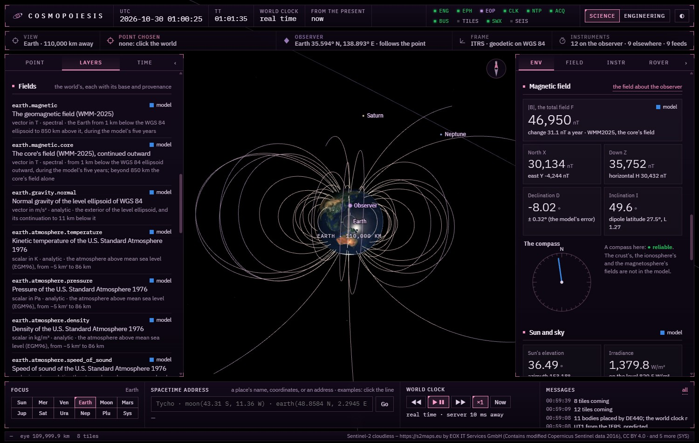</a><br><b>The Earth's field lines</b> (decision 0007). There are 48 lines of the core's field, WMM2025 continued outward. Each is traced by RK4 from 100 km above the model's sphere, at ±30°, ±50° and ±65° of latitude, to the ground or to six Earth radii, and coloured by |B| on a logarithmic scale from 0.2 to 50 μT. The field is one of the world's fields, each with its base and provenance; on the left is their catalogue, each with its fibre, its representation and its base. On the right, the observer's magnetometer reads the same model where the observer stands, 4,894 m up near Fuji. |B| is 46,950 nT, changing by 31.1 nT a year: 30,134 nT north, −4,244 nT east and 35,752 nT down. The declination is −8.02° (± 0.32°, the model's error), and the inclination 49.6°. A compass there is reliable.</td>
<td width="50%" valign="top"><a href="../assets/gallery/cosmo-11-moon-field.jpg">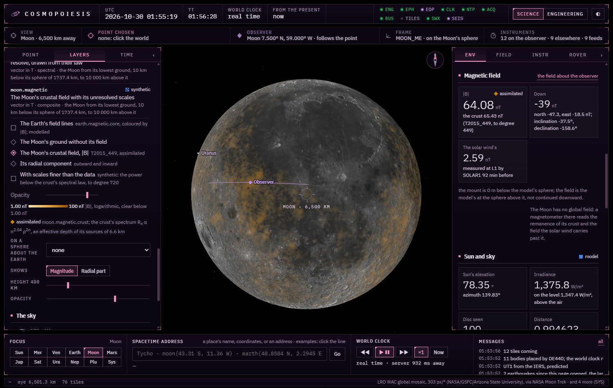</a><br><b>The Moon's crustal field</b> (decision 0005, <a href="../development/decisions/0052-fields-known-in-part.md">ADR 0052</a>). T2015_449's |B| at the surface is laid over the near side, from 1 to 100 nT on a logarithmic scale and clear below 1 nT, its magnetised crust in amber. The legend gives the law of the crust's spectrum, R<sub>n</sub> ∝ n<sup>2.04</sup> ρ<sup>2n</sup>, an effective depth of its sources of 6.6 km. The scales the model leaves unresolved are drawn from that law. The observer stands at Reiner Gamma, the brightest of the swirls. Its magnetometer reads 64.08 nT there: the crust's 65.43 nT and the solar wind's 2.59 nT, added as vectors. The solar wind's field was measured at L1 92 minutes before and carried to the Moon. The components are −47.3 nT north, −18.5 nT east and −39 nT down.</td>
</tr>
<tr>
<td width="50%" valign="top"><a href="../assets/gallery/cosmo-15-moon-radial.jpg">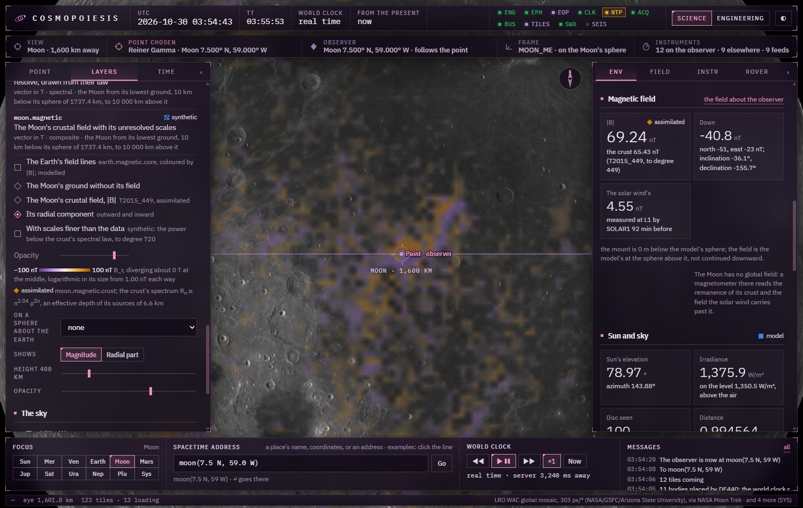</a><br><b>The Moon's field, outward and inward</b> (decision 0005). The radial part B<sub>r</sub> of T2015_449 at the surface around Reiner Gamma, seen from 1,600 km, on a half-degree grid. The scale diverges about zero: amber where the field points outward, violet where it points inward. It is logarithmic in its size from 1 nT each way, to 100 nT. The crust's sources are patches of both signs, the remanence of fields long gone. At Reiner Gamma the magnetometer reads 69.24 nT. The crust gives 65.43 nT of it, and the solar wind's field, measured at L1 92 minutes before and carried to the Moon, gives 4.55 nT. Its down component is −40.8 nT: there the field points up, out of the ground.</td>
<td width="50%" valign="top"><a href="../assets/gallery/cosmo-12-field-cube.jpg">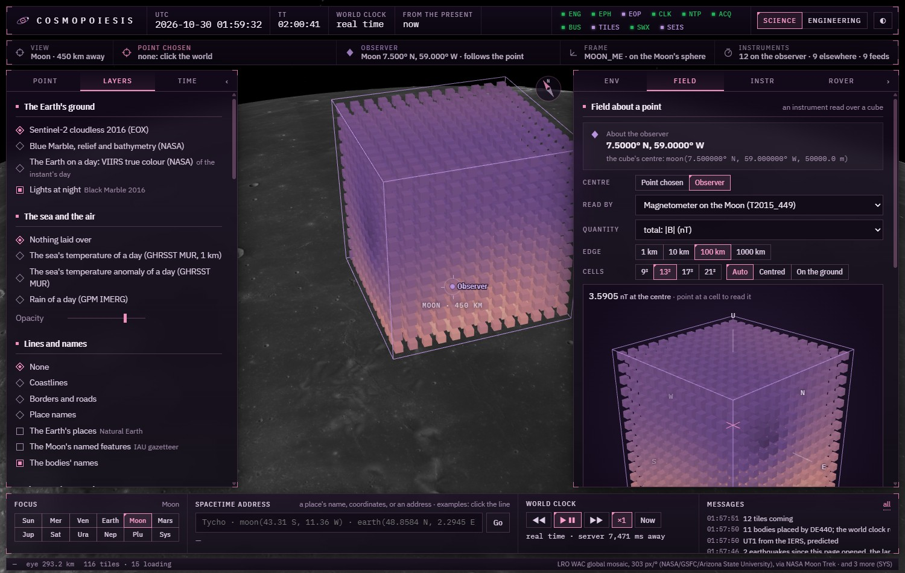</a><br><b>The field about a point</b> (decision 0006). The same magnetometer is read over a cube of 100 km above Reiner Gamma, in 13³ = 2,197 cells, and the cube is placed in the world. Each cell is a reading of T2015_449, with its unresolved part drawn from its law and the solar wind's field added. Colour is |B| on a logarithmic scale up to 232 nT, strongest near the ground. At the cube's centre, 50 km up, |B| is 3.59 nT. The linear fit over the cube gives a gradient of 0.42 nT/km, nearly all of it upward (−0.39 nT/km): the field falls off with height. The engine reads the cube in 2.8 s, in a process of its own, so the acquisition never waits for it.</td>
</tr>
<tr>
<td width="50%" valign="top"><a href="../assets/gallery/cosmo-14-air-over-fuji.jpg">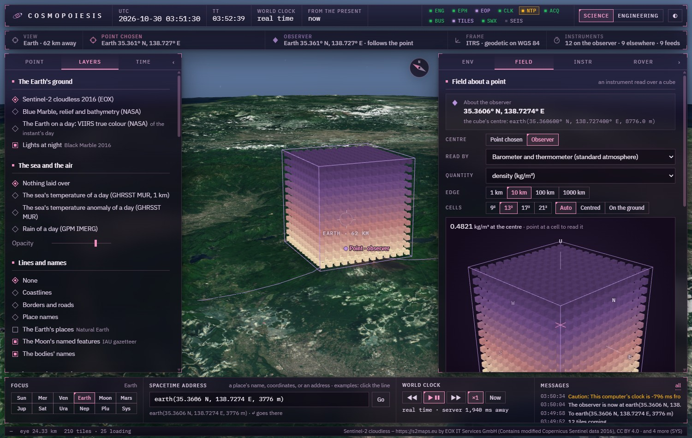</a><br><b>The air over Fuji</b>, a field about a point. The barometer is read over a cube 10 km on a side, standing on Fuji's summit (3,776 m) and reaching to 13,776 m above WGS 84, in 13³ cells. Each cell's colour is the density of the 1976 standard atmosphere, which falls with height, from cream near the summit to plum above. At the cube's centre, 8,776 m up, the density is 0.4821 kg/m³. The cube is drawn twice: in the FIELD page, where it can be turned and read cell by cell, and in the world, standing on the mountain, the camera 62 km away.</td>
<td width="50%" valign="top"><a href="../assets/gallery/cosmo-16-interior-cube.jpg">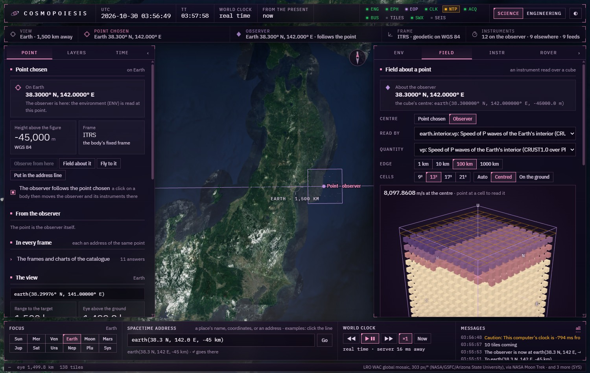</a><br><b>The Earth's interior as a field</b> (decision 0010, <a href="../development/decisions/0055-the-earth-beneath.md">ADR 0055</a>). The speed of P waves, <code>earth.interior.vp</code> (CRUST1.0 over PREM), is read over a cube 100 km on a side, centred 45 km beneath the sea east of Sendai. The address is <code>earth(38.3 N, 142.0 E, -45 km)</code>, and the observer stands there, in the mantle. The crust is slow (violet, from 5,800 m/s), and the mantle beneath its Moho is fast (cream, to 8,112 m/s). At the centre the speed is 8,097.9 m/s. Of 2,197 cells, 2,028 are read. The top layer, 169 cells, lies above the sea and is refused, for the field's base is the Earth beneath its ground and its seas. The surface, where it crosses the cube, is drawn in amber.</td>
</tr>
</table>

### 9.3 The Ground, the Sea and What Lies Beneath

The terrain says where each of its heights comes from; the sea can be taken away to show its floor, or coloured by its temperature; and ENV looks beneath the observer to the centre of the Earth ([ADR 0055](../development/decisions/0055-the-earth-beneath.md)).

<table>
<tr>
<td width="50%" valign="top"><a href="../assets/gallery/cosmo-18-terrain-provenance.jpg">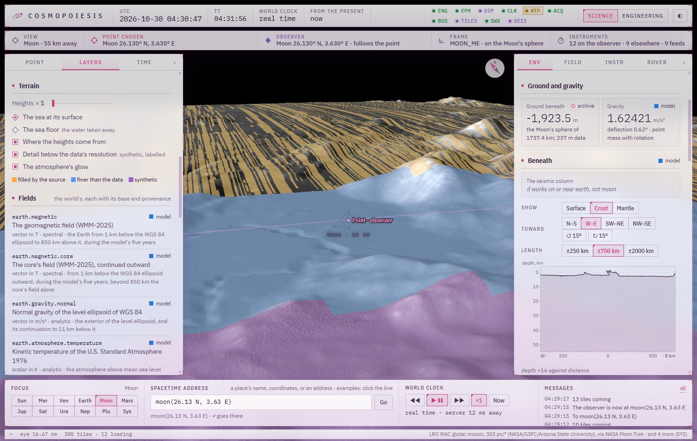</a><br><b>Where the heights come from</b>, near Hadley Rille on the Moon, seen from 55 km toward the Montes Apenninus. LOLA's grid there is 237 m, and every sample of the terrain says what it is. In the distance the heights are LOLA's own, in stripes: the laser's ground tracks, measured and left untinted, and between them the samples its makers filled (amber). Nearer, the tiles are finer than the data and interpolated here (blue). Nearest, they carry synthetic detail below the data's resolution (violet), labelled so and never taken for measurement. On the right, the observer's ground lies 1,923.5 m below the Moon's sphere of 1,737.4 km.</td>
<td width="50%" valign="top"><a href="../assets/gallery/cosmo-17-sea-floor.jpg">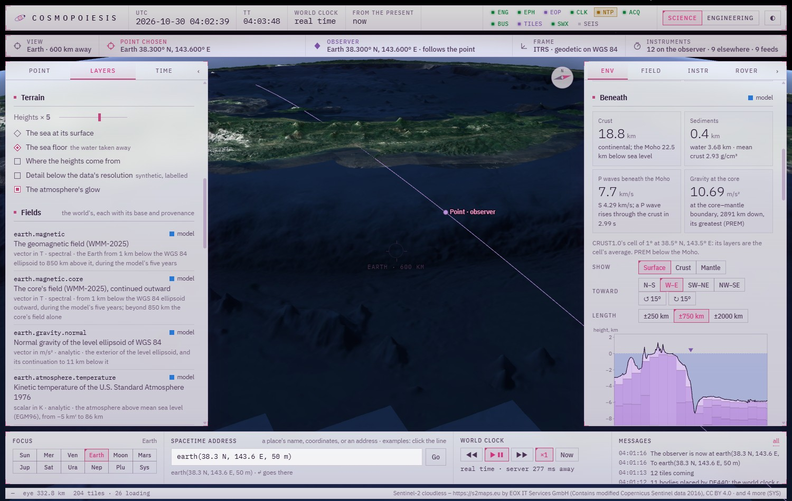</a><br><b>The sea floor, the water taken away</b>. Off Japan, seen obliquely from 600 km, with heights five times exaggerated. The terrain tiles' second layer is the solid surface beneath the sea, and LAYERS can draw it instead of the sea's surface. Honshu stands above, and the Pacific floor runs down to the Japan Trench, with seamounts on the plate as it comes toward it. The orchid line is the trace of the section through the observer, who is 50 m above the sea at 38.3° N, 143.6° E. On the right is that section's surface view: the land, the sea and its floor, from the Sea of Japan across Honshu to the trench and the Pacific.</td>
</tr>
<tr>
<td width="50%" valign="top"><a href="../assets/gallery/cosmo-22-sea-temperature.jpg">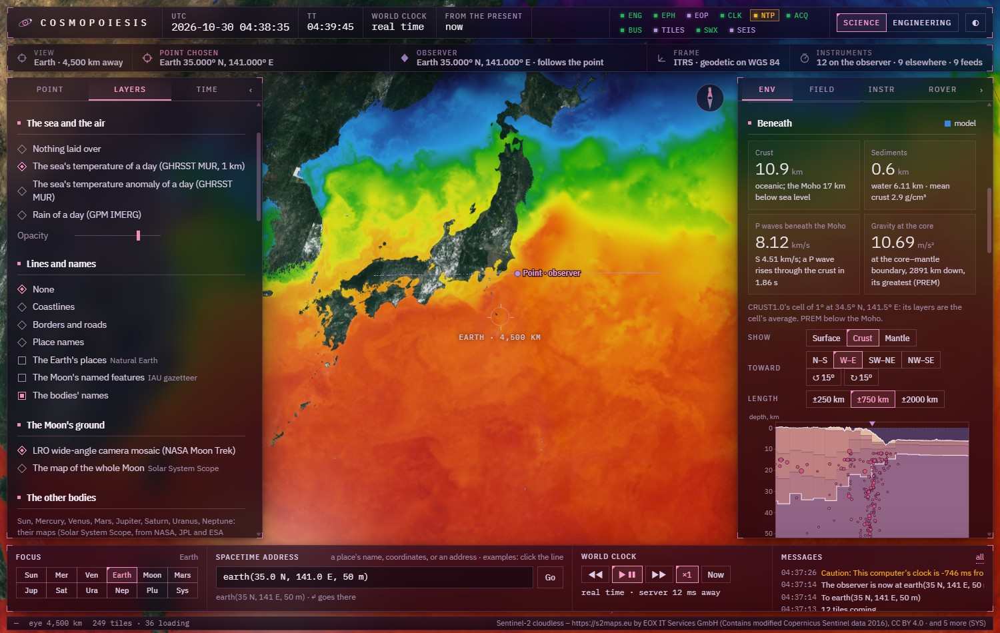</a><br><b>The sea's temperature</b> around Japan, from 4,500 km, in GHRSST's MUR analysis at 1 km: the latest day NASA's GIBS serves, in its own colours, from blue (cold) to red (warm). The Kuroshio carries warm water north-east along Japan's south coast and turns out into the Pacific. Cold water of the Oyashio lies off Hokkaido and Tohoku, and the Sea of Japan grades from warm in the south to cold in the north. On the right, beneath the observer east of the Bōsō peninsula: oceanic crust 10.9 km thick under 6.11 km of water, its Moho 17 km below sea level.</td>
<td width="50%" valign="top"><a href="../assets/gallery/cosmo-19-beneath-japan.jpg"></a><br><b>Beneath the Japan Trench</b> (decision 0010). The observer is 50 m above the sea at 38.3° N, 143.0° E, and the section runs west to east through it for 1,500 km, its trace on the world. The seismic column beneath it is CRUST1.0's cell of 1°. There are 3.68 km of water, 0.4 km of sediments, and 18.8 km of crust, of mean density 2.93 g/cm³, to a Moho 22.5 km below sea level. Beneath the Moho, P waves run at 7.7 km/s and S waves at 4.29 km/s. A P wave rises through the crust in 2.99 s. The section's crust view shows the layers, constant in their cells and cut by the sea floor. Global CMT's centroids since 1976 lie within 75 km of the line: 377 of them, 112 below this view. They fall steeply beneath the trench, where the Pacific plate sinks.</td>
</tr>
<tr>
<td width="50%" valign="top"><a href="../assets/gallery/cosmo-20-beneath-mantle.jpg"></a><br><b>The mantle at true scale</b>, the same section taken out into a window of its own (decision 0009), to 800 km, the Earth's curvature drawn. Rock is coloured by its density, and PREM's discontinuities at 220, 400 and 670 km are dashed. The earthquakes trace the Pacific plate. It sinks from the trench westward beneath Japan, and its deepest events here lie nearly 400 km down, some 500 km west of the trench. On the right is the column beneath the observer to the centre: the speeds of P and S waves and the density against depth, the Earth's regions banded. S waves stop at the liquid outer core.</td>
<td width="50%" valign="top"><a href="../assets/gallery/cosmo-21-beneath-andes.jpg"></a><br><b>Beneath the Andes, by day</b>. The observer stands on the Atacama's ground at 22.0° S, 69.6° W, 1,700 m above WGS 84. The section runs west to east for 1,500 km, depths nine times exaggerated, and is taken out into its own window. From the west it crosses the sea and the Peru–Chile trench, then the coast. The crust thickens eastward under the Altiplano, its Moho nearly 70 km down, then thins again toward the plains. The earthquakes of the Nazca plate dip eastward beneath the continent. In the observer's own cell the crust is 35 km thick, the Moho 33.3 km below sea level. P waves run at 8.24 km/s beneath it and take 5.63 s to rise through it.</td>
</tr>
</table>

### 9.4 Bodies That Move: Satellites, and a Rover That Learns

<table>
<tr>
<td width="50%" valign="top"><a href="../assets/gallery/cosmo-09-satellites.jpg"></a><br><b>Satellites</b>: the space stations, GPS and Galileo by SGP4, seen from 62,000 km over the day side of Asia and Australia. The stations are named beside their points. GPS's satellites, in orange, and Galileo's, in green, circle at some 20,000 and 23,000 km. On the left are the groups: 32 for Galileo, 32 for GPS and 16 for the stations, their elements fetched 45 hours before. On the right are the instruments mounted on the ISS itself, a family placed on a satellite by its NORAD number. The ISS is over 35.63° N, 86.04° E, 426.5 km up, in full sunlight (1,379.7 W/m²). Its magnetometer on WMM2025 reads 42,971 nT: 24,694 nT north, 414 nT east and 35,164 nT down.</td>
<td width="50%" valign="top"><a href="../assets/gallery/cosmo-13-rover.jpg"></a><br><b>A rover that learns</b> (decision 0008, <a href="../development/decisions/0054-bodies-dynamics-and-knowledge.md">ADR 0054</a>). A rover, a body of its own apart from the observer, surveys Reiner Gamma. It is kinematic and drives in lines, 4,486 m in 6 h 14 min of mission time, through 12 waypoints and 449 readings. Its magnetometer, on a 1.5 m mast, reads a hidden truth: T2015_449, plus a realisation (seed 1) of the part the model leaves unresolved, to degree 1440. Its readings run some 3 to 5 nT above T2015_449 (on the right). The mission's map, taken out into a window, shows its uncertainty after the survey: 0.02 nT along the track, 0.21 nT where it did not drive. Before any reading it was 9.5 nT. Its 1,347 observations' innovations have a mean square of 1.054, inside the band of 0.924 to 1.076 for knowledge that is calibrated.</td>
</tr>
</table>

### 9.5 Bodies with Joints: a Rabbit, a Fish and a Dog

Three robots of the robotics domain, each a body with joints moved by three methods of one motion, each in the environment it was built for. Where nothing has measured that environment the world presumes its properties, a law with its spread, and stands the robot on a realisation of it, which its sensors read and its belief learns ([ADR 0058](../development/decisions/0058-a-body-with-joints.md), [ADR 0059](../development/decisions/0059-robots-in-their-environments.md)).

<table>
<tr>
<td width="50%" valign="top"><a href="../assets/gallery/cosmo-23-rabbit-world.jpg"></a><br><b>A rabbit on the Moon</b> ([ADR 0058](../development/decisions/0058-a-body-with-joints.md)): the robotics domain's hopping robot of 1.69 kg, six links and five geared motors in its plane, hopping forward at the 0.3 m/s asked at Reiner Gamma, 25.3 s into its run, in flight. In the world it is drawn at true scale 1.6 m from the camera, lit by the Sun, its shadow on the level strip its simulation stands on. On the right, its plane from its right side: each motor's torque as an arc against its peak, its centre's path dotted, the apex asked dashed. The method is semi-implicit Euler; the variational integrator of the discrete action and Runge–Kutta move the same body.</td>
<td width="50%" valign="top"><a href="../assets/gallery/cosmo-24-rabbit-ground.jpg"></a><br><b>The ground it learns, and every field at a point</b> ([ADR 0059](../development/decisions/0059-robots-in-their-environments.md)). On the left, POINT's fields at Reiner Gamma, each component with its provenance: the crust's field from T2015_449, 65.43 nT (assimilated); the scales it leaves unresolved, 15.99 nT (synthetic); their sum, 71.33 nT. On the right, the rabbit's ground. It was told the regolith's presumption, μ 0.83, 95 % within 0.58–1.19, from the angle of internal friction. Its sliding feet read the friction (rose), its belief follows (amber, one deviation's band), and the truth is dotted, revealed. At its toe it believes 0.869 ± 2.7 % where the truth is 0.842; its readings fit what it was told (1.3, within 0.2–1.8).</td>
</tr>
<tr>
<td width="50%" valign="top"><a href="../assets/gallery/cosmo-25-fish.jpg"></a><br><b>A fish in the ocean</b>: the robotics domain's swimming robot of 1.85 kg, a head and four driven links, 1 m down in the equatorial Pacific over 4,490 m of sea (CRUST1.0's). The water acts on each strip of its body: its added mass in the Lagrangian, its drag a force (physis's strip theory). In the world it is seen from 1.6 m above, through the sea's surface, which is drawn here by the day's sea temperature (GHRSST). On the right, from above: its links and servos' torques, its head's path, its wake (rose, where its tail pushed the water, fading over two seconds), and the current (blue, revealed) that carries it. It swims by drag, at a Strouhal number near 2.5 where a real fish swims at 0.2–0.4: strip theory leaves out the momentum a tail sheds into its wake.</td>
</tr>
<tr>
<td width="50%" valign="top"><a href="../assets/gallery/cosmo-26-dog-ice.jpg"></a><br><b>A dog on the Greenland ice sheet</b>: the robotics domain's four-legged robot of 10.2 kg, its legs separate in its plane so that it trots on diagonal pairs, at 72.6° N, 38.5° W, 3,160 m up, 15.4 s into a trot at the 0.3 m/s asked. CRUST1.0 has ice there, so its ground is ice. In the world it stands at true scale, its feet's readings of the ground rose on the strip. On the right, from its right side: its left legs paler behind, each motor's torque, the ground's force at each foot.</td>
<td width="50%" valign="top"><a href="../assets/gallery/cosmo-27-dog-ground.jpg"></a><br><b>What the dog learns of the ice</b>. It was told the presumption of ice, μ 0.15 (95 % within 0.06–0.36), and its feet read the truth as they slide. After 400 readings it believes 0.296 ± 17 % at its fore feet, where the ice is 0.317; the load that presses a foot 1 mm in, 17.98 N against 17.95 N. Its readings fit what it was told, a whitened mean square of 1.09 within 0.86–1.14. Below, the height of its centre as it trots, a ripple of each stride's pair.</td>
</tr>
</table>

## 10. The Urban Building Workbench

A three-dimensional GIS of Melbourne's centre, its streets read as a sea, after the user's *Street Oceanography* ([ADR 0060](../development/decisions/0060-streets-as-open-systems.md)). OpenStreetMap's 15,038 buildings stand lowered to a fifth of their height, so that the streets show between them, lit by the Sun of the clock's instant in Melbourne's time. The pedestrian counts are the City of Melbourne's, each way at 92 of its sensors since October 2024. The urban-science domain's C++ computes every number, in the workbench's engine.

<table>
<tr>
<td width="50%" valign="top"><a href="../assets/gallery/urban-01-tide.jpg"></a><br><b>The tide on the streets</b>, Thursday 13 March 2025 at 17:30. Each sensor's block of street is a channel of water standing to the level of its walkers, one metre for every hundred an hour. The level is the street's tide: its counts fitted at the calendars' constituents (the week with its days, and the year) in civil time, here predicted for the hour; the deepest, at the station approaches, stand some 30 m. The legend says the day: 94 streets recorded, 16.4 mm of rain. As the clock runs the water rises and falls.</td>
<td width="50%" valign="top"><a href="../assets/gallery/urban-02-high-water.jpg"></a><br><b>When the water is high</b>, in the workbench's deep-sea night. The water stands at each street's weekday high water and is coloured by its hour on a cyclic map: amber where it comes at the evening commute, 16:30 to 18:30 (50 streets), rose and plum at midday, 11:30 to 14:30 (41 streets), as a port's establishment is the hour of its high water. By Courtier's form number, 72 of the 100 streets have a diurnal tide, one crest a day, 26 a mixed tide mainly diurnal, and 2 a mixed tide mainly semidiurnal.</td>
</tr>
<tr>
<td width="50%" valign="top"><a href="../assets/gallery/urban-03-currents.jpg"></a><br><b>Currents</b>, Wednesday 12 March 2025 at 08:30. A sensor that counts each way carries two lanes of walkers, those walking forward on the left. Each lane holds as many as walk there on average at that hour (N = λL/v, at 1.34 m/s), moving in real time. Coral walk toward the centre of the city's counts and sea blue away; the arrows are the net current, the morning flood running in. On 29 of 41 footpaths the residual current runs as left-hand traffic would (a sign test, p = 0.006).</td>
<td width="50%" valign="top"><a href="../assets/gallery/urban-04-surge.jpg"></a><br><b>A surge</b>: Christmas Day 2025 at 13:00. The water stands at the count observed that hour, coloured by how far it lies from the tide (sea glass below, brick rose above), and a dark tide mark floats at the prediction. Most shops are shut and the centre is quiet: the water lies far below its marks. The calendars cannot predict a holiday, so it is the surge, as a storm surge is the sea's departure from its astronomical tide. 99 streets were recorded that day.</td>
</tr>
<tr>
<td width="50%" valign="top"><a href="../assets/gallery/urban-05-waves.jpg"></a><br><b>Waves on Swanston Street</b> (a model), 17:30. The crowd walking north from Flinders Street is a kinematic wave (Lighthill–Whitham–Richards by Godunov's scheme, physis), its blocks and nine crossings taken from the map, a signal at each of seven streets and none at the lanes. Walkers enter at the rate counted northward there, 1,681 an hour, 449 on the street. The engine keeps four minutes second by second; the page plays them, each walker moving at the model's speed, queuing before a red crossing and released at green.</td>
<td width="50%" valign="top"><a href="../assets/gallery/urban-06-tides-and-currents.jpg"></a><br><b>The tides and currents of the city</b>, an analysis beside the map. The commuters' flood and ebb: the net current toward the centre summed over the counting lines through the mean weekday, and what the lines have taken in since 05:00, about 5,200 people by 17:00. Below it, the arrow of time on the streets: the walkers' entropy production, bounded below by the measured edges (Schnakenberg's edge terms, each non-negative), highest at 08:30 on weekdays when the commute runs one way.</td>
</tr>
</table>

## 11. Credits

The screenshots are the infrastructure's, under its MIT licence, except the three that show Pangu-Weather's forecasts (§1.3: earth-15, earth-16 and earth-17). Those are shared under CC BY-NC-SA 4.0, the licence of the model's parameters: for learning and research, not for commercial use. The data in all of them keep their own licences.

| Data | Source | Licence |
|---|---|---|
| Base map | Natural Earth | Public domain |
| Relief | ETOPO 2022 (NOAA NCEI); ASTER GDEM (METI and NASA), shaded by NASA GIBS | Public domain; NASA, acknowledge |
| Forecasts and analyses | GFS and WaveWatch III (NOAA NCEP, via PacIOOS ERDDAP); AIGFS and AIGEFS (NOAA NCEP and EPIC, via Unidata THREDDS); OISST v2.1 (NOAA NCEI) | Public domain |
| Our AI forecasts | Pangu-Weather (Bi et al. 2023, *Nature* 619, 533–538), run from the GFS analysis at 0.25° (NOAA NCEP, NOMADS) | Model parameters CC BY-NC-SA 4.0; analysis public domain |
| Cyclone tracks and disaster alerts | GDACS (United Nations and European Commission JRC), relaying the warning centres | No reuse licence stated; provided "as is"; credited, and not a warning |
| Climate classes | Beck et al. (2023), *Scientific Data* 10, 724 | CC BY 4.0 |
| Climate normals | TerraClimate (Abatzoglou et al. 2018) | CC0 |
| Imagery of the Earth | VIIRS true colour, Blue Marble and Black Marble (NASA, via GIBS) | NASA, acknowledge |
| Country indicators | World Bank, World Development Indicators | CC BY 4.0 |
| Earthquakes | USGS ComCat | Public domain |
| The ocean beneath a place | HYCOM ESPC-D-V02 (US Navy, via HYCOM.org) | Public release, distribution unlimited |
| Tectonic plates | PB2002 (Bird 2003), as converted by H. Ahlenius (Nordpil); motion NNR-MORVEL56 (Argus et al. 2011) | ODC Attribution 1.0 |
| GPS velocities and positions | Nevada Geodetic Laboratory (Blewitt, Hammond and Kreemer 2018) | None stated; supplied as is; cited |
| Earthquake mechanisms | Global CMT Project (Dziewonski et al. 1981; Ekström et al. 2012) | None stated; cited |
| The crust | CRUST1.0 (Laske et al. 2013) | None stated; cited |
| Ephemeris | JPL DE440 (Park et al. 2021) | Freely distributed |
| Maps of the bodies and the sky | Solar System Scope (INOVE), from NASA, JPL and ESA data | CC BY 4.0 |
| Detail of the Moon and Mars | LRO WAC (NASA/GSFC/ASU), Viking MDIM 2.1 (NASA/USGS), via NASA Trek | NASA, acknowledge |
| Stars | HYG v4.1 | CC BY-SA 4.0 |
| Galaxies | Karachentsev et al. (2013); Tully (2015); names from SIMBAD (CDS) | Published catalogues; cite |
| Station observations | METAR (NOAA Aviation Weather Center); NDBC buoys (NOAA) | Public domain |
| Best tracks of cyclones | IBTrACS v04r01 (NOAA NCEI; Knapp et al. 2010) | Public domain |
| ECMWF forecasts | IFS, AIFS and ENS open data (ECMWF) | CC BY 4.0; based on data and products of ECMWF |
| Population | GHS-POP R2023A (European Commission JRC) | CC BY 4.0 |
| Provinces | Natural Earth 1:10m admin-1 | Public domain |
| Climatology of the scores | NCEP/NCAR Reanalysis 1 (NOAA PSL) | Public domain |
| Sentinel-2 | Copernicus Sentinel-2 Level-2A, via Earth Search | Free and open; contains modified Copernicus Sentinel data 2026 |
| The human brain | MNI 152 ICBM 2009c nonlinear asymmetric (Fonov et al. 2011) and its FreeSurfer segmentation, via TemplateFlow | MNI: permission to use, copy, modify and distribute |
| Deep nuclei | MASSP 2.0 (Bazin et al. 2020); thalamic nuclei (Najdenovska et al. 2018), via TemplateFlow | CC BY 4.0 |
| Gyri | Harvard–Oxford cortical atlas (Makris et al. 2006), FSL | FSL licence, non-commercial |
| Cytoarchitectonic areas, fibre bundles | Julich-Brain 3.1 (Amunts et al. 2020); deep white matter (Guevara et al. 2012), EBRAINS | CC BY-NC-SA 4.0 |
| Networks | Schaefer et al. (2018), via TemplateFlow | MIT |
| The mouse brain | Allen Mouse Brain CCFv3 (Wang et al. 2020), Allen Institute | Allen Institute terms of use |
| EEG | EEG Motor Movement/Imagery Dataset (Schalk et al. 2004), PhysioNet | ODC Attribution 1.0 |
| fMRI maps | Individual Brain Charting (Pinho et al. 2018), via NeuroVault | CC0 |
| Genomes | NCBI RefSeq (O'Leary et al. 2016), via the E-utilities | Public domain under NCBI's policy; some sequences may carry their submitters' rights |
| Trade between economies | OECD, Balanced International Merchandise Trade Statistics (BIMTS), adjusted for re-exports | CC BY 4.0 |
| Exchange rates and the euro's deposit facility rate | European Central Bank, ECB Data Portal (EXR; FM) | Reuse with the source acknowledged |
| Policy rates | Bank for International Settlements, central bank policy rates (WS_CBPOL) | Use with the BIS cited as the source |
| Places of the economies | Natural Earth 1:50m admin-0, label points | Public domain |
| Satellites' elements | CelesTrak (T. S. Kelso), from the 18th and 19th Space Defense Squadrons' public catalogue | Distributed freely; CelesTrak credited |
| Earth orientation and leap seconds | IERS Rapid Service/Prediction Centre (Bulletin A), via the IERS Data Centre; Bulletin C, via IANA | Free of charge, the IERS cited; public domain |
| The Moon's orientation | DE440's lunar librations (JPL), via NAIF | Freely distributed |
| The geoid | EGM96 (NGA and NASA), via GeographicLib | Public domain |
| Terrain of the Earth | Mapzen's terrain tiles (Terrarium) on the AWS Open Data registry, from SRTM, 3DEP, ETOPO1, GMTED, EU-DEM, the UK Environment Agency's LIDAR and others | Each source's terms, attributed as Mapzen's list gives them |
| Terrain of the Moon | LRO LOLA gridded data records (NASA GSFC, PDS Geosciences Node) | NASA data, freely available |
| Imagery of the Earth, cloudless | Sentinel-2 cloudless 2016 (EOX IT Services GmbH) | CC BY 4.0; contains modified Copernicus Sentinel data 2016 |
| Names of the Moon's features | IAU WGPSN and USGS Astrogeology (the Gazetteer of Planetary Nomenclature) | Public domain |
| The geomagnetic field | WMM2025 (NOAA NCEI and the British Geological Survey) | Public domain (US Government material, 17 U.S.C. 403) |
| The sea's temperature | GHRSST Level 4 MUR (NASA JPL, PO.DAAC), via NASA GIBS | NASA, acknowledge |
| The Earth's interior | PREM (Dziewonski and Anderson 1981), beneath CRUST1.0 | Published model; cited |
| The ground's classes | CRUST1.0 (Laske, Masters, Ma and Pasyanos 2013): where it has water, ice and sediments | Published model; cited |
| The Moon's crustal field | T2015_449 (Wieczorek 2018, Zenodo 10.5281/zenodo.3873648), from the surface vector mapping of Tsunakawa et al. (2015) | CC BY 4.0 |
| Space weather | NOAA SWPC: the real-time solar wind (DSCOVR, ACE), the planetary K index, GOES's X-rays and protons | Public domain; SWPC credited |
| Pedestrian counts | City of Melbourne, Pedestrian Counting System (the archive of 2009–2022 and the live record since October 2024) | Counts: none stated, the City's open data CC BY 4.0; locations CC BY 4.0 |
| Buildings, streets and spaces of a city | OpenStreetMap contributors, through Overpass | ODbL 1.0 |
| Hourly weather | Open-Meteo, from ERA5 and the IFS | CC BY 4.0 |
| Public holidays | Nager.Date | Free for private and non-profit use; cited |

## 12. Making the Screenshots

The screenshots were taken with headless Chrome at 1600 × 1000 pixels, driven over the DevTools protocol, and saved as JPEG.

The Earth Atlas keeps its view in the address, so each picture can be reproduced from its URL on the local server. For example:

```
http://127.0.0.1:8790/#p=globe&c=-32,36,3.25&s=wind.10m@gfs-forecast:speed&f=wind.10m@gfs-forecast&t=2026-10-22T12:00Z
```

- `p`: the projection.
- `c`: the longitude, latitude and distance of the view.
- `s`, `f`, `l` and `m`: the surface, the flow, the lines, and the model compared.
- `t`: the instant, in UTC.

The Urban Building Workbench's pictures, at 1500 × 950 pixels, were taken from its local server in the same way, the clock's date and hour, the layers and the view set by a script in the page.

The Spiking Simulator's pictures, at 1500 × 950 pixels, were taken in the same way, each from a link that opens an example, runs it and opens a view, for example `http://127.0.0.1:8830/#preset=brunel-si-fast&run=1&from=300&to=360`: `preset` names the example, `run=1` runs it, `tab` opens a view, `from` and `to` (in ms) the span of the activity shown, and `threads` the threads used. The runs are deterministic, so each picture comes back the same.

The Complex Atlas's pictures, at 1500 × 950 pixels, were taken the same way from links that open a complex, a theory or a passage, for example `http://127.0.0.1:8850/#family=lattice-torus&n=12&m=12` (then **Run** in Fields), `#family=surface&genus=2` (the Net view), `#mode=generation&theory=matrix&order=2&stage=graphs`, `#mode=generation&theory=coloured-simplicial&order=3&stage=graphs` and `#mode=generation&theory=gft-boulatov&order=2&stage=graphs` (then a graph's **Its spin foam** and a vertex), and the passages of the Generation mode for the condensate and the quadrangulation. The engine's runs are seeded, so each picture comes back the same.

The History Complex's pictures, at 1500 × 950 pixels, were taken the same way from links that open a canon, a view and a date, for example `http://127.0.0.1:8870/#canon=europe-1785-1828&date=1814-11-15`, `#canon=vienna-1890-1938&mode=spin&time=events`, `#view=loom&canon=italy-1401-1564&focus=tie:julius2~michelangelo`, `#view=moment&canon=vienna-1890-1938&date=1934-12-31` and `#canon=integrated&time=events`, `#view=loom&canon=athens-470-322bc&focus=tie:alcibiades~athens` and `#view=record&canon=science-1543-1727`; a tour's step is `tour=4` with `open=1`, and the power is computed by its button in Readings. The engine's sampling is seeded, so each picture comes back the same.

The Genome Workbench's pictures, at 1500 × 950 pixels, were taken the same way, from links that open a view, a genome and a window. For example, `http://127.0.0.1:8890/#genome=ncbi:NC_000913.3&begin=3905000&end=3945000` (then the chip **predicted genes**), and `#align` (the example **Two reads of one place**, the schedule **WFA**). Also `#index`, `#reads`, `#assembly` and `#trees`; `#toolbox&tool=align-msa` and `#toolbox&tool=tree-build` (then **Example**); `#data` (then Ctrl K); and `#run`. The night theme is the moon at the foot of the rail. The simulations are seeded, so each picture comes back the same.

The Economy Atlas's pictures, at 1500 × 950 pixels, were taken the same way from links that open a view and what it shows, for example `http://127.0.0.1:8910/#map&year=2024&economy=USA`, `#map&year=2010&arcs=driven`, `#spacetime&from=2015-01&to=2026-06&currency=MXN`, `#production&table=three` and `#circuits&network=five`: `year`, `arcs` (`all`, `driven`, `circulating` or `none`), `shown`, `faces`, `labels`, `flowing`, `economy` (a place's id, ISO alpha-3 for the library's) and `dataset` for the map; `from`, `to`, `currency` and `dataset` for spacetime; `table` and `network` for the examples. The two pictures by night were taken after the day-and-night button; the gravity equation's after its run from its card, and the towns' after adding `examples/towns-places.csv` and `examples/towns-flows.csv` with the title "Towns of the North Sea (invented)", whose content gives the dataset its id, `#map&dataset=8587152f0c26514c`.

Cosmopoiesis's pictures, at 1500 × 950 pixels, were taken the same way, from a fresh profile, by driving the console from scripts of steps: its focus keys, its decks and pages, the theme, the layers, the figures' keys and their windows, and addresses typed into its address unit (`earth(51.4779 N, 0.0015 W, 92 m)`, `moon(43.31 S, 11.36 W)`, the step from Fuji above, `moon(7.5 N, 59.0 W)` for Reiner Gamma, `moon(26.13 N, 3.63 E)` for Hadley Rille, and points beneath the sea and the Andes). They were taken from a server of their own (`serve.py --port 8932`), whose acquisition is apart from that of a session in use. The page keeps the view of its body in focus in the address, `http://127.0.0.1:8930/#earth/30.00000/12.00000/20000000/0.0/0.0` (the body, the latitude and longitude in degrees, the range in metres, the heading and the tilt). The rover surveyed by lines, kinematic, with the truth's seed 1. Its instant is the present, so the sky, the readings and the counters differ each time the pictures are taken.
