# Gallery

*Status: draft, 2026-10-23.*

These are screenshots of the infrastructure's applications, the three atlases taken on 22 October 2026 from their local servers with the data of that day, the Spiking Simulator and the Complex Atlas on 23 October.

- Both are web applications without a build step.
- Their science is the provisional JavaScript of the domains they draw on, tested against published references and closed-form answers in 422 checks.
- Each caption says what is shown, where the data come from, and how the picture is made.

Click an image to see it at full size. To run the applications yourself, see the READMEs of the [Earth Atlas](../applications/earth-atlas/README.md), the [Celestial Atlas](../applications/celestial-atlas/README.md), the [Brain Atlas](../applications/brain-atlas/README.md), the [Spiking Simulator](../applications/spiking-simulator/README.md) and the [Complex Atlas](../applications/complex-atlas/README.md).

## 1. The Earth Atlas

The atmosphere, the ocean, the land and its people on one globe, or on equal-area and equirectangular maps, at one instant. Each kind of data comes from its own dataset and is joined to the map only in the application.

### 1.1 Weather and the Ocean

<table>
<tr>
<td width="50%" valign="top"><a href="../assets/gallery/earth-01-wind.jpg"></a><br><b>Wind at 10 m</b> from the GFS forecast for 22 October 2026, 12:00 UTC. Colour gives the speed, and moving particles trace the flow. Two cyclones turn in the North Atlantic.</td>
<td width="50%" valign="top"><a href="../assets/gallery/earth-02-isobars.jpg"></a><br><b>Pressure at sea level</b> and isobars every 4 hPa, with highs and lows, on the equal-area Equal Earth projection. Lows near 950 hPa follow the Southern Ocean's storm track, and a typhoon of 932 hPa lies east of the Philippines.</td>
</tr>
<tr>
<td width="50%" valign="top"><a href="../assets/gallery/earth-04-waves.jpg"></a><br><b>Waves</b> from WaveWatch III. Colour gives the significant wave height. Particles travel along the peak direction at the deep-water group speed, gT/4π. Swell from the Southern Ocean spreads north into the Atlantic.</td>
<td width="50%" valign="top"><a href="../assets/gallery/earth-07-sst-anomaly.jpg"></a><br><b>Sea-surface temperature anomaly</b> from NOAA's OISST v2.1, 20 October 2026. A warm tongue lies along the equator in the eastern Pacific, the pattern of El Niño.</td>
</tr>
</table>

### 1.2 Models Compared, and Our Own

<table>
<tr>
<td width="50%" valign="top"><a href="../assets/gallery/earth-05-model-difference.jpg"></a><br><b>Two models compared.</b> NOAA's AI model AIGFS minus the GFS, air temperature at 2 m, on a diverging scale fitted to the whole forecast. Any two models of the same quantity can be differenced this way.</td>
<td width="50%" valign="top"><a href="../assets/gallery/earth-06-our-models.jpg"></a><br><b>A model of our own.</b> Our shallow-water model, 48 hours after starting from the GFS analysis of 19 October 2026: heights at 500 hPa, contours every 60 m, and the wind.</td>
</tr>
</table>

Our two models run in the page by the spectral transform method at T42. The panel compares their errors with persistence, the forecast that nothing changes:

| Lead | Barotropic model (1950) | Shallow-water model | Persistence |
|---|---|---|---|
| +24 h | 58 m | 43 m | 81 m |
| +48 h | 85 m | 74 m | 108 m |
| +72 h | 108 m | 100 m | 127 m |

These are root-mean-square errors of the height of the 500 hPa surface over 20–80° N, against the GFS's own analyses. The theory is in [the barotropic note](../domains/meteorology/theory/barotropic-vorticity-model.md) and [the shallow-water note](../domains/meteorology/theory/shallow-water-model.md).

### 1.3 Prediction: an AI Model Run Here, Tropical Cyclones and Disasters

We run the AI weather model Pangu-Weather (Bi et al. 2023) ourselves, on a laptop's CPU, from NOAA's GFS analysis at 0.25°. A week's forecast takes about half an hour, and becomes a product like NOAA's. Tropical cyclones are found in every forecast's sea-level pressure and drawn beside the observed track and the official forecast ([ADR 0022](../development/decisions/0022-ai-forecast-cyclones-and-disasters.md)).

<table>
<tr>
<td width="50%" valign="top"><a href="../assets/gallery/earth-15-cyclone-forecasts.jpg"></a><br><b>One typhoon, five forecasts.</b> Typhoon Champi on 23 October 2026, 12:00 UTC, in Pangu-Weather's sea-level pressure and wind. Its track as found in each model is drawn in that model's colour. Pangu-Weather (green) and NOAA's AIGFS (gold) recurve it toward southern Japan with the official forecast (white, dashed), the AIGEFS ensemble mean (blue) takes it north, and the GFS (pink) west into the Taiwan Strait. The label gives each model's central pressure.</td>
<td width="50%" valign="top"><a href="../assets/gallery/earth-16-ai-verification.jpg"></a><br><b>A forecast checked.</b> Pangu-Weather started from the analysis of 19 October 2026, 00:00 UTC, seen 48 hours later. Its track of Champi (red) runs beside the observed one (white), within 49 km at one day and 58 km at two. In the panel, its errors are set beside our own models and persistence.</td>
</tr>
<tr>
<td width="50%" valign="top"><a href="../assets/gallery/earth-17-ai-week-ahead.jpg"></a><br><b>Five days ahead.</b> Pangu-Weather's wind at 10 m and pressure at sea level for 27 October 2026, 00:00 UTC, from the analysis of 21 October, 18:00 UTC: the storm tracks of both hemispheres, the trade winds, and two cyclones in the western Pacific.</td>
<td width="50%" valign="top"><a href="../assets/gallery/earth-18-disaster-alerts.jpg"></a><br><b>Disaster alerts</b> of the last month from GDACS: tropical cyclones, earthquakes, floods, volcanoes, droughts and wildfires, coloured by alert level. Champi is Red. GDACS's alerts are automatic and do not replace official warnings.</td>
</tr>
</table>

Errors of the forecast from 19 October, as for our models above:

| Lead | Pangu-Weather | Shallow-water model | Barotropic model | Persistence |
|---|---|---|---|---|
| +24 h | 6.6 m | 43 m | 58 m | 81 m |
| +48 h | 12.7 m | 74 m | 85 m | 108 m |
| +72 h | 18.3 m | 100 m | 108 m | 126 m |

Its cyclones are too weak, as its authors report: Champi's central pressure in it is about 45 hPa above the GFS's on the same grid. The theory is in [the note on learned forecast models](../domains/meteorology/theory/learned-forecast-models.md) and [the note on cyclone tracking](../domains/meteorology/theory/tropical-cyclone-tracking.md).

### 1.4 Climate

<table>
<tr>
<td width="50%" valign="top"><a href="../assets/gallery/earth-08-koppen.jpg"></a><br><b>Climate classes</b> of 1991–2020 after Köppen and Geiger, from the 1 km maps of Beck et al. (2023) at 0.1°. The conventional colours are kept but softened, over the shaded relief.</td>
<td width="50%" valign="top"><a href="../assets/gallery/earth-09-koppen-change.jpg"></a><br><b>Climate classes in change.</b> The classes of 2071–2099 under the scenario SSP5-8.5, in colour where they differ from those of 1991–2020, and faint where they do not. Much of Siberia passes from Dfc to Dfb and Dfa: its summers warm.</td>
</tr>
<tr>
<td width="50%" valign="top"><a href="../assets/gallery/earth-10-climate-diagram.jpg"></a><br><b>A climate diagram.</b> Mumbai, class Am (tropical monsoon), and its normal year from TerraClimate, drawn after Walter and Lieth (1960). The dry season, from November to May, is dotted. The monsoon, above 100 mm a month from June to September, is filled.</td>
<td width="50%" valign="top"><a href="../assets/gallery/earth-11-precipitation-normal.jpg"></a><br><b>The normal July.</b> Precipitation in July, the normal of 1991–2020 from TerraClimate. The monsoons of South Asia and the Sahel are wet, and the Mediterranean summer is dry. Normals follow the month of the time shown.</td>
</tr>
</table>

The atlas also classifies the TerraClimate normals itself, by the rules of Beck et al. (2018). Its classes agree with the published map in 89 % of land cells. The classification is invariant under a group of order 2·(6!)⁴: permutations of the months within each half-year, and the exchange of the halves. See [the theory note](../domains/climate/theory/koppen-geiger-classification.md).

### 1.5 The Earth from Space, and Its Relief

<table>
<tr>
<td width="50%" valign="top"><a href="../assets/gallery/earth-03-blue-marble.jpg"></a><br><b>Day and night.</b> NASA's Blue Marble by day, and the Black Marble's city lights where the Sun has set, at 17:40 UTC. Sunset and the ends of civil, nautical and astronomical twilight are drawn as steps.</td>
<td width="50%" valign="top"><a href="../assets/gallery/earth-03b-satellite.jpg"></a><br><b>The Earth from space</b> on 20 October 2026: the VIIRS true-colour mosaic from NASA GIBS. A gap between two orbits crosses the Sahara.</td>
</tr>
<tr>
<td width="50%" valign="top"><a href="../assets/gallery/earth-12-alps.jpg"></a><br><b>The Alps at close range.</b> Shaded relief from 30 m elevations (ASTER GDEM, through NASA GIBS), fetched for the region in view. It is drawn over hypsometric tints from ETOPO 2022, with Lake Geneva on the left.</td>
<td width="50%" valign="top"><a href="../assets/gallery/earth-12b-himalaya.jpg"></a><br><b>The Himalaya</b> around Everest, at the centre of the view, in the same way. The Tibetan Plateau lies above, and the valleys descend toward the Ganges plain below.</td>
</tr>
</table>

### 1.6 Earthquakes and People

<table>
<tr>
<td width="50%" valign="top"><a href="../assets/gallery/earth-13-earthquakes.jpg"></a><br><b>Earthquakes</b> of magnitude 4.5 and above over a month, from the USGS. Colour gives the depth and size the magnitude. They trace the subduction zones of the western Pacific.</td>
<td width="50%" valign="top"><a href="../assets/gallery/earth-14-population-density.jpg"></a><br><b>People.</b> Population density by country, 2024, from the World Bank. It is joined to Natural Earth's countries by stated codes; the base map itself carries no values.</td>
</tr>
</table>

### 1.7 The Ocean Beneath, and the Solid Earth

Choose a place, and the atlas looks beneath it: into the ocean, fetched on demand from the US Navy's ocean model ([ADR 0023](../development/decisions/0023-ocean-column-and-data-on-demand.md)), and into the solid Earth: its plates, the motion of the ground, its earthquakes and its crust ([ADR 0024](../development/decisions/0024-the-solid-earth.md)).

<table>
<tr>
<td width="50%" valign="top"><a href="../assets/gallery/earth-19-ocean-column.jpg"></a><br><b>The ocean beneath a place.</b> The Kuroshio south of Japan, as a current profiler would record it: eastward and northward current and temperature to 1000 m, two days back and four ahead, from HYCOM (US Navy). The strip above is the Sun's height there; the dashed line, the mixed layer; the pointer reads every value.</td>
<td width="50%" valign="top"><a href="../assets/gallery/earth-20-plates.jpg"></a><br><b>The plates in motion.</b> The 52 plates of PB2002 (Bird 2003), coloured by their speed in NNR-MORVEL56 and carried as particles, about 10¹⁵ times faster than real. The Pacific and the plates around Australia move fastest; boundaries are coloured by kind, with teeth on the overriding plate at trenches.</td>
</tr>
<tr>
<td width="50%" valign="top"><a href="../assets/gallery/earth-21-gps-record.jpg"></a><br><b>Where the ground has moved.</b> GPS station J037 at Sendai since 1994, its plate's motion removed: the Tōhoku earthquake of 2011 threw it 3 m east and 1 m south, and it has crept east since, as the mantle relaxes. Dashed: earthquakes near enough to move it. On the map, GPS velocities relative to their plates (Nevada Geodetic Laboratory).</td>
<td width="50%" valign="top"><a href="../assets/gallery/earth-22-mechanisms.jpg"></a><br><b>How the ground broke.</b> Every earthquake of magnitude 6.5 and more since 1976 around Japan, as beach balls from Global CMT moment tensors: thrusts (rose) along the trenches, normal faults (blue) on the outer rise. The place card gives Tōhoku's planes and axes on a stereonet.</td>
</tr>
<tr>
<td width="50%" valign="top"><a href="../assets/gallery/earth-23-section.jpg"></a><br><b>A section across the Japan Trench,</b> toward the overriding plate: the relief above, the crust to the Moho, and the earthquakes within 100 km of the line, which trace the Pacific plate sinking westward, the Wadati–Benioff zone, down to 450 km beneath the Sea of Japan.</td>
<td width="50%" valign="top"><a href="../assets/gallery/earth-24-crust.jpg"></a><br><b>The crust.</b> The depth of the Moho from CRUST1.0, from 7 km under the oceans to 70 km under Tibet; beside it, the column beneath Lhasa, 75 km of crust to scale, with each layer's P-wave speed.</td>
</tr>
</table>

Their verification: plate velocities agree with the EarthScope calculator to 0.005 mm/yr; GPS stations in stable plate interiors move by 0.3 to 0.6 mm/yr relative to their plate; the nodal planes of all 70,451 Global CMT earthquakes agree with the catalogue's within 0.76° (99 %). The theory is in [the note on plate kinematics](../domains/geophysics/theory/plate-kinematics.md), [the note on earthquake mechanisms](../domains/geophysics/theory/earthquake-mechanisms.md) and [the note on the ocean column](../domains/oceanography/theory/the-ocean-column.md).

### 1.8 Plug-ins: Algorithms Loaded on Request

A plug-in is a script the atlas loads when asked, runs on the data it holds, and shows on the Earth. It derives from one of four classes, `Diagnostic`, `ForecastModel`, `DataAssimilation` or `Trajectories`, says which fields it needs, and returns products and sketches that the atlas draws like anything else ([ADR 0027](../development/decisions/0027-earth-atlas-plugins.md)). The four built in are shown here, each loaded and run from the panel, which is on the right of every picture: the source of each field, the parameters, Run, and the tables.

<table>
<tr>
<td width="50%" valign="top"><a href="../assets/gallery/earth-25-plugin-vorticity.jpg">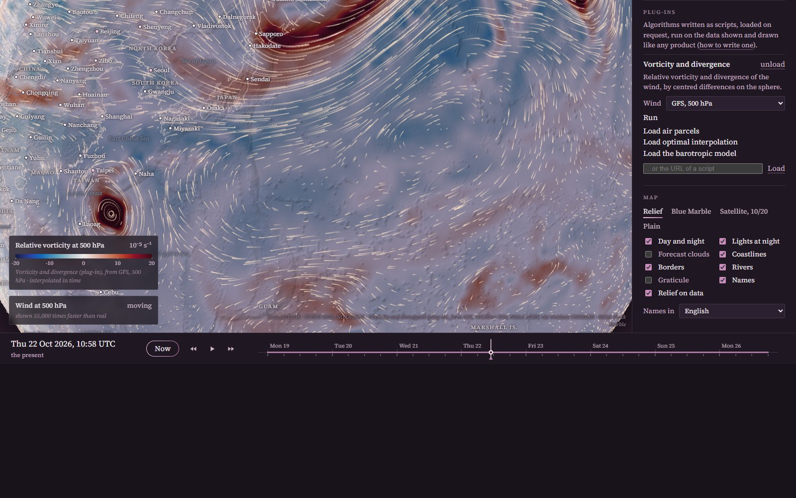</a><br><b>A diagnostic.</b> Relative vorticity at 500 hPa, computed from the GFS wind by centred differences on the sphere, in the unit of synoptic charts. The jet stream shows as paired bands, cyclonic (red) and anticyclonic (blue), and a typhoon near Taiwan as a knot of red; particles trace the wind that was differenced. The source and its level are chosen in the panel.</td>
<td width="50%" valign="top"><a href="../assets/gallery/earth-26-plugin-parcels.jpg">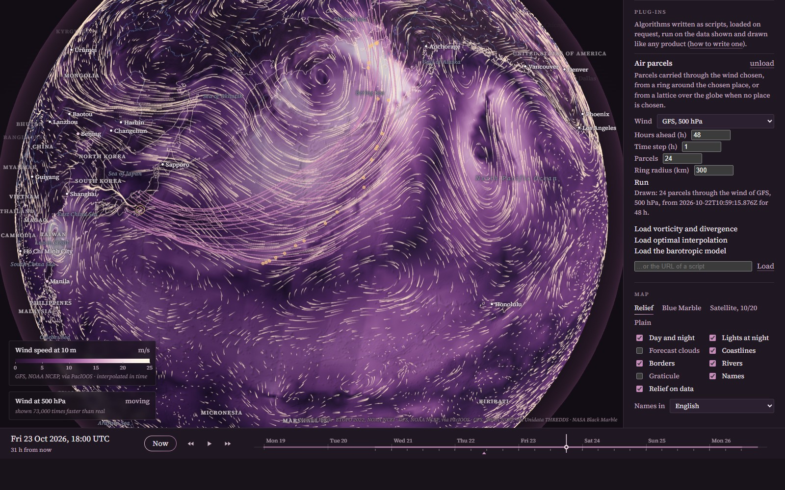</a><br><b>Trajectories.</b> Twenty-four parcels started on a ring 300 km around Tokyo and carried through the GFS forecast's 500 hPa wind, hour by hour through the forecast's own times, by a fourth-order Runge–Kutta step on the sphere. The paths are drawn whole; the points on them move with the time shown, here 36 hours on, well out over the Pacific.</td>
</tr>
<tr>
<td width="50%" valign="top"><a href="../assets/gallery/earth-27-plugin-assimilation.jpg">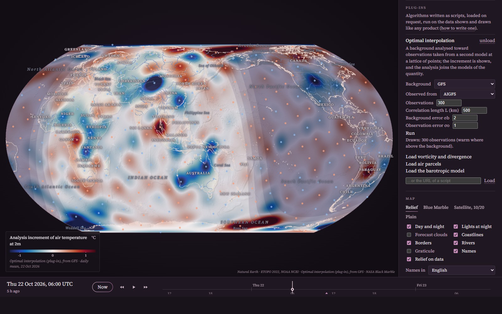</a><br><b>Data assimilation.</b> Optimal interpolation of the GFS temperature at 2 m, the background, toward 300 observations taken from NOAA's AI model AIGFS at a lattice of points: the increment the analysis adds, on a symmetric scale, with the observations drawn warm where they lie above the background and cool below (correlation length 500 km, σ<sub>b</sub> = 2 K, σ<sub>o</sub> = 1 K). The analysis itself joins the models of the quantity, and can be differenced against either.</td>
<td width="50%" valign="top"><a href="../assets/gallery/earth-28-plugin-barotropic.jpg">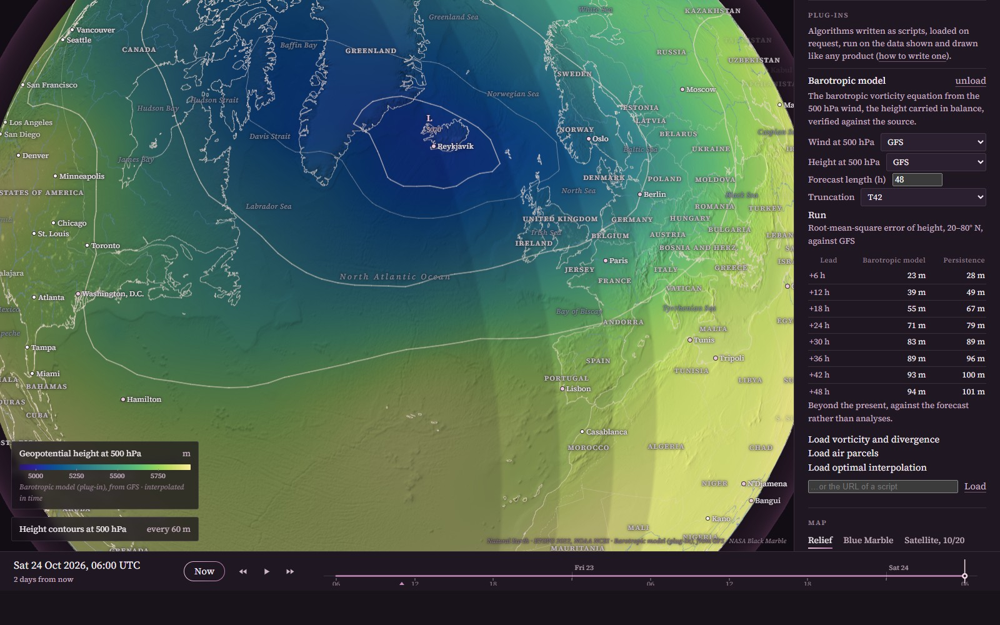</a><br><b>A forecast model.</b> The barotropic vorticity equation at T42, run through the <code>ForecastModel</code> class from the GFS wind at 500 hPa, 48 hours on: the height in balance with the flow, contours every 60 m, a low of 5070 m over Iceland. The panel sets its root-mean-square error of height over 20–80° N beside persistence at every recorded lead.</td>
</tr>
</table>

Each plug-in is checked without a page, in [the Earth Atlas's suite](../applications/earth-atlas/tests/run-tests.mjs), against an answer in closed form: the vorticity of a solid-body rotation, a parcel in such a rotation, an analysis that reproduces exact observations and leaves the far field alone, and a rotation the barotropic model keeps steady. How to use and write one is in [plugins/README.md](../applications/earth-atlas/plugins/README.md).

<table>
<tr>
<td width="50%" valign="top"><a href="../assets/gallery/earth-30b-plugin-cpp.jpg">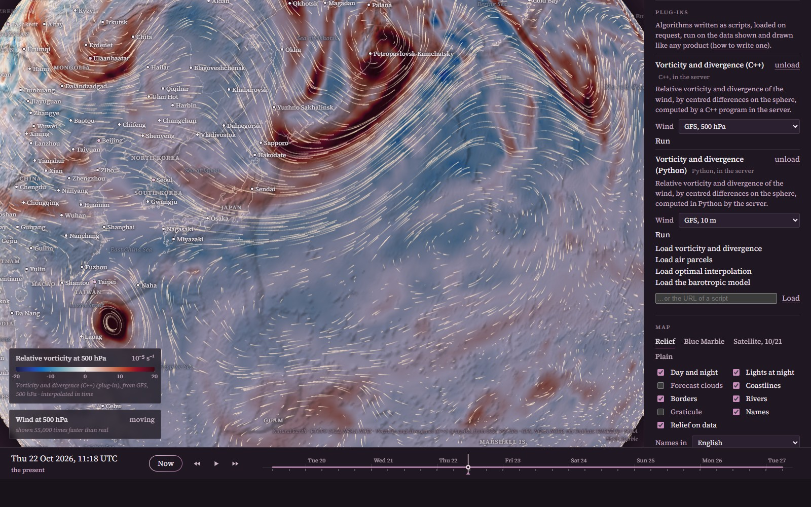</a><br><b>The same algorithm in C++,</b> on the project's server: the vorticity plug-in written as a program, compiled by the server with its own compiler, run on files behind one contract, and shown by the page exactly as the JavaScript one ([ADR 0029](../development/decisions/0029-plugins-in-python-and-cpp.md)). The three implementations, JavaScript, Python and C++, agree on a solid-body rotation to the last digit.</td>
<td width="50%" valign="top"><a href="../assets/gallery/earth-30-plugin-languages.jpg">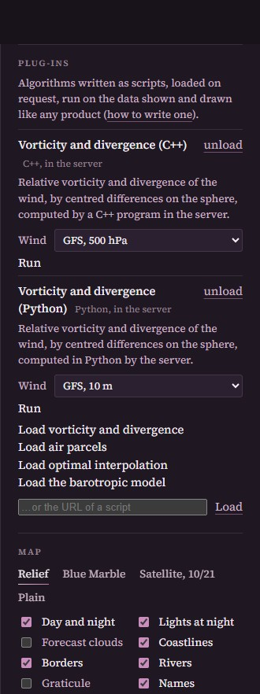</a><br><b>Three languages in one panel.</b> The C++ plug-in, run, and the Python one, loaded, each named with its language and where it runs; below them the JavaScript plug-ins still to load, and the field for a script's URL. The panel is the same whatever the language.</td>
</tr>
</table>

### 1.9 Observations, and Our Own Sensors

Weather stations, buoys and the user's own sensors are drawn as dots, each its report nearest the time shown, on the same colour scale as the models' fields, so that a dot and the field beneath it compare by eye ([ADR 0031](../development/decisions/0031-observations-scores-and-hazards.md)). A sensor's reading, posted to the API, appears on the globe within a tenth of a second ([observation/sensors](../observation/sensors/README.md)).

<table>
<tr>
<td width="50%" valign="top"><a href="../assets/gallery/earth-31-observations.jpg">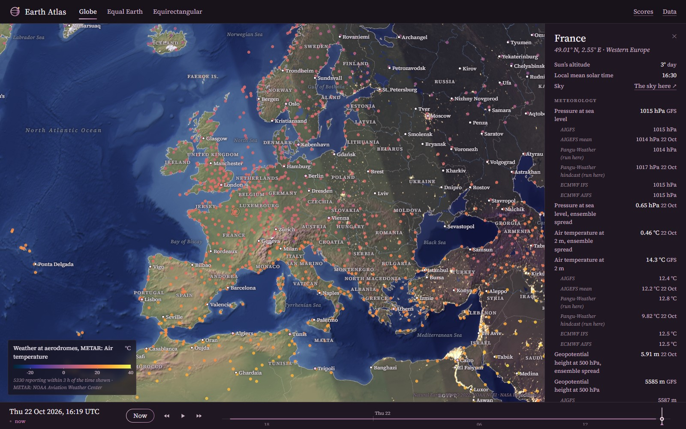</a><br><b>Weather at aerodromes.</b> Air temperature at about 5,300 aerodromes (METAR, NOAA Aviation Weather Center) at 16:19 UTC on 22 October 2026, each station's report nearest the time shown. The place card gives the models' values at a chosen place, and below them the nearest station's report.</td>
<td width="50%" valign="top"><a href="../assets/gallery/earth-32-buoys.jpg">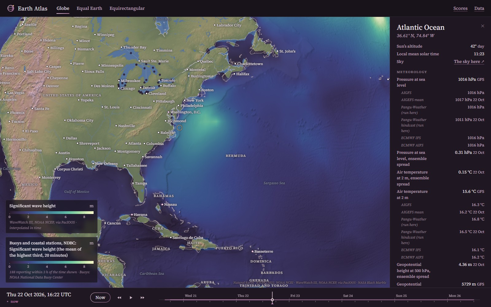</a><br><b>Waves measured and forecast.</b> NDBC buoys off the eastern United States, coloured by the significant wave height they measured, over WaveWatch III's forecast on the same scale.</td>
</tr>
</table>

### 1.10 ECMWF's Forecasts, the Scores, and Real Observations Assimilated

<table>
<tr>
<td width="50%" valign="top"><a href="../assets/gallery/earth-33-ecmwf.jpg">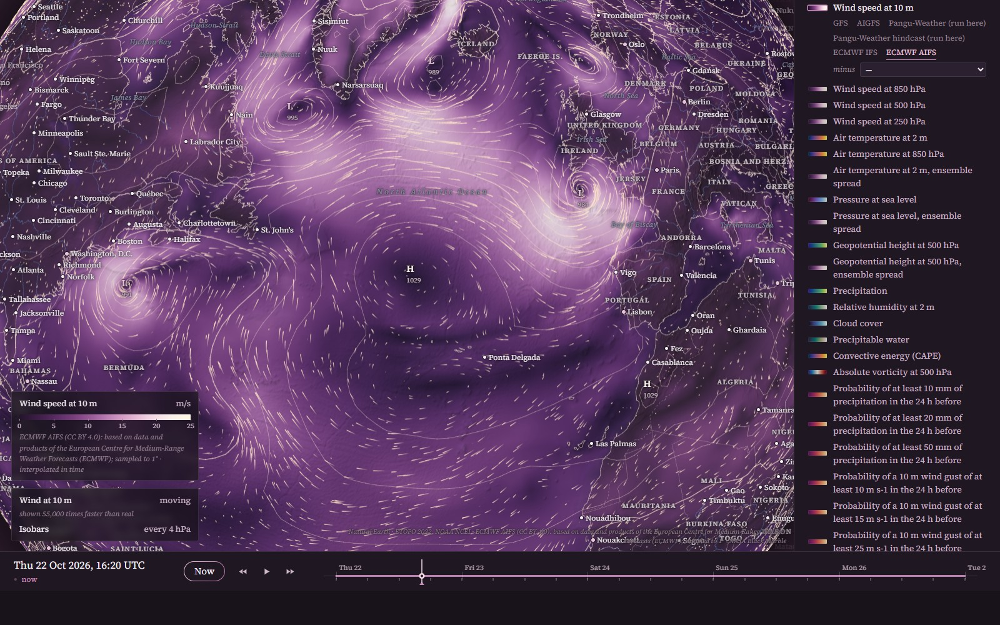</a><br><b>ECMWF's AI model.</b> AIFS's wind at 10 m and isobars over the North Atlantic, with lows of 984–995 hPa. ECMWF's IFS and AIFS are model buttons beside GFS, AIGFS and Pangu-Weather under every quantity (open data, CC BY 4.0: based on data and products of ECMWF).</td>
<td width="50%" valign="top"><a href="../assets/gallery/earth-34-ensemble-probability.jpg">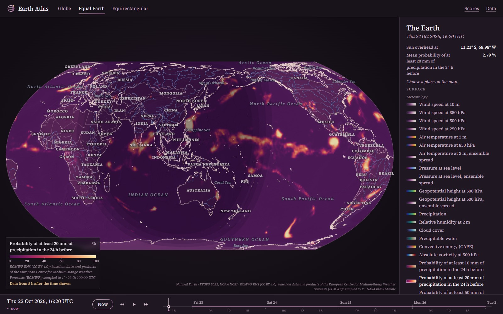</a><br><b>The ensemble as a probability.</b> The chance, among ECMWF's ensemble members, of at least 20 mm of rain in the 24 hours to 23 October 00 UTC: the intertropical convergence zone, the storm tracks, and a typhoon east of the Philippines.</td>
</tr>
<tr>
<td width="50%" valign="top"><a href="../assets/gallery/earth-35-scores.jpg">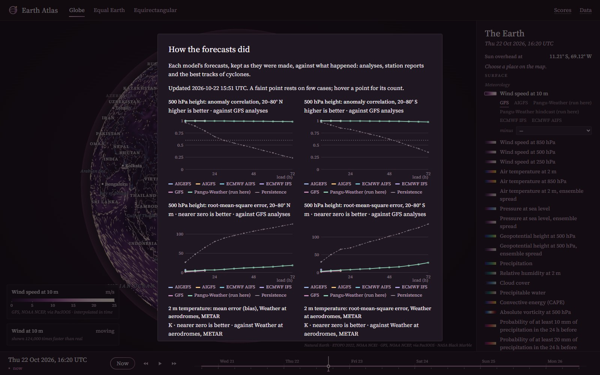</a><br><b>How the forecasts did.</b> Every run is kept and scored once its weather has happened. Pangu-Weather's 500 hPa height errs by 6.6 m at a day and 18.5 m at three; persistence (dashed) by 80 and 127 m. Its anomaly correlation stays above 0.98 at three days, while persistence falls to 0.24. Faint points rest on few cases.</td>
<td width="50%" valign="top"><a href="../assets/gallery/earth-36-assimilation.jpg">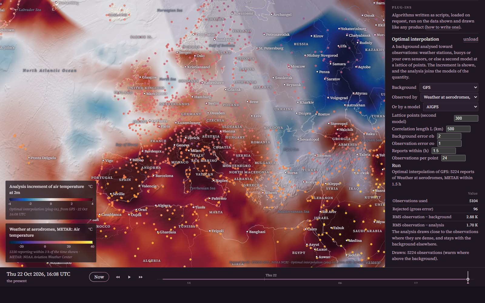</a><br><b>Real observations assimilated.</b> GFS's 2 m temperature analysed toward 5,104 METAR reports at the time shown, 96 rejected as gross errors: the increment, warm where the stations are warmer than the model. The root-mean-square difference from the stations falls from 2.88 K to 1.70 K.</td>
</tr>
</table>

### 1.11 Hazards

Hazard models in the domains, run as plug-ins on the forecasts and catalogues. None is a warning: warnings come from the national services.

<table>
<tr>
<td width="50%" valign="top"><a href="../assets/gallery/earth-37-fire-weather.jpg">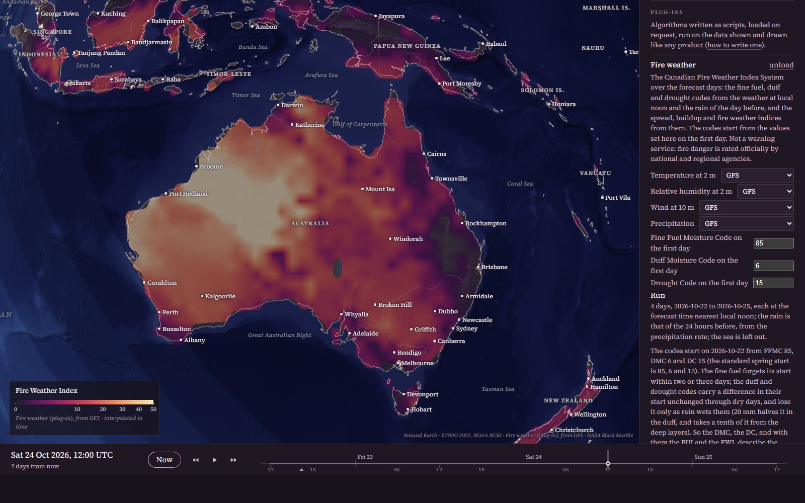</a><br><b>Fire weather.</b> The Canadian Fire Weather Index over Australia on 24 October 2026, from GFS's weather at local noon (Van Wagner 1987; the standard test data reproduced). The dry west and centre rate highest.</td>
<td width="50%" valign="top"><a href="../assets/gallery/earth-38-heat.jpg">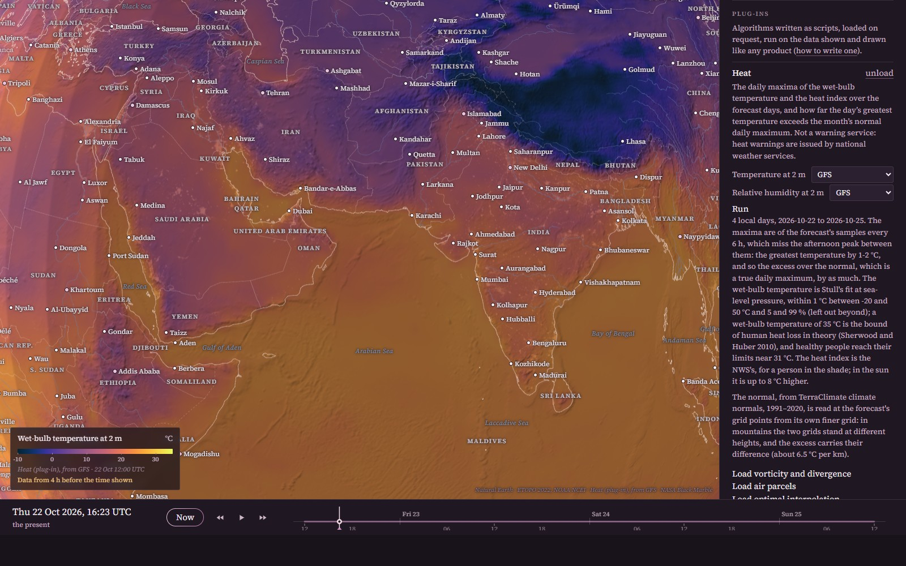</a><br><b>Heat.</b> The day's greatest wet-bulb temperature (Stull 2011), where heat meets humidity: highest over the warm seas and coasts of the Arabian Sea and the Bay of Bengal. The plug-in also gives the NWS heat index and the excess over the month's normal.</td>
</tr>
<tr>
<td width="50%" valign="top"><a href="../assets/gallery/earth-39-heavy-rain.jpg">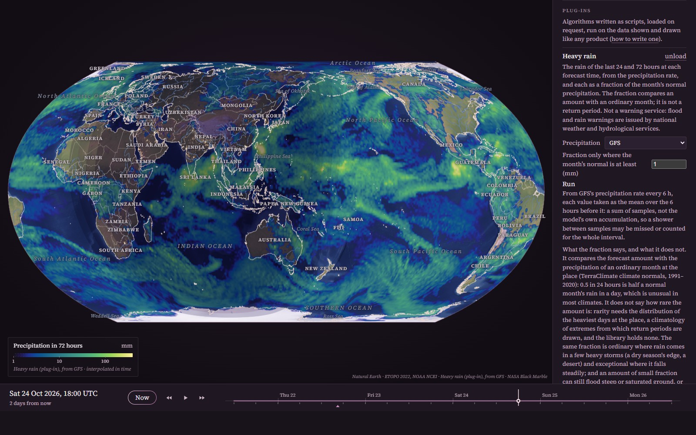</a><br><b>Heavy rain.</b> The rain of the 72 hours to 24 October 18:00 UTC from GFS, on a logarithmic scale; the plug-in also gives it as a fraction of the month's normal.</td>
<td width="50%" valign="top"><a href="../assets/gallery/earth-40-tsunami.jpg">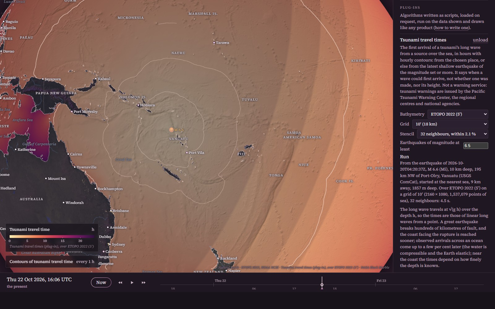</a><br><b>Tsunami travel times</b> from the M 6.6 earthquake off Vanuatu on 20 October, over ETOPO's bathymetry, with hourly contours: Port Vila in 44 minutes, Honiara in 1 h 09 min. Chile 1960, computed the same way, reaches Hilo in 14.9 h and Sanriku in 22.4 h, as observed.</td>
</tr>
<tr>
<td width="50%" valign="top"><a href="../assets/gallery/earth-41-aftershocks.jpg">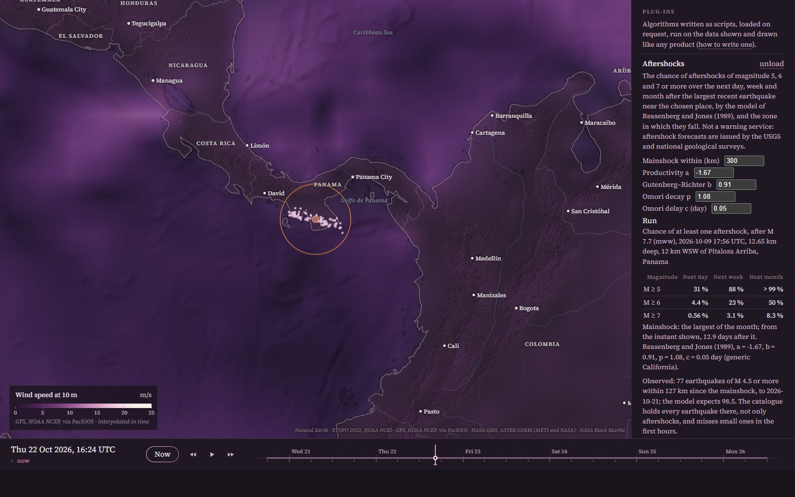</a><br><b>Aftershocks</b> of the M 7.7 earthquake off Panama on 9 October, 12.9 days on (Reasenberg and Jones 1989): a 23 % chance of M ≥ 6 in the next week, 50 % in the month. The circle is the zone of the rupture's length; the dots, the earthquakes since.</td>
<td width="50%" valign="top"><a href="../assets/gallery/earth-42-volcanic-ash.jpg">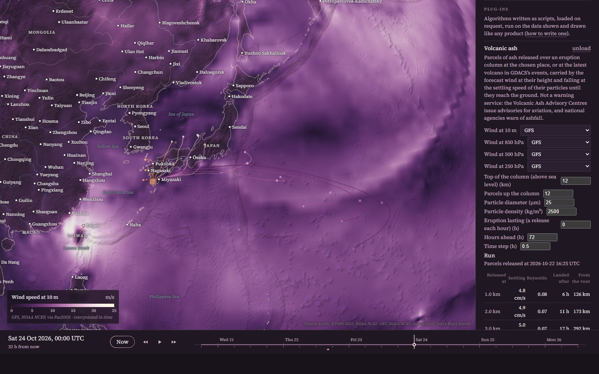</a><br><b>Volcanic ash</b> from Sakurajima: parcels of 25 µm ash released 1 to 12 km up the column, carried by the forecast wind at their height and settling at Stokes' speed. The lowest land on Kyushu and Shikoku within hours; the highest are carried thousands of kilometres east.</td>
</tr>
</table>

### 1.12 People, Regions and the Land

<table>
<tr>
<td width="50%" valign="top"><a href="../assets/gallery/earth-43-exposure.jpg">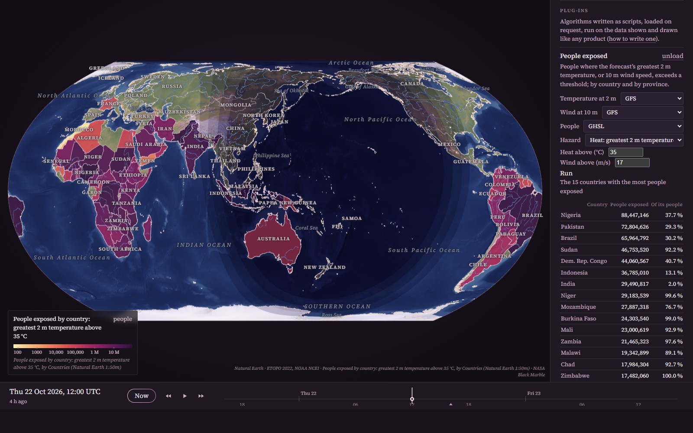</a><br><b>People exposed</b> to a forecast maximum above 35 °C, by country, from GHS-POP 2025 and GFS: 88 million in Nigeria, 73 million in Pakistan, 92 % of the people of Sudan. Provinces are offered too.</td>
<td width="50%" valign="top"><a href="../assets/gallery/earth-44-population.jpg">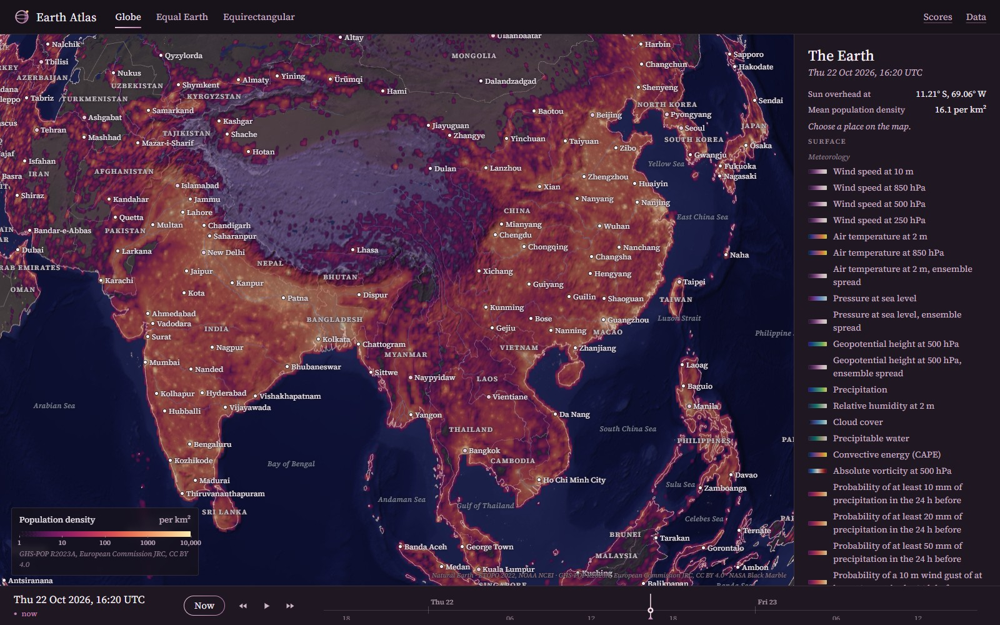</a><br><b>Where people live:</b> GHS-POP 2025 (European Commission JRC, CC BY 4.0), summed to 0.25°, on a logarithmic scale. Its world total, 8 191 988 536, is the release's own.</td>
</tr>
<tr>
<td width="50%" valign="top"><a href="../assets/gallery/earth-45-terrain.jpg">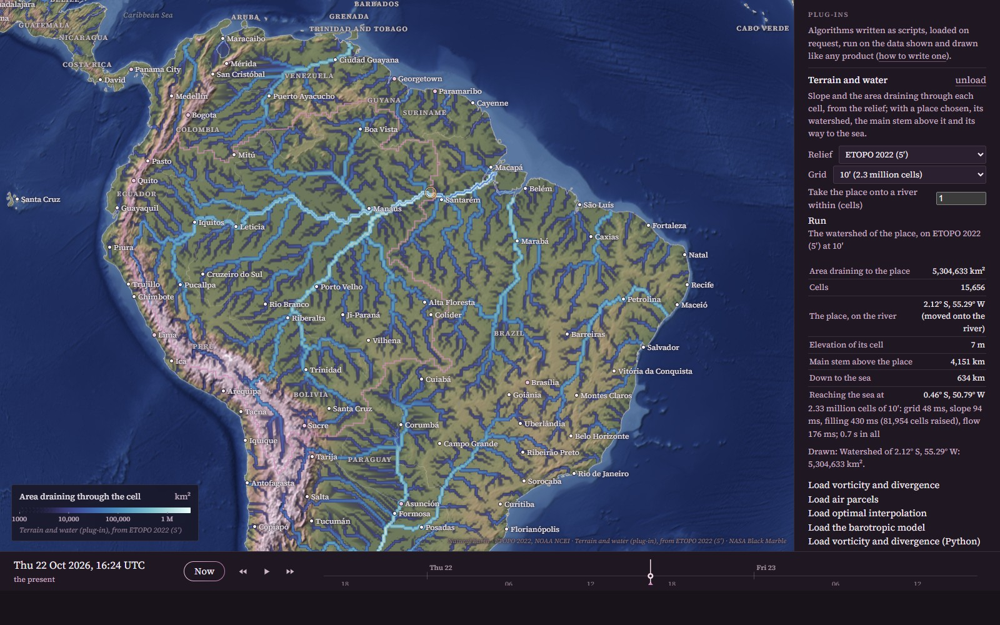</a><br><b>Terrain and water.</b> The area draining through each cell of South America, from ETOPO's relief by Priority-Flood and D8 (2.3 million cells in 0.7 s in the page), which draws the rivers; with the Amazon's watershed at Óbidos, 5.3 million km², its main stem and its way to the sea.</td>
<td width="50%" valign="top"><a href="../assets/gallery/earth-46-ndvi.jpg">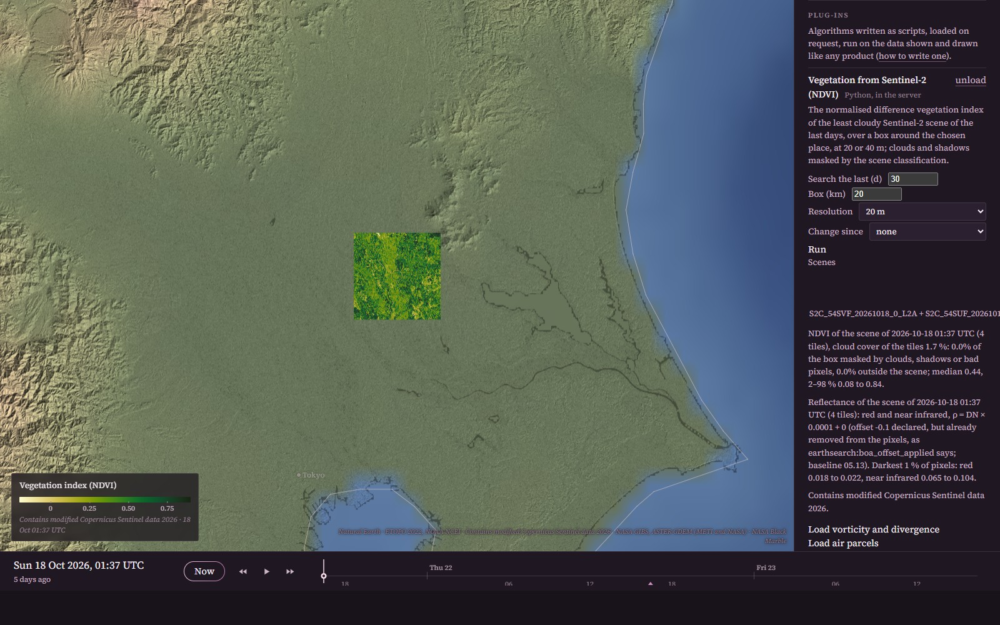</a><br><b>The Earth at 20 m.</b> The vegetation index (NDVI) of the Sentinel-2 scene of 18 October 2026 in a box of 20 km near Tsukuba, computed by a Python plug-in in the server from Cloud-Optimised GeoTIFF windows (contains modified Copernicus Sentinel data 2026). <a href="../assets/gallery/earth-46b-ndvi-close.jpg">A close-up</a> shows the Kinu and Kokai rivers among the fields.</td>
</tr>
</table>

Every product shown here is also served to programs in Python, C and C++ and JavaScript by the API ([api/README.md](../api/README.md)): fields sampled at places, observations and their stream, the domains' functions, and the plug-ins.

## 2. The Celestial Atlas

The Sun, the Moon, the planets, the stars and the galaxies, at any instant from 1849 to 2150 or live. Positions come from JPL's DE440 ephemeris, read directly from its kernel.

### 2.1 The Solar System

<table>
<tr>
<td width="50%" valign="top"><a href="../assets/gallery/celestial-01-solar-system.jpg"></a><br><b>The Solar System</b> on 21 October 2026, 22:21 UTC, with osculating orbits and the Milky Way behind the stars. Bodies are enlarged 600 times (the Sun 20 times), and the view says so.</td>
<td width="50%" valign="top"><a href="../assets/gallery/celestial-02-saturn.jpg"></a><br><b>Saturn</b> and its rings, which lie in its equatorial plane. Each body's map is turned to the instant shown by the IAU rotation models, which agree with JPL Horizons to within 0.011°.</td>
</tr>
<tr>
<td width="50%" valign="top"><a href="../assets/gallery/celestial-03-jupiter.jpg"></a><br><b>Jupiter</b>, lit by the Sun from its direction at that instant.</td>
<td width="50%" valign="top"><a href="../assets/gallery/celestial-04-earth-night.jpg"></a><br><b>The Earth at night.</b> The Blue Marble by day, and the Black Marble's lights where the Sun is below the horizon: the same imagery products as the Earth Atlas.</td>
</tr>
</table>

### 2.2 Close to the Moon and Mars, and Beyond the Sun

<table>
<tr>
<td width="50%" valign="top"><a href="../assets/gallery/celestial-05-moon.jpg"></a><br><b>The Moon</b> at close range. When a body fills the view, the part in view is fetched from NASA's Trek tiles (here the LRO wide-angle camera mosaic) at the screen's resolution.</td>
<td width="50%" valign="top"><a href="../assets/gallery/celestial-06-moon-close.jpg"></a><br><b>Closer still:</b> craters and a winding rille, lit by the Sun from its direction at that instant.</td>
</tr>
<tr>
<td width="50%" valign="top"><a href="../assets/gallery/celestial-07-mars.jpg"></a><br><b>Mars</b> from the Viking MDIM 2.1 colour mosaic, turned by Mars's IAU rotation model, periodic terms included.</td>
<td width="50%" valign="top"><a href="../assets/gallery/celestial-08-neighbourhood.jpg"></a><br><b>The stellar neighbourhood:</b> 1,900 stars within 20 parsecs from HYG v4.1, at their measured distances, in galactic coordinates, against the Milky Way.</td>
</tr>
</table>

### 2.3 Galaxies, the Sky and the Orbits

<table>
<tr>
<td width="50%" valign="top"><a href="../assets/gallery/celestial-09-local-volume.jpg"></a><br><b>The Local Volume.</b> 869 galaxies of the Updated Nearby Galaxy Catalog (Karachentsev et al. 2013), in supergalactic coordinates. Each is linked to its main disturber, and the tidal groups are named. The atlas recomputes the disturbers; they agree with the published ones for 99.2 % of galaxies.</td>
<td width="50%" valign="top"><a href="../assets/gallery/celestial-10-hubble-flow.jpg"></a><br><b>The Hubble flow</b> of the Local Volume: velocity against distance, coloured by tidal index, with v = H₀d for H₀ = 73 km s⁻¹ Mpc⁻¹.</td>
</tr>
<tr>
<td width="50%" valign="top"><a href="../assets/gallery/celestial-11-local-universe.jpg"></a><br><b>The Local Universe.</b> 43,037 galaxies of the 2MASS Redshift Survey in 25,474 groups (Tully 2015), linked to their group centres. Clusters are named through SIMBAD.</td>
<td width="50%" valign="top"><a href="../assets/gallery/celestial-12-sky-chart.jpg"></a><br><b>The sky</b> over Tokyo on the morning of 22 October 2026, drawn as a star atlas. It shows the constellations, the bright stars and the planets, with refraction applied.</td>
</tr>
<tr>
<td width="50%" valign="top"><a href="../assets/gallery/celestial-13-orbits.jpg"></a><br><b>The orbits</b> of the inner planets seen from the north ecliptic pole, with the lines of sight from the Earth and each planet's elongation.</td>
<td width="50%" valign="top"><a href="../assets/gallery/celestial-14-sky-from-a-place.jpg"></a><br><b>The sky from a place</b> chosen by clicking the Earth: here San Pedro de Atacama, at 01:30 local time on 22 October 2026, with Canopus, Achernar and the far southern constellations high in the south. The globe in the panel shows the Earth by day and its lights by night at that instant. "The weather here" opens the Earth Atlas at the same place and time.</td>
</tr>
</table>

## 3. The Brain Atlas

The human brain in the round, every part of it clickable for its anatomy; sections through it; atlases and data mapped onto it; the head and its electrodes around it; and the mouse brain beside it ([ADR 0028](../development/decisions/0028-neuroscience-and-the-brain-atlas.md), [ADR 0032](../development/decisions/0032-the-anatomy-of-the-brain-atlas.md)).

<table>
<tr>
<td width="50%" valign="top"><a href="../assets/gallery/brain-01-gyri.jpg">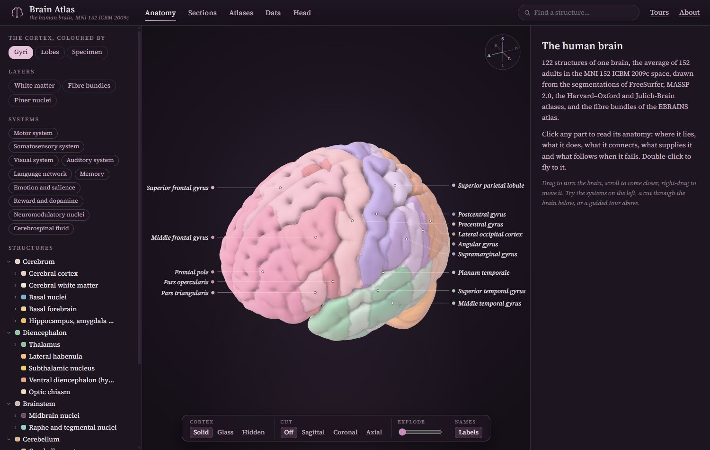</a><br><b>The brain in the round</b>, the unbiased average of 152 adults (MNI 152 ICBM 2009c): the cortex from the template's tissue maps, coloured by the Harvard–Oxford gyri in the hues of their lobes and shaded by its sulcal depth, with the names set out beside it as on an engraved plate.</td>
<td width="50%" valign="top"><a href="../assets/gallery/brain-02-hippocampus.jpg"></a><br><b>Through a glass cortex</b>, the deep structures: the caudate and putamen, the thalamus, the hippocampus and amygdala, the ventricles, the brainstem and the cerebellum. Choosing a structure opens its card: its Latin name, its measures on each side, where it lies, what it does, what it connects, its blood supply and what follows when it fails, with the sources of each statement.</td>
</tr>
<tr>
<td width="50%" valign="top"><a href="../assets/gallery/brain-03-coronal-section.jpg"></a><br><b>A coronal cut</b> near the anterior commissure, from the tour <i>Into the deep nuclei</i>: the face of the cut shows the template's image washed in the colour of each structure, from the ventricle outward through the caudate, the internal capsule, the pallidum and the putamen to the insula.</td>
<td width="50%" valign="top"><a href="../assets/gallery/brain-04-arcuate.jpg"></a><br><b>The arcuate fasciculus</b>, from the tour <i>The paths of language</i>: its long segment in red, its anterior and posterior segments in green and yellow, as Catani et al. (2005) colour them, from the EBRAINS atlas of the deep white-matter bundles (Guevara et al. 2012).</td>
</tr>
<tr>
<td width="50%" valign="top"><a href="../assets/gallery/brain-05-sections.jpg"></a><br><b>Sections</b> through the template, every structure washed in its colour and the chosen one, the putamen, outlined; the card beside them is the same as in the round.</td>
<td width="50%" valign="top"><a href="../assets/gallery/brain-06-julich-area-44.jpg">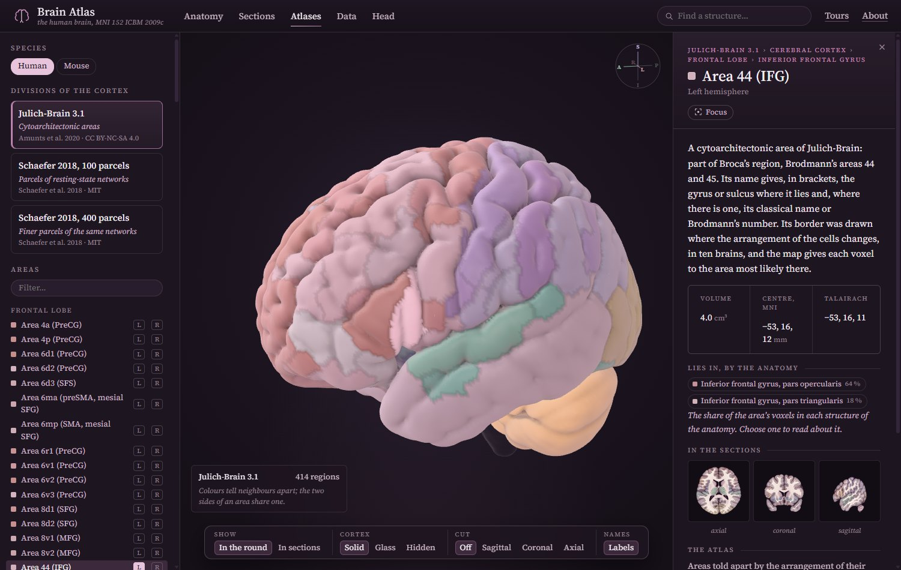</a><br><b>Julich-Brain 3.1</b>, the cortex divided by its cells (Amunts et al. 2020), each area in a hue of its lobe. Area 44, the posterior half of Broca's region, is chosen: the card says where it lies in the gross anatomy, 64 % of it in the pars opercularis.</td>
</tr>
<tr>
<td width="50%" valign="top"><a href="../assets/gallery/brain-07-networks.jpg">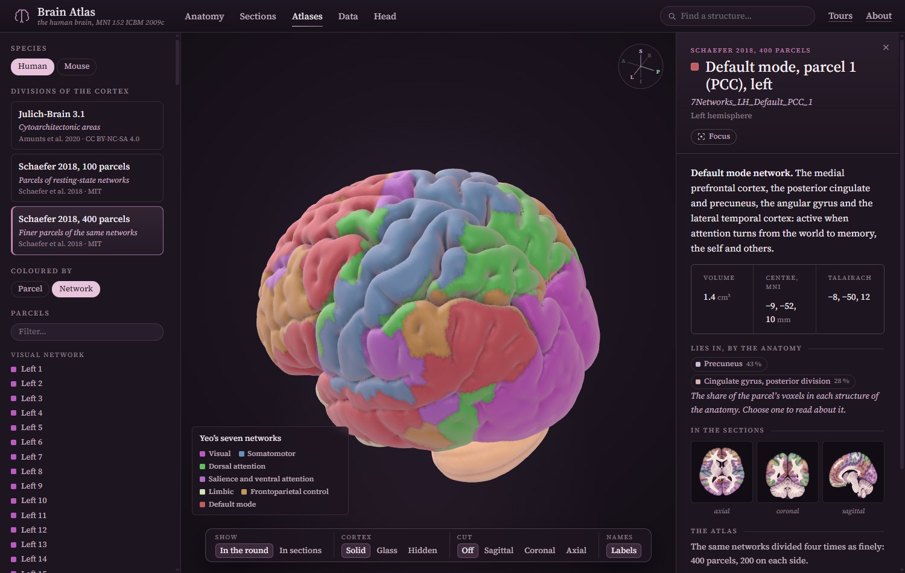</a><br><b>Schaefer's 400 parcels</b> coloured by the seven networks of Yeo et al. (2011). A parcel of the default mode network is chosen; its card describes the network and finds the parcel in the precuneus and the posterior cingulate gyrus.</td>
<td width="50%" valign="top"><a href="../assets/gallery/brain-08-scalp-map.jpg">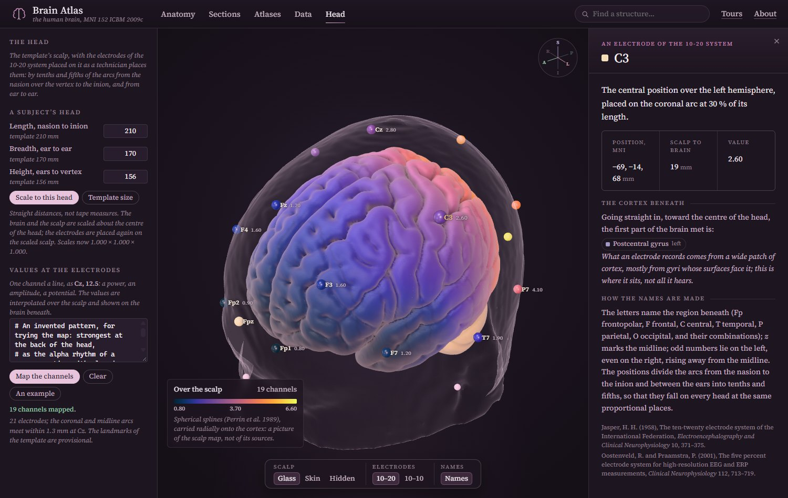</a><br><b>The head and its electrodes</b>: the scalp cast from the template, the 10–20 system placed on it by the arcs between the nasion, the inion and the ears, and channel values interpolated by spherical splines (Perrin et al. 1989) and carried onto the cortex. The card of C3 names the gyrus beneath it and the depth to the brain.</td>
</tr>
<tr>
<td width="50%" valign="top"><a href="../assets/gallery/brain-09-mouse.jpg">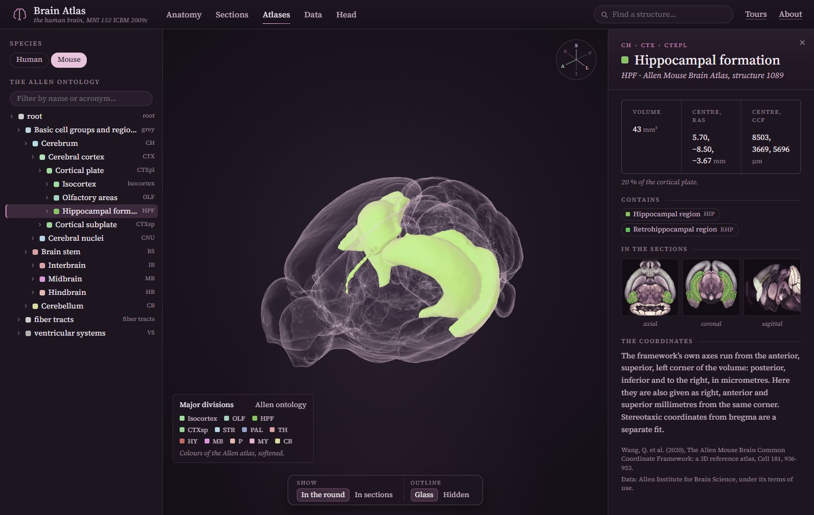</a><br><b>The mouse brain</b> in the Allen Common Coordinate Framework (Wang et al. 2020): its major divisions in the atlas's colours, softened, inside a glass outline, the ontology as a tree, and the hippocampal formation chosen.</td>
<td width="50%" valign="top"></td>
</tr>
</table>

### 3.1 Signals on the Brain

The Signals mode carries recordings of the living brain onto the template: EEG through a model of the head and an inverse estimate, MEG beside it, and fMRI read through the cortex ([ADR 0034](../development/decisions/0034-biosignals-on-the-brain.md)).

<table>
<tr>
<td width="50%" valign="top"><a href="../assets/gallery/brain-10-alpha-sources.jpg">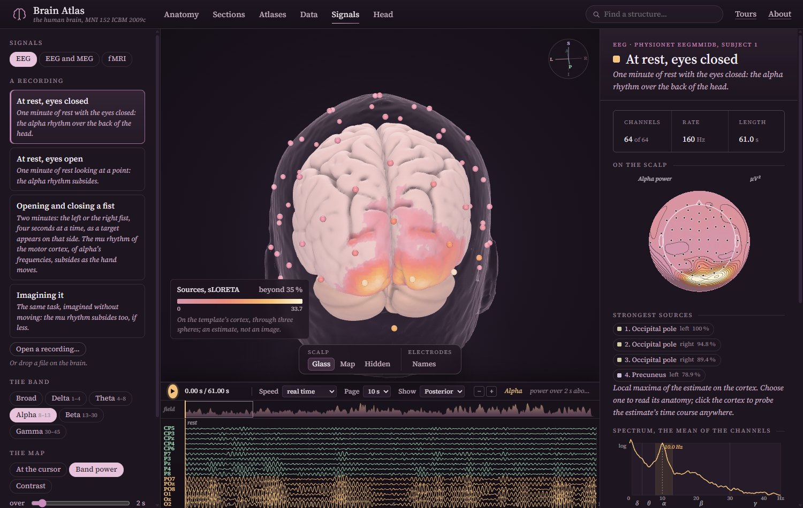</a><br><b>The alpha rhythm</b> of one person at rest with the eyes closed (PhysioNet's EEG Motor Movement/Imagery Dataset, Schalk et al. 2004): its power over a minute, carried from 64 electrodes to 4,694 sources on the cortex through three spheres (Rush and Driscoll 1968) and sLORETA (Pascual-Marqui 2002). It lies at both occipital poles, where Berger (1929) found it; the scalp map, the strongest sources and the spectrum, peaking at 10 Hz, are on the card, the 64 traces below.</td>
<td width="50%" valign="top"><a href="../assets/gallery/brain-11-potential.jpg">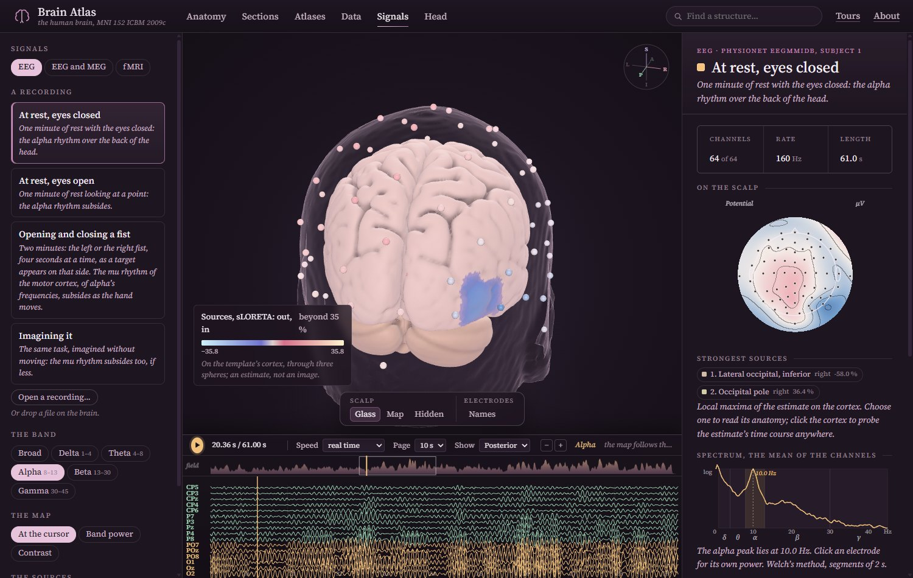</a><br><b>One instant</b> of the same recording, filtered to the alpha band: the potential on the scalp by spherical splines, and the signed estimate on the cortex, the current flowing out (warm) or in (cool). Playing the recording, at any speed down to a tenth, moves the cursor through the traces and the maps with it.</td>
</tr>
<tr>
<td width="50%" valign="top"><a href="../assets/gallery/brain-12-mu-rhythm.jpg"></a><br><b>The mu rhythm</b> subsiding as a fist opens and closes: the power of 8–13 Hz in the spans of movement, against the spans of rest, read from the recording's annotations. The ratio falls most over the postcentral and precentral gyri of both sides, the event-related desynchronisation of Pfurtscheller and Lopes da Silva (1999).</td>
<td width="50%" valign="top"><a href="../assets/gallery/brain-13-eeg-and-meg.jpg">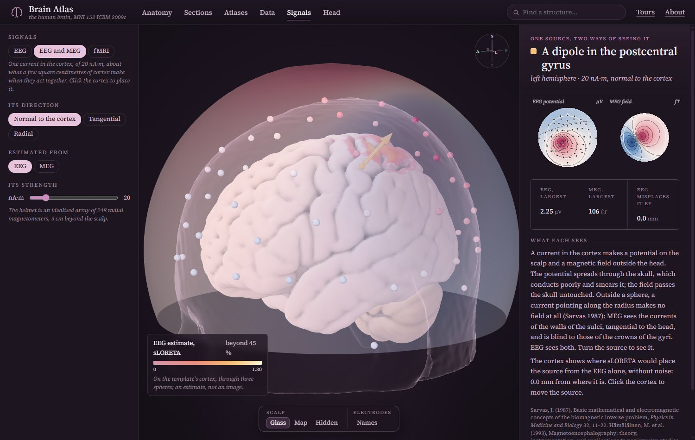</a><br><b>EEG and MEG</b> of one current in the postcentral gyrus, placed by a click: the potential through three shells and the field by Sarvas's formula (1987) on a helmet of 248 magnetometers. The potential is broad, the field a tight pair of poles at right angles to it; turn the current to point along the radius and the field vanishes, while the potential stays.</td>
</tr>
<tr>
<td width="50%" valign="top"><a href="../assets/gallery/brain-14-fmri-hand.jpg"></a><br><b>Moving the right hand</b>, an fMRI map of one person from the Individual Brain Charting project (Pinho et al. 2018), smoothed by 6 mm and read through the cortex onto its surface: the hand knob of the left central sulcus, with the peaks named by the anatomy at them.</td>
<td width="50%" valign="top"><a href="../assets/gallery/brain-15-fmri-language.jpg"></a><br><b>Listening to stories</b>, against mental arithmetic: warm on the left middle temporal and angular gyri, where language and meaning are; cool over the intraparietal sulci, where the arithmetic is.</td>
</tr>
<tr>
<td width="50%" valign="top"><a href="../assets/gallery/brain-16-fmri-sections.jpg"></a><br><b>In sections</b>, the same map over the template's image, at its peak in the left middle temporal gyrus; a click on a peak in the card goes there.</td>
<td width="50%" valign="top"><a href="../assets/gallery/brain-17-fmri-faces.jpg"></a><br><b>Seeing faces</b>, against bodies, places and tools: the occipital and fusiform face areas of both sides, on the underside of the occipital and temporal lobes.</td>
</tr>
</table>

## 4. The Spiking Simulator

Networks of spiking neurons composed from the neuroscience domain's twenty-two models, classical and quantum, and run by its C++ engine: exact where the dynamics are linear, the same spikes on any number of threads ([ADR 0038](../development/decisions/0038-the-spiking-simulator.md)). Each picture is one of the simulator's examples, run on 23 October 2026 on the development machine (four cores, WSL) and shown by its visualizer; every number in a caption is the run's own, from the engine's analysis over the window it states. The simulator is not online; to run these examples yourself, see [the Spiking Simulator on your computer](../README.md#the-spiking-simulator-on-your-computer) in the README's Quick Start.

<table>
<tr>
<td width="50%" valign="top"><a href="../assets/gallery/snn-01-asynchronous-irregular.jpg">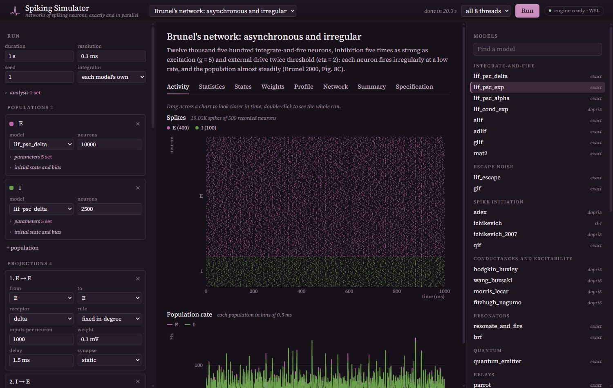</a><br><b>Brunel's balanced network</b> (Brunel 2000, Fig. 8C): 10,000 excitatory and 2,500 inhibitory integrate-and-fire neurons, each receiving 1,000 and 250 synapses after 1.5 ms, inhibition five times as strong (g = 5), Poisson drive twice threshold (η = 2); 15.6 million synapses, a second of activity. 400 and 100 of them are drawn over the populations' rates. Each fires at 38 Hz, its intervals varying with a CV of 0.43, the population's rate without a rhythm.</td>
<td width="50%" valign="top"><a href="../assets/gallery/snn-02-fast-oscillation.jpg">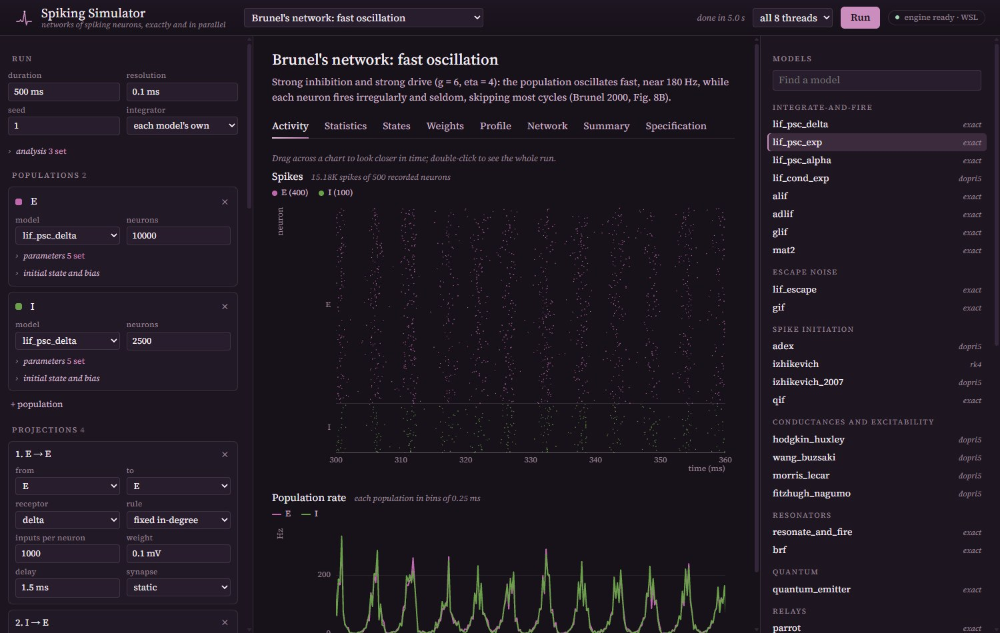</a><br><b>The fast oscillation</b> (g = 6, η = 4; Fig. 8B), dragged out to 300–360 ms: the population fires in volleys 5.3 ms apart, the 187.5 Hz rhythm of its spectrum, while each neuron, at 60 Hz, joins about one volley in three and skips the rest, irregularly (CV 0.78).</td>
</tr>
<tr>
<td width="50%" valign="top"><a href="../assets/gallery/snn-03-fast-oscillation-statistics.jpg">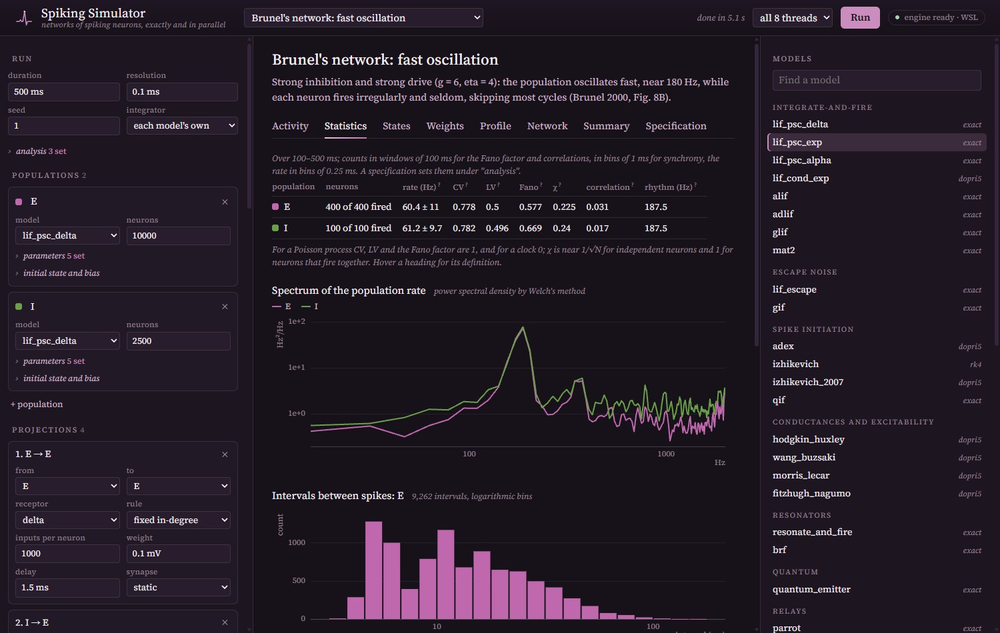</a><br><b>Its statistics</b>, the engine's own: rates, the irregularity of intervals (CV, and the local variation LV), Fano factors, Golomb's synchrony χ = 0.23 (independent neurons would give 1/√400 = 0.05), and the spectrum of the population's rate by Welch's method, its peak at 187.5 Hz; the intervals between spikes below.</td>
<td width="50%" valign="top"><a href="../assets/gallery/snn-04-synchronous-regular.jpg">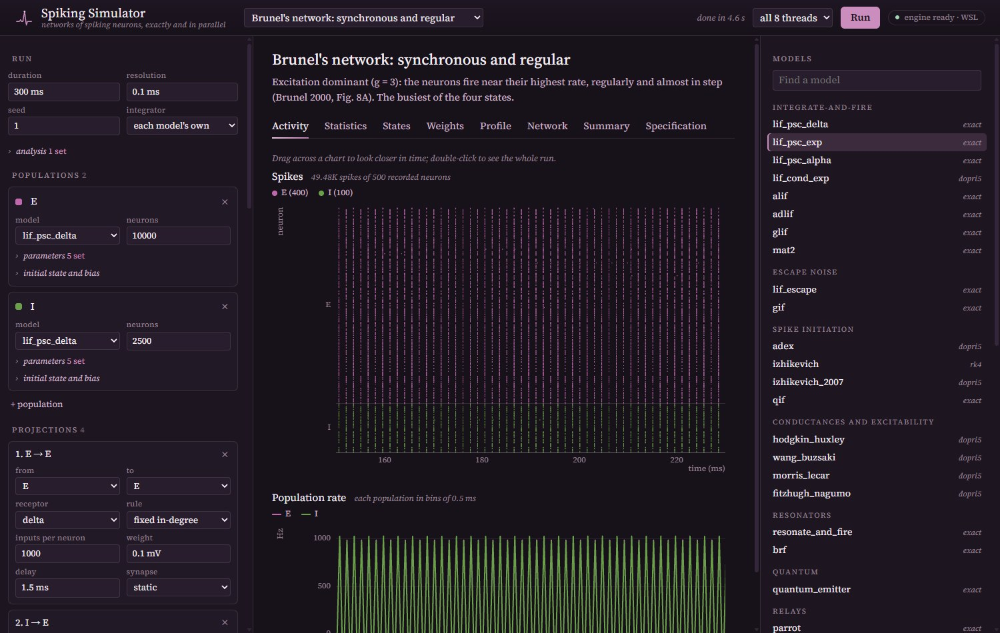</a><br><b>Excitation dominant</b> (g = 3, η = 2; Fig. 8A), between 150 and 230 ms: every neuron fires at 332 Hz, near the limit set by its 2 ms refractory period, as regularly as a clock (CV below 0.01) and in step with the others (χ = 0.50).</td>
</tr>
<tr>
<td width="50%" valign="top"><a href="../assets/gallery/snn-05-slow-oscillation.jpg">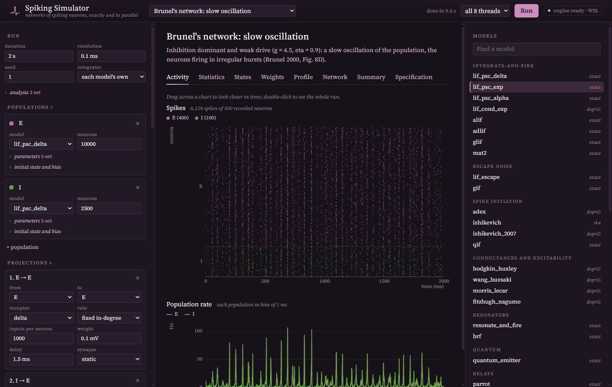</a><br><b>The slow oscillation</b> (g = 4.5, η = 0.9; Fig. 8D), two seconds: the population's rate rises and falls with a rhythm of 19.5 Hz, while each neuron fires at 6.3 Hz, irregularly (CV 0.66), in some of its waves.</td>
<td width="50%" valign="top"><a href="../assets/gallery/snn-06-classes-of-excitability.jpg">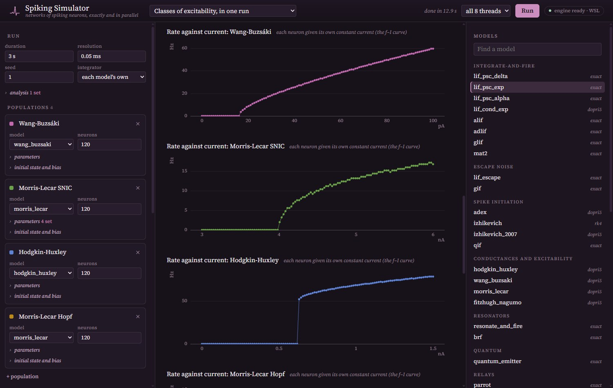</a><br><b>The classes of excitability, in one run</b>: populations of 120 neurons, each neuron given its own current, so that its rate is a point of the model's f–I curve. Wang and Buzsáki's interneuron (1996) begins to fire at 16 pA, at any low rate, as Morris and Lecar's fibre does with Rinzel and Ermentrout's SNIC parameters, at 4 nA: class 1. Hodgkin and Huxley's axon jumps from silence to about 50 Hz near 0.6 nA: class 2 (Hodgkin 1948).</td>
</tr>
<tr>
<td width="50%" valign="top"><a href="../assets/gallery/snn-07-quantum-emitters.jpg">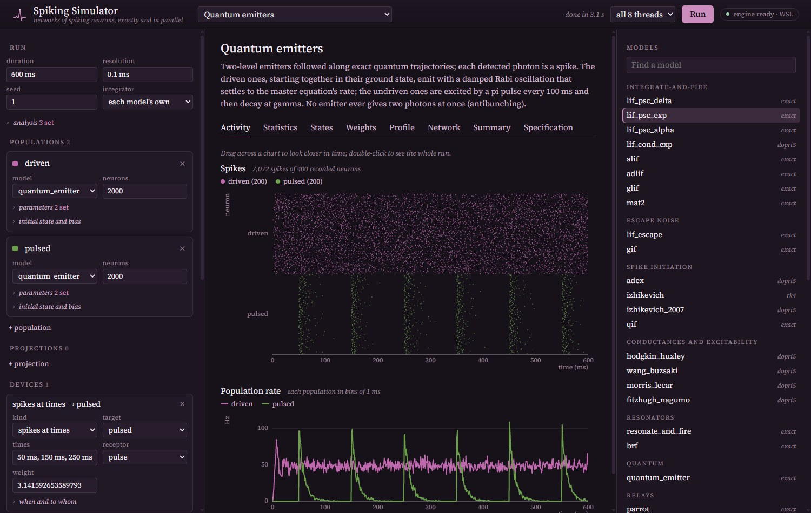</a><br><b>Quantum emitters</b>, two-level systems followed along exact quantum trajectories, each detected photon a spike. 2,000 driven ones (Ω = 400 rad/s, γ = 100/s), starting together in their ground state, emit with a damped Rabi oscillation that settles near the master equation's 48.5 photons a second; 2,000 undriven ones, given a π pulse every 100 ms, decay at γ after each. No emitter gives two photons at once: the driven ones' Fano factor is 0.88, below Poisson's 1.</td>
<td width="50%" valign="top"><a href="../assets/gallery/snn-08-stdp.jpg">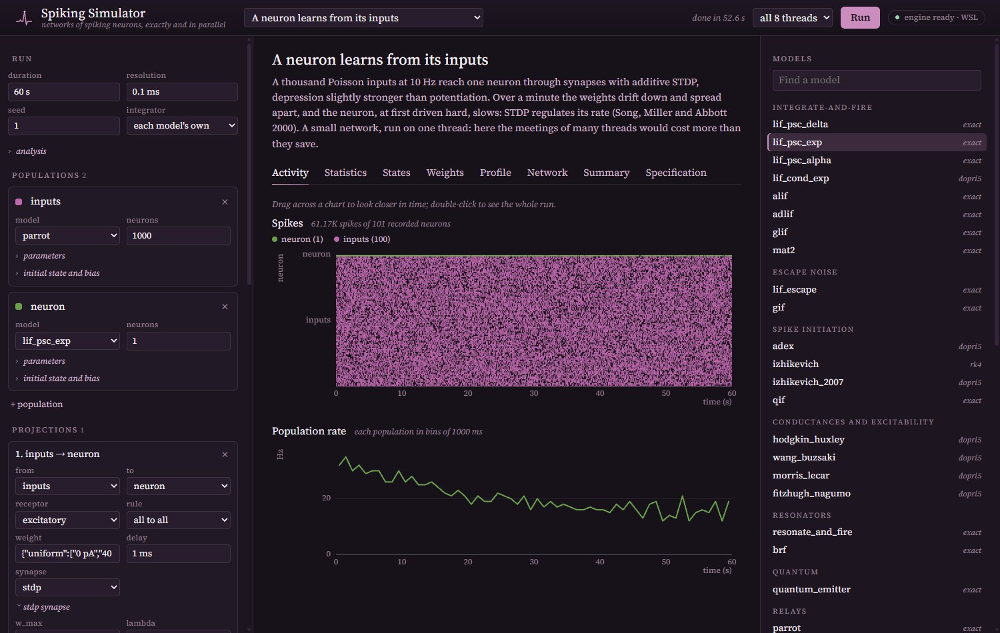</a><br><b>A neuron learns from its inputs</b> (Song, Miller and Abbott 2000): a thousand Poisson inputs at 10 Hz reach it through synapses with additive STDP, depression 5 % the stronger. Over a minute the weights wear down and spread (mean 20.5 to 17.5 pA, standard deviation 11.5 to 12.8 pA), and the neuron, first driven at 34 Hz, slows to about 16 Hz.</td>
</tr>
<tr>
<td width="50%" valign="top"><a href="../assets/gallery/snn-09-adaptation.jpg">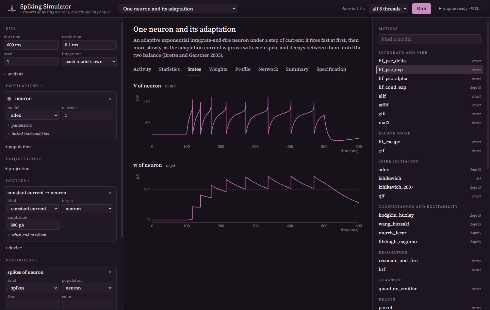</a><br><b>Adaptation</b> in one adaptive exponential integrate-and-fire neuron (Brette and Gerstner 2005) under 800 pA from 100 to 500 ms: it fires fast at first, then more slowly, as the adaptation current w steps up by 80.5 pA at each spike and decays between them; after the step w ebbs and the potential sinks below rest before returning.</td>
<td width="50%" valign="top"><a href="../assets/gallery/snn-10-network.jpg">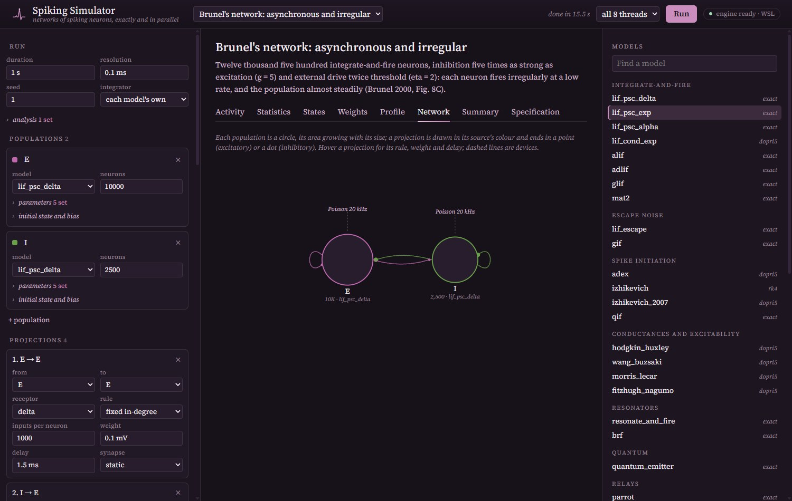</a><br><b>The network drawn</b> from its specification: the two populations, their four projections (inhibitory ones ending in a dot) and the Poisson drive of each. Every network here is the engine's own JSON specification, with its quantities in units, and runs unchanged from the command line.</td>
</tr>
</table>

## 5. The Complex Atlas

Cell complexes, their invariants and the fields on them, and the generation of spacetime by field theories, from the foundations morphe and physis through the atlas's C++ engine ([ADR 0039](../development/decisions/0039-complexes-symmetry-and-fields.md), [ADR 0040](../development/decisions/0040-the-generation-of-spacetime.md)). Every number in the captions is the engine's own, computed on 23 October 2026 on the development machine; the runs are seeded, so each picture comes back the same.

<table>
<tr>
<td width="50%" valign="top"><a href="../assets/gallery/complex-01-gauge-torus.jpg">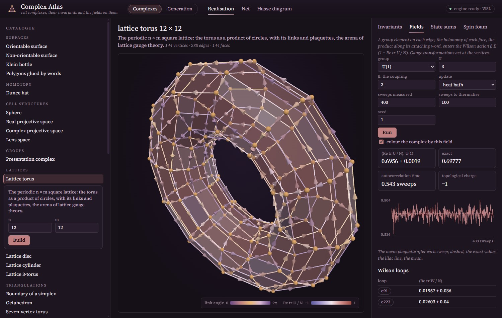</a><br><b>A gauge field on a lattice torus</b>: U(1) on the 12 × 12 periodic lattice at β = 2, by heat bath and overrelaxation, 400 sweeps after 100. The links are coloured by their angle and the plaquettes by Re U. The mean plaquette, 0.6956 ± 0.0019, agrees with the exact value of two-dimensional Yang–Mills on a torus, 0.69777 (Migdal 1975; Witten 1991). The topological charge is an integer, −1, and the two Polyakov loops along the generators of π₁ vanish within their errors, as the centre symmetry requires.</td>
<td width="50%" valign="top"><a href="../assets/gallery/complex-02-genus-two-net.jpg">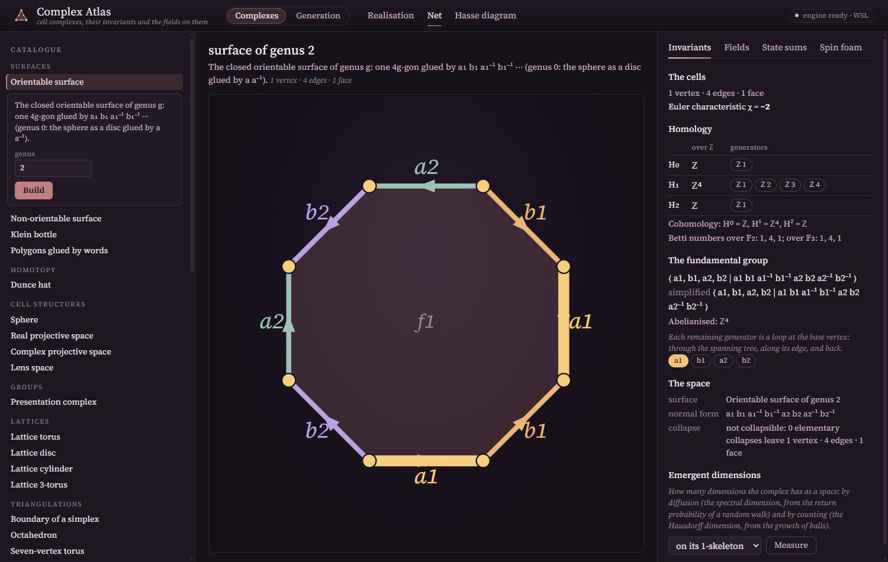</a><br><b>The surface of genus 2</b> as one octagon glued by its word a₁ b₁ a₁⁻¹ b₁⁻¹ a₂ b₂ a₂⁻¹ b₂⁻¹: one vertex, four edges, one face, χ = −2. Its homology ℤ, ℤ⁴, ℤ and its fundamental group come from morphe's exact computation; the generator a₁ is drawn as its loop, the two sides it glues lit together.</td>
</tr>
<tr>
<td width="50%" valign="top"><a href="../assets/gallery/complex-03-torus-seven-generator.jpg">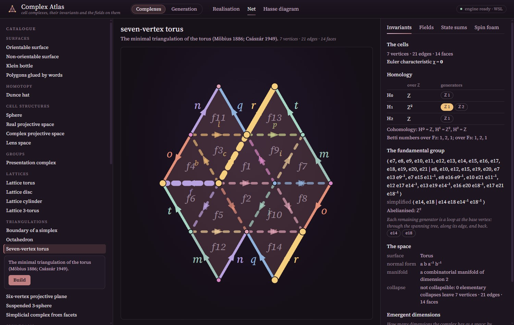</a><br><b>The seven-vertex torus</b>, the minimal triangulation (Möbius 1886; Császár 1949), unfolded into its net: fourteen triangles in a hexagon whose sides are glued in pairs. A generator of H₁ = ℤ² is drawn in gold. The fundamental group simplifies from fifteen generators to ⟨e14, e18 | e14 e18 e14⁻¹ e18⁻¹⟩.</td>
<td width="50%" valign="top"><a href="../assets/gallery/complex-04-feynman-graphs.jpg">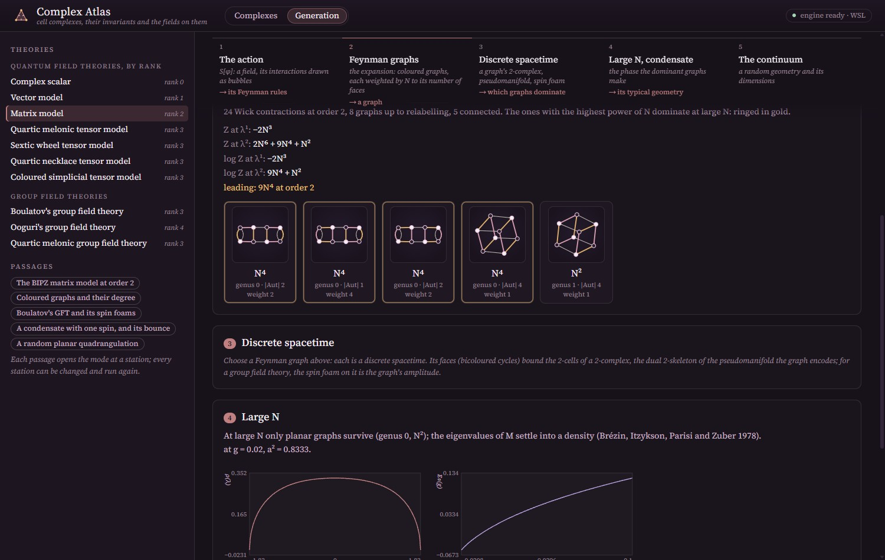</a><br><b>A field theory's Feynman graphs</b>: the matrix model S = tr MM† + λ tr (MM†)² at second order, in the Generation mode. Its 24 Wick contractions fall into 8 graphs, 5 of them connected, each a 3-coloured graph (a ribbon graph) weighted N to its faces. The series are exact: Z = 1 − 2N³λ + (2N⁶ + 9N⁴ + N²)λ² + … and log Z = −2N³λ + (9N⁴ + N²)λ² + …. The planar graphs, which dominate, are ringed in gold.</td>
</tr>
<tr>
<td width="50%" valign="top"><a href="../assets/gallery/complex-05-planar-limit.jpg">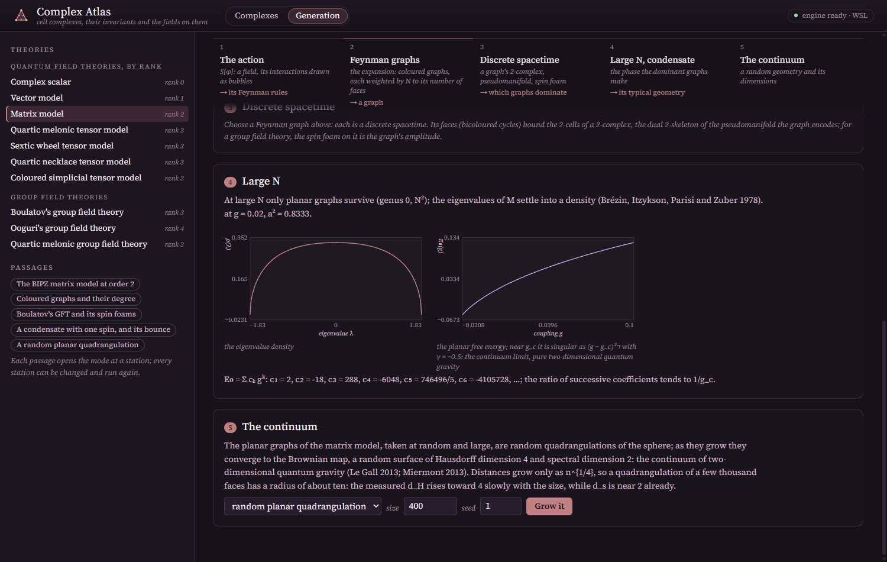</a><br><b>The planar limit</b>: at large N only planar graphs survive, and the eigenvalues settle into the density of Brézin, Itzykson, Parisi and Zuber (1978), here at g = 0.02 for V = M²/2 + gM⁴. The planar free energy ends at g_c = −1/48. There the planar surfaces grow without bound: the continuum of two-dimensional quantum gravity, with string susceptibility γ = −1/2. The engine reads −0.4999995 from 400 exact coefficients.</td>
<td width="50%" valign="top"><a href="../assets/gallery/complex-06-coloured-graphs.jpg">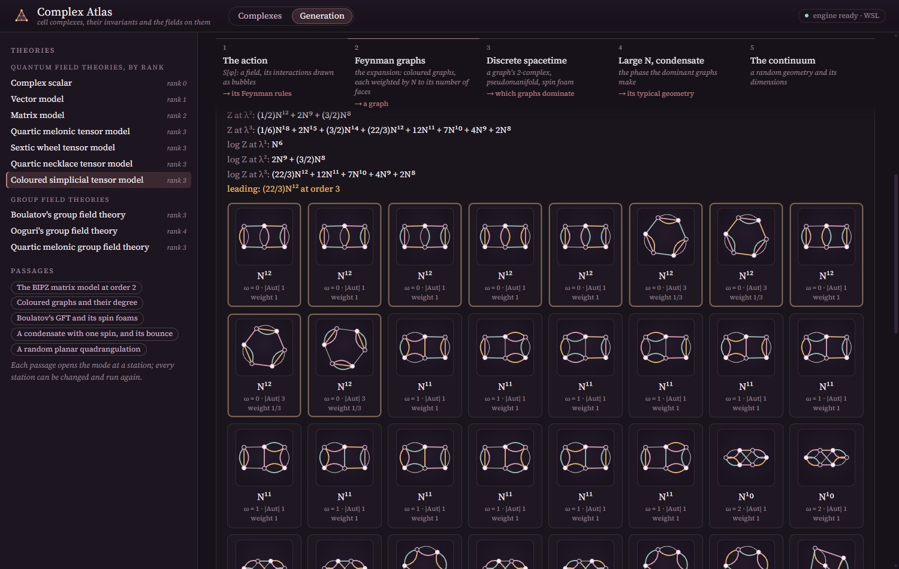</a><br><b>Tensor models generate pseudomanifolds</b>: the coloured simplicial model in dimension 3 at third order has 41 connected Feynman graphs, each a 4-coloured graph triangulating a 3-dimensional pseudomanifold. The leading term, (22/3)N¹², sums the melonic graphs of Gurau degree ω = 0: 22 is the Fuss–Catalan number, divided by 3!. Graphs of degree 1 and 2 follow at N¹¹ and N¹⁰.</td>
</tr>
<tr>
<td width="50%" valign="top"><a href="../assets/gallery/complex-07-spin-foam.jpg">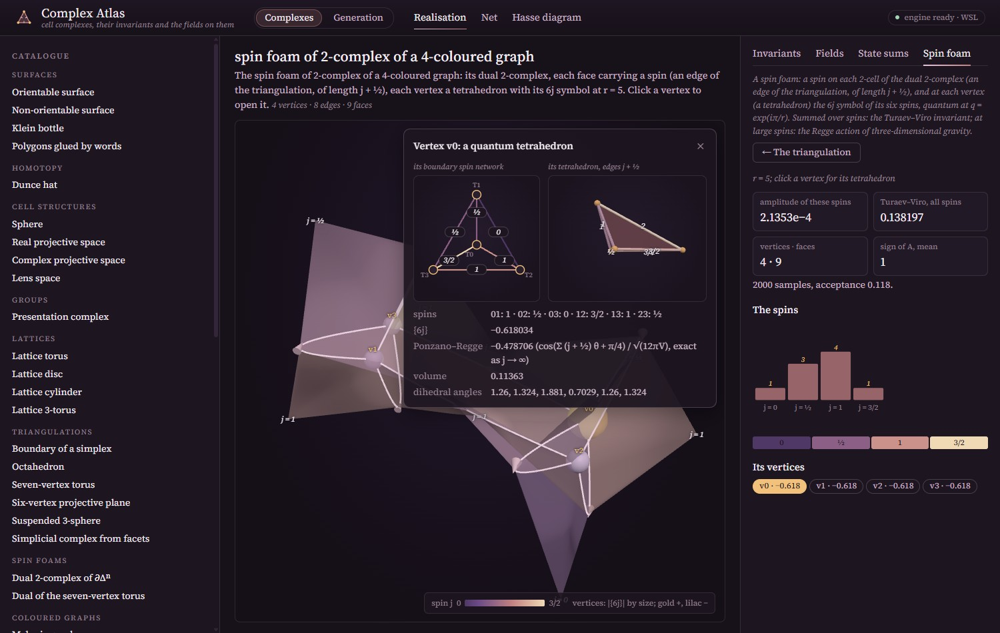</a><br><b>A spin foam, vertex by vertex</b>: a Feynman graph of Boulatov's group field theory becomes the 2-complex of a triangulated 3-sphere. Its spins are sampled at r = 5 with weight |A|, its faces coloured by spin. Vertex v₀ is opened: its boundary spin network (the tetrahedral graph and its six spins) and its quantum tetrahedron, edges j + ½, volume 0.1136. Its quantum 6j symbol is −0.618 (−1/φ), against the Ponzano–Regge asymptotic −0.479. Summed over all spins, the amplitudes give the Turaev–Viro invariant 0.138197 = w⁻², that of S³.</td>
<td width="50%" valign="top"><a href="../assets/gallery/complex-08-condensate-bounce.jpg">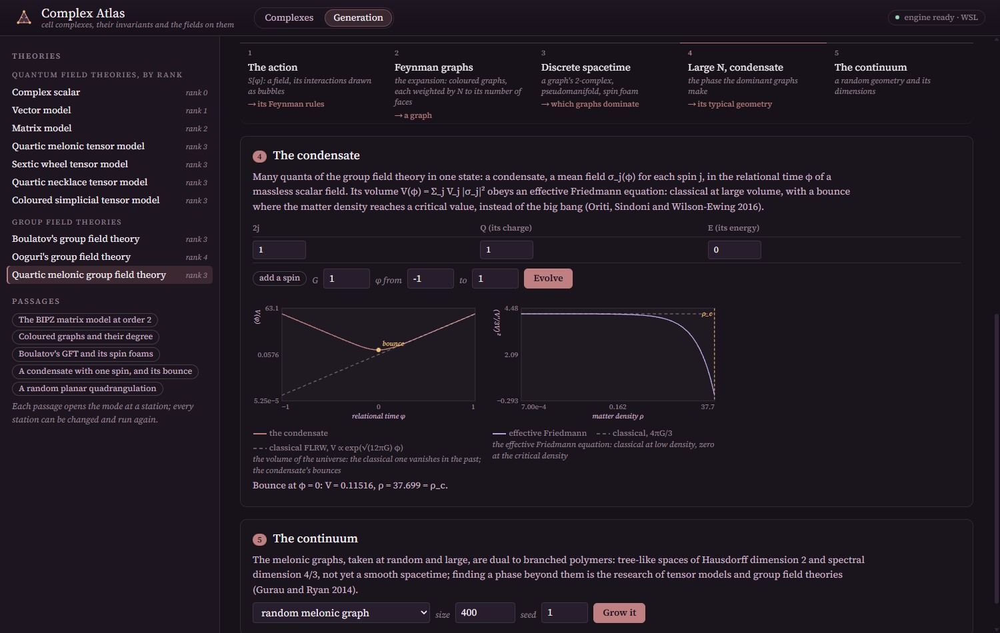</a><br><b>A condensate's universe bounces</b>: many quanta of a group field theory in one state, a mean field σ_j(φ) for spin ½ in the relational time of a massless scalar (Oriti, Sindoni and Wilson-Ewing 2016). Far from φ = 0 its volume follows classical FLRW, V ∝ exp(±√(12πG) φ), dashed. Where the classical volume would vanish, it bounces at V = 0.11516, when the matter density reaches ρ_c = 37.699. Right, the effective Friedmann equation: classical 4πG/3 at low density, zero at ρ_c.</td>
</tr>
<tr>
<td width="50%" valign="top"><a href="../assets/gallery/complex-09-random-quadrangulation.jpg">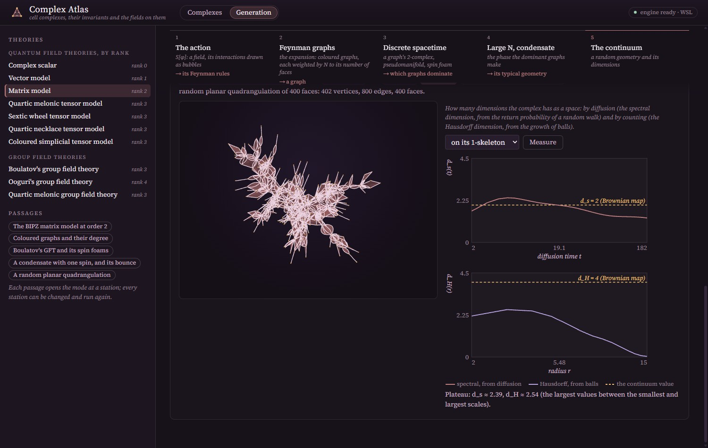</a><br><b>The continuum of the planar limit</b>: a uniform random planar quadrangulation of 400 faces, drawn by the Cori–Vauquelin–Schaeffer bijection (Le Gall 2013; Miermont 2013). As the size grows, these converge to the Brownian map, of spectral dimension 2 and Hausdorff dimension 4. At this size the plateaus read d_s ≈ 2.39 and d_H ≈ 2.54: distances grow only as n^{1/4}, so d_H approaches 4 slowly.</td>
<td></td>
</tr>
</table>

## 6. Credits

The screenshots are the infrastructure's, under its MIT licence, except the three that show Pangu-Weather's forecasts (§1.3: earth-15, earth-16 and earth-17). Those are shared under CC BY-NC-SA 4.0, the licence of the model's parameters: for learning and research, not for commercial use. The data in all of them keep their own licences.

| Data | Source | Licence |
|---|---|---|
| Base map | Natural Earth | Public domain |
| Relief | ETOPO 2022 (NOAA NCEI); ASTER GDEM (METI and NASA), shaded by NASA GIBS | Public domain; NASA, acknowledge |
| Forecasts and analyses | GFS and WaveWatch III (NOAA NCEP, via PacIOOS ERDDAP); AIGFS and AIGEFS (NOAA NCEP and EPIC, via Unidata THREDDS); OISST v2.1 (NOAA NCEI) | Public domain |
| Our AI forecasts | Pangu-Weather (Bi et al. 2023, *Nature* 619, 533–538), run from the GFS analysis at 0.25° (NOAA NCEP, NOMADS) | Model parameters CC BY-NC-SA 4.0; analysis public domain |
| Cyclone tracks and disaster alerts | GDACS (United Nations and European Commission JRC), relaying the warning centres | No reuse licence stated; provided "as is"; credited, and not a warning |
| Climate classes | Beck et al. (2023), *Scientific Data* 10, 724 | CC BY 4.0 |
| Climate normals | TerraClimate (Abatzoglou et al. 2018) | CC0 |
| Imagery of the Earth | VIIRS true colour, Blue Marble and Black Marble (NASA, via GIBS) | NASA, acknowledge |
| Country indicators | World Bank, World Development Indicators | CC BY 4.0 |
| Earthquakes | USGS ComCat | Public domain |
| The ocean beneath a place | HYCOM ESPC-D-V02 (US Navy, via HYCOM.org) | Public release, distribution unlimited |
| Tectonic plates | PB2002 (Bird 2003), as converted by H. Ahlenius (Nordpil); motion NNR-MORVEL56 (Argus et al. 2011) | ODC Attribution 1.0 |
| GPS velocities and positions | Nevada Geodetic Laboratory (Blewitt, Hammond and Kreemer 2018) | None stated; supplied as is; cited |
| Earthquake mechanisms | Global CMT Project (Dziewonski et al. 1981; Ekström et al. 2012) | None stated; cited |
| The crust | CRUST1.0 (Laske et al. 2013) | None stated; cited |
| Ephemeris | JPL DE440 (Park et al. 2021) | Freely distributed |
| Maps of the bodies and the sky | Solar System Scope (INOVE), from NASA, JPL and ESA data | CC BY 4.0 |
| Detail of the Moon and Mars | LRO WAC (NASA/GSFC/ASU), Viking MDIM 2.1 (NASA/USGS), via NASA Trek | NASA, acknowledge |
| Stars | HYG v4.1 | CC BY-SA 4.0 |
| Galaxies | Karachentsev et al. (2013); Tully (2015); names from SIMBAD (CDS) | Published catalogues; cite |
| Station observations | METAR (NOAA Aviation Weather Center); NDBC buoys (NOAA) | Public domain |
| Best tracks of cyclones | IBTrACS v04r01 (NOAA NCEI; Knapp et al. 2010) | Public domain |
| ECMWF forecasts | IFS, AIFS and ENS open data (ECMWF) | CC BY 4.0; based on data and products of ECMWF |
| Population | GHS-POP R2023A (European Commission JRC) | CC BY 4.0 |
| Provinces | Natural Earth 1:10m admin-1 | Public domain |
| Climatology of the scores | NCEP/NCAR Reanalysis 1 (NOAA PSL) | Public domain |
| Sentinel-2 | Copernicus Sentinel-2 Level-2A, via Earth Search | Free and open; contains modified Copernicus Sentinel data 2026 |
| The human brain | MNI 152 ICBM 2009c nonlinear asymmetric (Fonov et al. 2011) and its FreeSurfer segmentation, via TemplateFlow | MNI: permission to use, copy, modify and distribute |
| Deep nuclei | MASSP 2.0 (Bazin et al. 2020); thalamic nuclei (Najdenovska et al. 2018), via TemplateFlow | CC BY 4.0 |
| Gyri | Harvard–Oxford cortical atlas (Makris et al. 2006), FSL | FSL licence, non-commercial |
| Cytoarchitectonic areas, fibre bundles | Julich-Brain 3.1 (Amunts et al. 2020); deep white matter (Guevara et al. 2012), EBRAINS | CC BY-NC-SA 4.0 |
| Networks | Schaefer et al. (2018), via TemplateFlow | MIT |
| The mouse brain | Allen Mouse Brain CCFv3 (Wang et al. 2020), Allen Institute | Allen Institute terms of use |
| EEG | EEG Motor Movement/Imagery Dataset (Schalk et al. 2004), PhysioNet | ODC Attribution 1.0 |
| fMRI maps | Individual Brain Charting (Pinho et al. 2018), via NeuroVault | CC0 |

## 7. Making the Screenshots

The screenshots were taken with headless Chrome at 1600 × 1000 pixels, driven over the DevTools protocol, and saved as JPEG.

The Earth Atlas keeps its view in the address, so each picture can be reproduced from its URL on the local server. For example:

```
http://127.0.0.1:8790/#p=globe&c=-32,36,3.25&s=wind.10m@gfs-forecast:speed&f=wind.10m@gfs-forecast&t=2026-10-22T12:00Z
```

- `p`: the projection.
- `c`: the longitude, latitude and distance of the view.
- `s`, `f`, `l` and `m`: the surface, the flow, the lines, and the model compared.
- `t`: the instant, in UTC.

The Spiking Simulator's pictures, at 1500 × 950 pixels, were taken in the same way, each from a link that opens an example, runs it and opens a view, for example `http://127.0.0.1:8830/#preset=brunel-si-fast&run=1&from=300&to=360`: `preset` names the example, `run=1` runs it, `tab` opens a view, `from` and `to` (in ms) the span of the activity shown, and `threads` the threads used. The runs are deterministic, so each picture comes back the same.

The Complex Atlas's pictures, at 1500 × 950 pixels, were taken the same way from links that open a complex, a theory or a passage, for example `http://127.0.0.1:8850/#family=lattice-torus&n=12&m=12` (then **Run** in Fields), `#family=surface&genus=2` (the Net view), `#mode=generation&theory=matrix&order=2&stage=graphs`, `#mode=generation&theory=coloured-simplicial&order=3&stage=graphs` and `#mode=generation&theory=gft-boulatov&order=2&stage=graphs` (then a graph's **Its spin foam** and a vertex), and the passages of the Generation mode for the condensate and the quadrangulation. The engine's runs are seeded, so each picture comes back the same.
